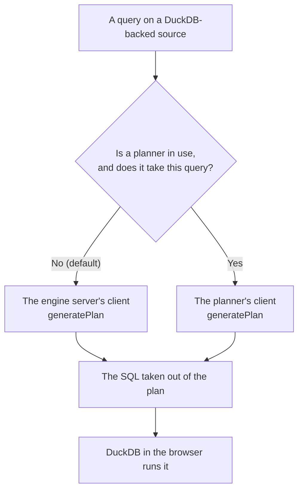

# Adding a query planner to Legend DataCube

Legend DataCube lets a plugin contribute a **query planner**: something other than the engine server that generates the SQL for queries on DataCube's DuckDB-backed sources. This guide explains what a planner is, how to write one, how to register it in a deployment, and how to test it.

- [When a planner is used](#when-a-planner-is-used)
- [The contract](#the-contract)
- [Example 1: another engine server](#example-1-another-engine-server)
- [Example 2: a planner that answers in the browser](#example-2-a-planner-that-answers-in-the-browser)
- [Registering the plugin](#registering-the-plugin)
- [Turning it on](#turning-it-on)
- [Rules a planner must keep](#rules-a-planner-must-keep)
- [Testing a planner](#testing-a-planner)

## When a planner is used

DataCube runs queries on three kinds of source on its own DuckDB, in the browser: **cached sources, local files and cached Iceberg tables**. For those, it asks the engine server only for an execution plan (`POST /pure/v1/execution/generatePlan`), takes the SQL out of the plan, and runs that SQL itself.

So for these sources, anything that answers `generatePlan` with a plan holding DuckDB SQL can take the engine server's place. A planner does exactly that, and nothing else:



Everything else DataCube does is unchanged: other sources (Legend Query, functions, lakehouse) and every other engine call (grammar, typing, and so on) still go to the engine server.

## The contract

A plugin contributes planners through `LegendDataCubeApplicationPlugin.getExtraDuckDBQueryPlanners()`. Both are exported from `@finos/legend-application-data-cube`:

```ts
class LegendDataCubeApplicationPlugin extends LegendApplicationPlugin {
  getExtraDuckDBQueryPlanners?(): LegendDataCubeDuckDBQueryPlanner[];
}

interface LegendDataCubeDuckDBQueryPlanner {
  key: string;
  label: string;
  createEngineServerClient(): LegendDataCubeQueryPlannerClient;
  isQuerySupported?(query: PlainObject<V1_Lambda>): boolean;
}

type LegendDataCubeQueryPlannerClient = V1_EngineServerClient & {
  dispose?: () => void;
};
```

| Member                       | What it is for                                                                                                                                                                                      |
| ---------------------------- | --------------------------------------------------------------------------------------------------------------------------------------------------------------------------------------------------- |
| `key`                        | Names the planner's setting, `debugger.planner.<key>.enabled`. It must be non-empty and unique among the planners of a deployment; DataCube refuses to start otherwise                              |
| `label`                      | Names the planner to the user: in the title of its setting, and at the start of its error messages (`[<label>] …`)                                                                                  |
| `createEngineServerClient()` | Returns the client the planner generates plans with. DataCube calls it **once, when the planner is first asked for a plan**, not when the plugin is registered and not when the setting is read     |
| `isQuerySupported(query)`    | Optional. Given the protocol JSON of the query's lambda, says whether to ask this planner. A query it is not asked for goes to the engine server. When absent, the planner is asked for every query |
| `dispose()` on the client    | Optional. Called when DataCube's engine is disposed, to release what the client holds (a worker, a connection)                                                                                      |

The client is a `V1_EngineServerClient`, so DataCube asks it exactly as it asks the engine server: `generatePlan(input)`, with the same input, and it reads the answer with the same `V1_deserializeExecutionPlan`. A client can be a plain `V1_EngineServerClient` pointing somewhere else, or a subclass.

## Example 1: another engine server

The simplest planner sends `generatePlan` to a different engine server, for example to try a newer engine on cached sources without moving the whole app to it:

```ts
import {
  LegendDataCubeApplicationPlugin,
  type LegendDataCubeDuckDBQueryPlanner,
} from '@finos/legend-application-data-cube';
import { V1_EngineServerClient } from '@finos/legend-graph';

export class CandidateEngine_LegendDataCubeApplicationPlugin extends LegendDataCubeApplicationPlugin {
  constructor() {
    super('candidate-engine-planner', '0.0.1');
  }

  override getExtraDuckDBQueryPlanners(): LegendDataCubeDuckDBQueryPlanner[] {
    return [
      {
        key: 'candidate-engine',
        label: 'the candidate engine',
        createEngineServerClient: () =>
          new V1_EngineServerClient({
            baseUrl: 'https://candidate-engine.example.com/api',
          }),
      },
    ];
  }
}
```

## Example 2: a planner that answers in the browser

A planner does not have to be a server. A subclass of `V1_EngineServerClient` can override `request()`, the one method every endpoint of that class ends in, and answer there: from a worker, a WebAssembly module, or anything else. Every method then keeps its name, input, output and errors.

Two things matter for such a planner:

- **Keep heavy code out of the app's start-up.** Put whatever loads the planner (its worker, its module) behind a dynamic `import()`, reached from `createEngineServerClient()` or from the client's first request. Then registering the plugin costs nothing until a user turns the planner on and runs a query.
- **Answer as a server would.** An error status should throw a `NetworkClientError`, as the engine server client does, so that DataCube and its users see the planner's message.

```ts
import {
  LegendDataCubeApplicationPlugin,
  type LegendDataCubeDuckDBQueryPlanner,
} from '@finos/legend-application-data-cube';
import { DataCubeFunction } from '@finos/legend-data-cube';
import {
  matchFunctionName,
  V1_EngineServerClient,
  type V1_ExecuteInput,
  type V1_ExecutionPlan,
} from '@finos/legend-graph';
import { isPlainObject, type PlainObject } from '@finos/legend-shared';

// a module of your own, loaded only when the planner is first used
type InBrowserPlanner = {
  generatePlan: (
    input: PlainObject<V1_ExecuteInput>,
  ) => Promise<PlainObject<V1_ExecutionPlan>>;
};
const loadPlanner = async (): Promise<InBrowserPlanner> =>
  (await import('./MyInBrowserPlanner.js')).createPlanner();

class InBrowserPlannerClient extends V1_EngineServerClient {
  private planner?: Promise<InBrowserPlanner> | undefined;

  constructor() {
    // the base URL only gives the routes their paths; nothing is sent there
    super({ baseUrl: 'http://in-browser-planner.invalid/api' });
  }

  // NOTE: `generatePlan` is a property holding an arrow function, not a method, so it is
  // overridden as a property; a method of the same name would never be called
  override generatePlan = async (
    input: PlainObject<V1_ExecuteInput>,
  ): Promise<PlainObject<V1_ExecutionPlan>> => {
    this.planner ??= loadPlanner();
    return (await this.planner).generatePlan(input);
  };

  dispose(): void {
    this.planner = undefined;
  }
}

/** Whether the query (protocol JSON) calls the function anywhere */
const callsFunction = (value: unknown, name: string): boolean =>
  Array.isArray(value)
    ? value.some((item) => callsFunction(item, name))
    : isPlainObject(value) &&
      ((typeof value.function === 'string' &&
        matchFunctionName(value.function, name)) ||
        Object.values(value).some((item) => callsFunction(item, name)));

export class InBrowser_LegendDataCubeApplicationPlugin extends LegendDataCubeApplicationPlugin {
  constructor() {
    super('in-browser-planner', '0.0.1');
  }

  override getExtraDuckDBQueryPlanners(): LegendDataCubeDuckDBQueryPlanner[] {
    return [
      {
        key: 'in-browser',
        label: 'the in-browser planner',
        createEngineServerClient: () => new InBrowserPlannerClient(),
        // e.g. leave a shape the planner cannot plan yet to the engine server
        isQuerySupported: (query) =>
          !callsFunction(query, DataCubeFunction.PIVOT),
      },
    ];
  }
}
```

This example overrides `generatePlan` alone, which is all DataCube calls on a planner's client. The endpoints of `V1_EngineServerClient` are all properties like it; the one method they all end in is `request()`, and overriding `request()` instead serves every endpoint at once. A complete planner built this way, which answers `pure/v1` routes with a WebAssembly build of a Legend compiler in a worker, is legend-lite's DataCube plugin (`wasm/data-cube-extension` in [the legend-lite repository](https://github.com/neema2/legend-lite)).

## Registering the plugin

Plugins are registered by the deployment that starts DataCube, with `withPlugins()`. In this repository that is `getPluginCollection()` in `packages/legend-application-data-cube-bootstrap/src/index.tsx`:

```ts
import { LegendDataCube } from '@finos/legend-application-data-cube';
import { WebConsole, type AbstractPlugin } from '@finos/legend-shared';
import { CandidateEngine_LegendDataCubeApplicationPlugin } from './CandidateEngine_LegendDataCubeApplicationPlugin.js';

export class LegendDataCubeWebApplication {
  static getPluginCollection(): AbstractPlugin[] {
    return [
      // loggers
      new WebConsole(),
      // a planner for cached sources, local files and cached Iceberg tables
      new CandidateEngine_LegendDataCubeApplicationPlugin(),
    ];
  }

  // ...
}
```

A deployment outside this repository does the same in its own entry point: add the plugin's package as a dependency, then pass the plugin to `withPlugins()` when it calls `LegendDataCube.create()`. See [extension-authoring.md](./extension-authoring.md) for working on a plugin against a local build of this repository.

## Turning it on

Each planner adds one setting to DataCube's settings (application menu, **Settings**), in the debug group, off by default:

| Setting                                                            | Key                              |
| ------------------------------------------------------------------ | -------------------------------- |
| Planner: Use `<label>` for Cached and Local Sources (Experimental) | `debugger.planner.<key>.enabled` |

It takes effect from the next query, with no reload. If several planners are on, the first one registered is used. With no planner registered, there is no setting and DataCube behaves as it always has.

## Rules a planner must keep

- **No fallback.** A query sent to a planner that fails is **not** retried on the engine server; the user sees the planner's message, prefixed with its label. This is deliberate: a fallback would hide exactly what the planner cannot do yet.
- **`isQuerySupported()` is a fixed rule by the shape of the query.** It is decided before anything is asked, from the query alone. It must not depend on whether a previous request failed.
- **Same input, same answer shape.** The planner receives the input the engine server would and must answer with the engine's plan shape: a single execution plan whose last SQL node holds a statement DuckDB can run.
- **Nothing loaded early.** `createEngineServerClient()` should be cheap. Anything heavy belongs behind a dynamic `import()`.

## Testing a planner

A planner can be unit-tested without DataCube at all: call `getExtraDuckDBQueryPlanners()` on the plugin, create the client, and call `generatePlan()`.

To test it through DataCube's own store, register the plugin with a plugin manager and create a `LegendDataCubeBaseStore`, as `src/stores/planner/__tests__/LegendDataCubeQueryPlannerPlugin.data-cube-test.ts` does. Two things to know:

- Importing `@finos/legend-application-data-cube` loads DataCube's DuckDB engine, which uses `import.meta`, which jest cannot parse. Mock that module (`LegendDataCubeDuckDBEngine`) in the test, or stub it in the jest configuration (`moduleNameMapper`), as this repository's own tests do.
- jsdom has no `Response`. A client that builds one, as a subclass overriding `request()` would, needs a small stand-in in the test.

To try it by hand, register the plugin as above, run `yarn dev:datacube`, open a local CSV file (**New DataCube**, source type **Local File**), turn the planner's setting on, and check the browser's network panel: no `generatePlan` request should reach the engine server for that source.
