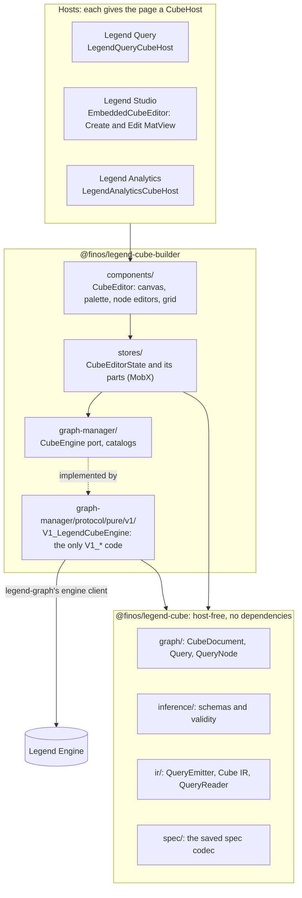
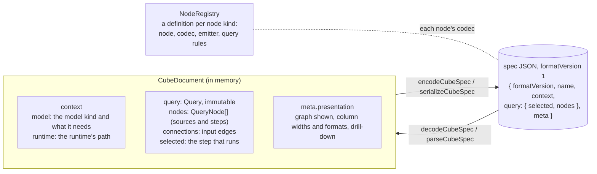
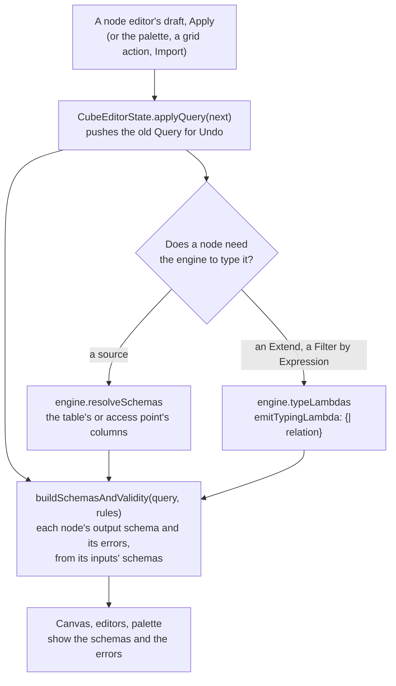
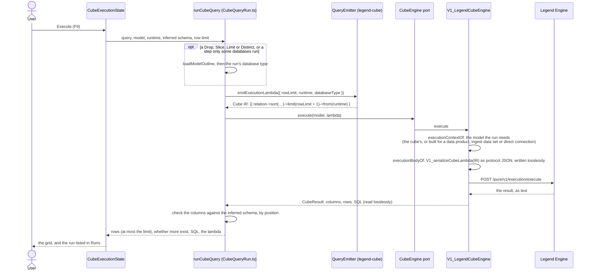
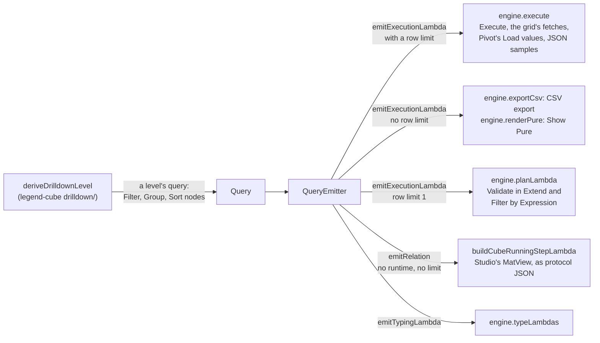
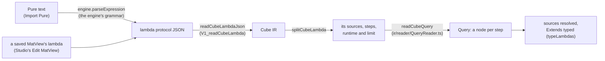

# Legend Cube architecture

How Legend Cube is built: its two packages, the cube document and its saved spec, and how a cube becomes the lambda
the engine runs, and back. For the people who change Cube; users read the
[user guide](https://legend.finos.org/cube). The diagrams are Mermaid, which GitHub draws.

## The packages



- **`@finos/legend-cube`** is the domain model and runs anywhere JavaScript runs: no browser, no Node, no Legend code
  ([its README](../../packages/legend-cube/README.md#host-free-rule) has the rule and its guards). It knows nothing of
  the engine's protocol: it writes and reads the **Cube IR**, its own Pure AST.
- **`@finos/legend-cube-builder`** is the page, its MobX stores, and the engine adapter. The stores talk to the engine
  only through the `CubeEngine` port (`graph-manager/CubeEngine.ts`); `V1_LegendCubeEngine` implements it, and is the
  one place that turns the Cube IR into the engine's protocol JSON and back.
- **A host** makes a `CubeHost` (the application store, the engine, the model catalog, and the catalogs it offers:
  data products, ingest, projects, connections) and renders `CubeEditor`. `LegendCubeHost` in the builder does most of
  it; see [hosting](../../packages/legend-cube-builder/docs/hosting.md).

## The cube document and its spec



- **The query graph is the only source of truth.** Every edit makes a new `Query`; the editor keeps the old ones for
  Undo. Nothing derived (schemas, the lambda, the results) is stored in the document, but what the engine answered: a
  source's schema snapshot, an Extend's column types, a Filter by Expression's check.
- **The spec** is the document as JSON: each node is `kind`, `id`, `inputs` and its own fields, written by its kind's
  codec (`spec/codecs/`). Values are typed, numbers written as strings so no digit is lost. Unknown keys and kinds are
  kept. A resolved source keeps a **schema snapshot**, so a cube opens typed; an unresolved one is typed again on
  import.
- **The registry** (`createNodeRegistry()`) lists the node kinds, in palette order; the palette, the context menu, the
  codec, the emitter and the reader all read it.

A spec's query, abbreviated (the example "Top customers by orders"):

```json
{
  "selected": "limit101",
  "nodes": [
    {
      "kind": "relational",
      "id": "relational101",
      "database": "…NorthwindDatabase",
      "schema": "NORTHWIND",
      "table": "ORDERS"
    },
    {
      "kind": "relational",
      "id": "relational102",
      "database": "…NorthwindDatabase",
      "schema": "NORTHWIND",
      "table": "CUSTOMERS"
    },
    {
      "kind": "rename",
      "id": "rename101",
      "inputs": ["relational102"],
      "mappings": [{ "from": "CUSTOMER_ID", "to": "CUSTOMER" }]
    },
    {
      "kind": "join",
      "id": "join101",
      "inputs": ["relational101", "rename101"],
      "joinType": "INNER",
      "leftColumns": ["CUSTOMER_ID"],
      "rightColumns": ["CUSTOMER"]
    },
    {
      "kind": "group",
      "id": "group101",
      "inputs": ["join101"],
      "columns": ["COMPANY_NAME", "COUNTRY"],
      "aggregations": [{ "function": "CountRows", "name": "ORDER_COUNT" }]
    },
    {
      "kind": "sort",
      "id": "sort101",
      "inputs": ["group101"],
      "sorts": [
        { "column": "ORDER_COUNT", "direction": "DESC" },
        { "column": "COMPANY_NAME", "direction": "ASC" }
      ]
    },
    { "kind": "limit", "id": "limit101", "inputs": ["sort101"], "size": 10 }
  ]
}
```

## From an edit to a typed graph



- **Inference is local and synchronous**: each node's `schematize` and `validate` run on its inputs' schemas, so the
  canvas knows every node's columns without the engine.
- **The engine types what Cube can't**: a source's columns (`resolveSchemas`), and the type of an expression the user
  wrote (`typeLambdas`, on the relation up to the node). Their answers feed inference again.
- **Query rules** are checks across the graph, e.g. that the database a step runs on can run it (`ir/CubeDialects.ts`:
  Pivot and JSON steps need certain databases).

## Running a cube



- **The emitter** walks the graph from the step that runs to its sources; each node kind's emitter (`ir/emitters/`)
  writes its Pure function, e.g. a Group is `groupBy(~[…], ~[…])`. A Sort's order is written where it is used: before
  a Limit, Drop or Slice, and again before the run's own limit. A window is bound with a `let`.
- **`rowLimit + 1`** rows are fetched to tell whether there are more than the limit.
- **The columns are checked**, since rows are read by position: the engine must return the inferred schema's columns,
  in order.
- **Every run is listed in Runs** with the lambda it sent: Show Pure and Copy JSON there show exactly what ran.

The Pure of the example above, as Show Pure prints it (no row limit there):

```
|#>{showcase::northwind::store::NorthwindDatabase.NORTHWIND.ORDERS}#
  ->join(
    #>{showcase::northwind::store::NorthwindDatabase.NORTHWIND.CUSTOMERS}#->rename(~CUSTOMER_ID, ~CUSTOMER),
    meta::pure::functions::relation::JoinKind.INNER,
    {l, r|$l.CUSTOMER_ID == $r.CUSTOMER}
  )
  ->select(~[CUSTOMER_ID, CUSTOMER, ORDER_ID, …, FAX])
  ->groupBy(~[COMPANY_NAME, COUNTRY], ~[ORDER_COUNT: x|1:y|$y->count()])
  ->sort([~ORDER_COUNT->descending(), ~COMPANY_NAME->ascending()])
  ->limit(10)
  ->sort([~ORDER_COUNT->descending(), ~COMPANY_NAME->ascending()])
  ->from(showcase::northwind::mapping::StoreRuntime)
```

Each node's part: `relational101` and `relational102` are the `#>{…}#` accessors, `rename101` the `rename`,
`join101` the `join` and the `select` that orders its columns, `group101` the `groupBy`, `sort101` the first `sort`,
`limit101` the `limit`; the last `sort` is the order of the rows the step that runs gives, and `from` binds the
runtime.

## One IR, many uses



- **The grid's server-side mode** runs each drill-down level as a query of Cube's own nodes, derived from the run's
  (`deriveDrilldownLevel`): a Filter of the expanded keys, a Group, a Sort. So every database workaround the emitter
  knows applies to the grid too.
- **Everything the engine runs goes through the emitter**; nothing builds Pure by hand.

## The way back: a lambda into a cube



The reader knows each node kind's Pure (the patterns in `ir/reader/StepPatterns.ts`), so a lambda Cube wrote reads
back into the same steps; a step it can't read is named in the error.

## Where to look

| What                               | Where                                                                                             |
| ---------------------------------- | ------------------------------------------------------------------------------------------------- |
| A node kind: node, codec, emitter  | `legend-cube/src/nodes/`, `spec/codecs/`, `ir/emitters/`, registered in `nodes/NodeRegistry.ts`   |
| Its editor, draft, help text, icon | `legend-cube-builder/src/components/editors/`, `stores/editors/`, `__lib__/LegendCubeHelpText.ts` |
| Schemas and validity               | `legend-cube/src/inference/SchemaInference.ts`                                                    |
| The emitter and the IR             | `legend-cube/src/ir/QueryEmitter.ts`, `CubeIR.ts`, `printIR` in `IRPrinter.ts`                    |
| Database rules                     | `legend-cube/src/ir/CubeDialects.ts`                                                              |
| The spec                           | `legend-cube/src/spec/CubeSpecCodec.ts`                                                           |
| A run                              | `legend-cube-builder/src/stores/CubeQueryRun.ts`, `CubeExecutionState.ts`, `CubeGridFetcher.ts`   |
| The engine adapter                 | `legend-cube-builder/src/graph-manager/protocol/pure/v1/V1_LegendCubeEngine.ts`                   |
| Lambda to and from protocol JSON   | `v1/V1_CubeLambdaSerializer.ts`, `v1/V1_CubeLambdaReader.ts`                                      |
| Import Pure                        | `legend-cube-builder/src/stores/CubeLambdaImportState.ts`, `legend-cube/src/ir/reader/`           |

Adding a step touches both packages: [the core half](../../packages/legend-cube/docs/adding-an-operation.md) and
[the builder half](../../packages/legend-cube-builder/docs/adding-an-operation.md).
