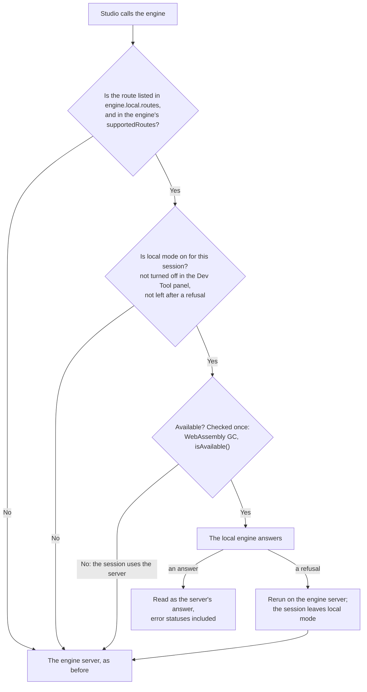

# Adding a local engine to Legend Studio

Legend Studio lets a plugin contribute a **local engine**: something in the browser that answers some engine calls instead of the engine server. The deployment's configuration decides which calls go to it. This guide explains when a call goes local, what a local engine must do, how to register one, how to turn it on, and how to test it.

- [When a call goes local](#when-a-call-goes-local)
- [The contract](#the-contract)
- [Example: an engine in a worker](#example-an-engine-in-a-worker)
- [Registering the plugin](#registering-the-plugin)
- [Turning it on](#turning-it-on)
- [Failures and refusals](#failures-and-refusals)
- [Telemetry](#telemetry)
- [Rules a local engine must keep](#rules-a-local-engine-must-keep)
- [Testing a local engine](#testing-a-local-engine)

## When a call goes local

Studio sends every engine call through one client. Local mode cuts in there, below everything that builds requests and reads answers. So a local engine receives exactly what the engine server would receive, and Studio reads its answer exactly as it reads the server's: the same results, the same parser and compilation errors, the same source positions.

A call is named by its **route** below the engine's `pure/v1/` path, for example `grammar/grammarToJson/model` (parse) or `grammar/jsonToGrammar/model` (compose).



Local mode applies to the **workspace editor**: form mode, text mode and Text Studio. The project viewer, the review screen, the showcase viewer and workspace setup keep every call on the engine server. They are read-only screens, and keeping local mode to the editor keeps a test deployment's measurements about editing sessions.

A **session** is one editor: from opening a workspace to leaving it. Each session checks availability once, and a refusal ends local mode for that session only; the next session starts in local mode again.

## The contract

A plugin contributes local engines through `LegendStudioApplicationPlugin.getExtraLocalEngines()`. Both are exported from `@finos/legend-application-studio`; the request and response types are exported from `@finos/legend-graph`:

```ts
class LegendStudioApplicationPlugin extends LegendApplicationPlugin {
  getExtraLocalEngines?(): LegendStudioLocalEngine[];
}

interface LegendStudioLocalEngine {
  key: string;
  label: string;
  supportedRoutes: string[];
  answer(
    route: string,
    request: { query: Record<string, string>; body: string },
  ): Promise<{ status: number; body: string }>;
  isAvailable?(): Promise<boolean>;
  isRefusal?(response: { status: number; body: string }): boolean;
}
```

| Member                | What it is for                                                                                                                                                                                                                                                             |
| --------------------- | -------------------------------------------------------------------------------------------------------------------------------------------------------------------------------------------------------------------------------------------------------------------------- |
| `key`                 | Names the engine in the configuration (`engine.local.engine`) and in telemetry. It must be non-empty and unique among the local engines of a deployment; Studio refuses to open the editor otherwise, where local mode is on                                               |
| `label`               | Names the engine to the user: in the Dev Tool panel and in the notice after a refusal                                                                                                                                                                                      |
| `supportedRoutes`     | The routes the engine answers. A route goes local only if it is listed here **and** in the configuration                                                                                                                                                                   |
| `answer(route, req)`  | Answers one call as the engine server's route would. `query` holds the call's query parameters, as strings; `body` is the request body as the server would receive it, uncompressed: the text for parse, JSON for compose. It returns the route's own HTTP status and body |
| `isAvailable()`       | Optional. Whether the engine can run in this browser, for example whether its module loads. Studio calls it once, before the first local call of a session, after checking that the browser supports WebAssembly GC                                                        |
| `isRefusal(response)` | Optional. Whether an answer means "this call is not supported here", rather than an error in the user's model. See [Failures and refusals](#failures-and-refusals)                                                                                                         |

The contract has no fixed list of calls: a new call needs a route in `supportedRoutes` and in the configuration, and no change to Studio.

Studio never disposes a local engine. An engine comes from a plugin, which lives as long as the page, and every editor the user opens shares it.

## Example: an engine in a worker

An engine that answers in the browser usually runs its compiler in a Web Worker, so that a long call doesn't freeze the page. Two things matter:

- **Keep heavy code out of the app's start-up.** Put whatever loads the engine (its worker, its module) behind a dynamic `import()`, reached from `isAvailable()` or from the first `answer()`. Registering the plugin then costs nothing until a session makes its first local call.
- **Answer as the server would.** An error in the user's model is the server's error status and error JSON, not a thrown error, so Studio shows it as it shows the server's: the notification, the problems panel, the cursor at its position.

```ts
import {
  LegendStudioApplicationPlugin,
  type LegendStudioLocalEngine,
} from '@finos/legend-application-studio';

// a module of your own, loaded only when the engine is first used
type InBrowserEngine = {
  answer: (
    route: string,
    query: Record<string, string>,
    body: string,
  ) => Promise<{ status: number; body: string }>;
};

let engine: Promise<InBrowserEngine> | undefined;
const loadEngine = (): Promise<InBrowserEngine> => {
  engine ??= import('./MyInBrowserEngine.js').then((module) =>
    module.createEngine(),
  );
  return engine;
};

export class InBrowserEngine_LegendStudioApplicationPlugin extends LegendStudioApplicationPlugin {
  constructor() {
    super('in-browser-engine', '0.0.1');
  }

  override getExtraLocalEngines(): LegendStudioLocalEngine[] {
    return [
      {
        key: 'in-browser',
        label: 'The in-browser engine',
        supportedRoutes: [
          'grammar/grammarToJson/model',
          'grammar/jsonToGrammar/model',
        ],
        isAvailable: () =>
          loadEngine().then(
            () => true,
            () => false,
          ),
        answer: async (route, { query, body }) =>
          (await loadEngine()).answer(route, query, body),
        // e.g. the engine marks what it doesn't support with its own error type
        isRefusal: (response) =>
          response.status === 400 && response.body.includes('"NOT_SUPPORTED"'),
      },
    ];
  }
}
```

[legend-lite](https://github.com/neema2/legend-lite) has a WebAssembly build of a Legend compiler that answers `pure/v1` routes, the kind of module such an engine wraps.

## Registering the plugin

Plugins are registered by the deployment that starts Studio, with `withPlugins()`. In this repository that is `getPluginCollection()` in `packages/legend-application-studio-bootstrap/src/index.tsx`:

```ts
static getPluginCollection(): AbstractPlugin[] {
  return [
    // loggers
    new WebConsole(),
    // a local engine for parse and compose
    new InBrowserEngine_LegendStudioApplicationPlugin(),
  ];
}
```

A deployment outside this repository does the same in its own entry point: add the plugin's package as a dependency, then pass the plugin to `withPlugins()` when it calls `LegendStudio.create()`. See [extension-authoring.md](./extension-authoring.md) for working on a plugin against a local build of this repository.

## Turning it on

Registering a plugin changes nothing on its own. The deployment turns local mode on in Studio's `config.json`, in its `engine` block:

```json
"engine": {
  "url": "https://engine.example.org/api",
  "local": {
    "mode": "on",
    "routes": ["grammar/grammarToJson/model", "grammar/jsonToGrammar/model"]
  }
}
```

| Field    | What it is for                                                                                                                                                                                    |
| -------- | ------------------------------------------------------------------------------------------------------------------------------------------------------------------------------------------------- |
| `mode`   | `off` (the default, and the meaning of any other value) or `on`: "use a local engine if one is provided". A later release adds `auto`; this release reads it as `off`                             |
| `routes` | The calls that go local. A call goes local only if it is listed here and in the engine's `supportedRoutes`. Adding a call is adding its route here, once the engine answers it as the server does |
| `engine` | Optional. The `key` of the local engine to use. Needed only when plugins provide more than one; with several and none named, local mode stays off and Studio logs a warning                       |

The configuration is read when the app loads; changing it needs no new build.

**For each user,** the Dev Tool panel shows **Local engine: off for this browser** where the deployment has local mode on. It sends the listed calls back to the engine server, from the next call, and is remembered in that browser (setting `engine.localEngineOff`). It can only turn local mode off, never on: where the deployment has local mode off, the switch is not shown.

## Failures and refusals

- **An error in the user's model** is shown as the server's would be. Studio doesn't rerun the call on the server, and the session stays in local mode.
- **A refusal**, an answer for which `isRefusal()` returns `true`, means the engine doesn't support something in this call. Studio reruns the same call on the engine server and returns the server's answer. The session then leaves local mode for every call, so that it uses one implementation at a time, and the user sees one notice.
- **A thrown error** from `answer()` is shown as it is, as any unexpected error. It is not a refusal and is not rerun. An engine that can fail this way after `isAvailable()` passed should answer with a status instead.
- **An unavailable engine**: when the browser doesn't support WebAssembly GC, or `isAvailable()` resolves to `false` or fails, the session uses the engine server for every call. This is a capability check made once per session, not a retry after an error.

A local call is not traced (Zipkin), as no network call is made.

## Telemetry

Each local call records an `engine.local-engine.call` event, and an unavailable engine records `engine.local-engine.unavailable` once per session. See [studio-telemetry.md](./studio-telemetry.md#local-engine). Neither carries the call's content: no model text, JSON or element paths.

## Rules a local engine must keep

- **Same request, same answer.** The engine receives what the server would and answers the route's own status and body, error JSON included. Studio commits the JSON a parse returns, so a difference from the server's JSON is a difference in what users commit.
- **Refuse rather than guess.** When the engine can't do something the server can, it should mark the answer as a refusal, so the call runs on the server, rather than answer differently.
- **`isAvailable()` is about the browser, not the call.** It decides once per session whether the engine can run here. It must not depend on any call's content.
- **Nothing loaded early.** Anything heavy belongs behind a dynamic `import()`.

## Testing a local engine

A local engine can be unit-tested without Studio at all: call `getExtraLocalEngines()` on the plugin and call `answer()` with a route, a query and a body.

To test it through Studio's own engine client, register the plugin with a `LegendStudioPluginManager`, create an `ApplicationStore` with `engine.local` in its configuration, create the session's router with `LegendStudioLocalEngineRouter.create()`, and pass it to `graphManager.initialize()` as `clientConfig.localEngineRouter`, as `src/stores/local-engine/__tests__/LegendStudioLocalEngineRouter.test.ts` does. Two things to know:

- jsdom has no `Response`, which the engine client builds from a local answer. That test installs a small stand-in.
- jsdom's WebAssembly may not support WebAssembly GC. Pass `supportsWebAssemblyGC: () => true` to `LegendStudioLocalEngineRouter.create()` to skip the browser check.

To try it by hand, register the plugin, set `engine.local` in the deployment's `config.json`, run `yarn dev`, open a workspace and enter text mode. The browser's network panel should show no `grammar/grammarToJson/model` or `grammar/jsonToGrammar/model` request to the engine server.
