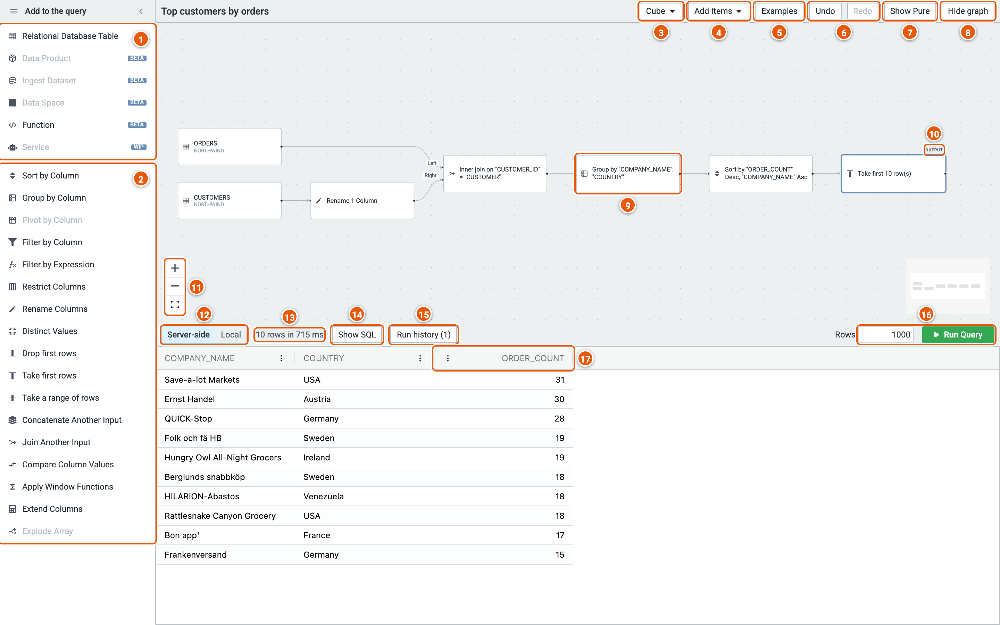
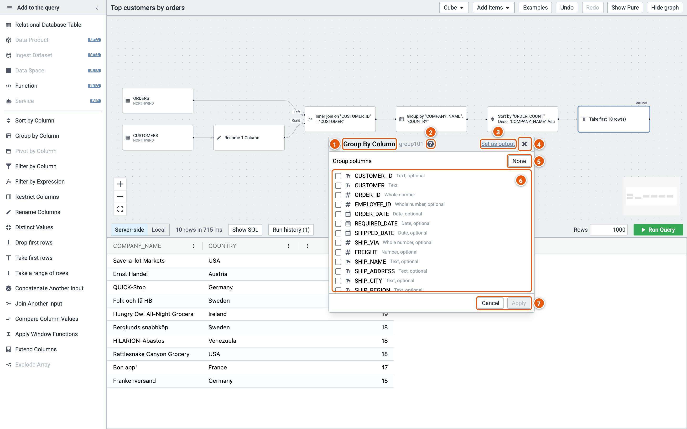
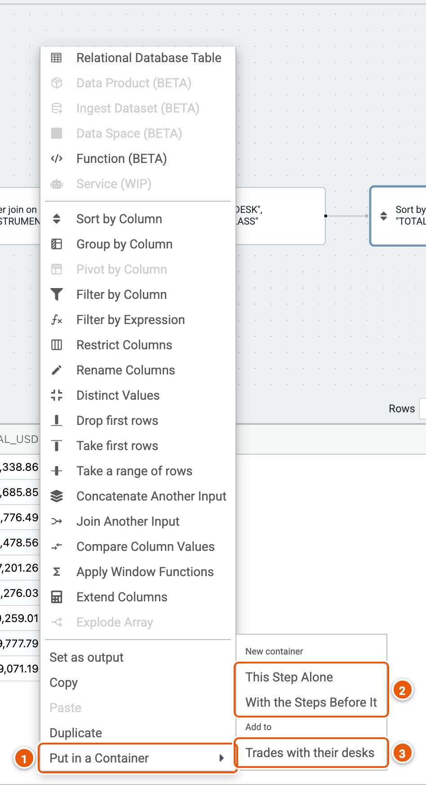
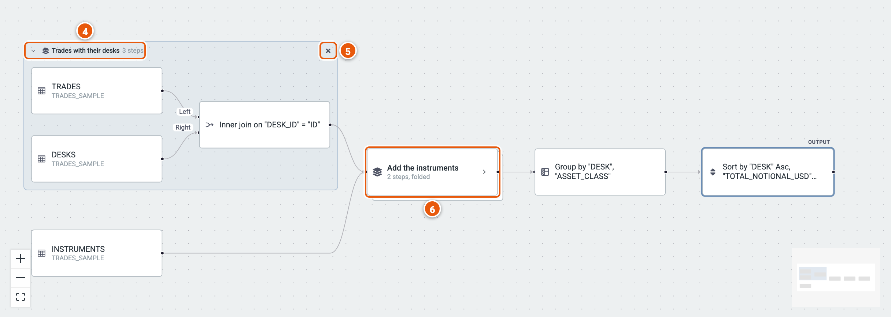

# The editor

New to Legend Cube? **Take the tour**, in the ☰ menu at the top left or on an empty cube's canvas: it walks through the
editor one part at a time, on an example when the cube is empty.

The editor below shows the example **Top customers by orders** (Examples, then Northwind): it joins orders to
customers, counts each customer's orders and keeps the ten customers with the most. The query is on top, as a graph of
steps; its rows are below.

Click the image to see it full size.

## The palette

1. **Sources**: where the rows come from: a database table, a data product, an ingest data set, a function or a
   service. Click one to pick it, or drop it on the canvas.
2. **Steps**: each works on the rows of the step before it. Click one to add it after the selected step, or drop it on
   the canvas; drop it on a step to add it after that step. A greyed-out step can't be added here; hover over it to
   see why, e.g. a database without JSON functions.

## The header

3. **Cube**: **New** starts an empty cube, **Import** opens a cube from its spec, **Import Pure** reads a Pure query
   into steps (checked as you type: its border turns green once Cube reads it and the engine compiles it), and **Export** shows this cube's spec, to copy or download.
4. **Add Items**: the palette's sources and steps, as a menu.
5. **Examples**: ready-made cubes on sample data, to try things out.
6. **Undo** and **Redo**: every change, opening an example included (Ctrl+Z and Ctrl+Shift+Z, or Cmd on a Mac).
7. **Show Pure**: the Pure query that runs, up to the output step.
8. **Hide graph**: more room for the results; **Show graph** brings it back.

## The graph

9. **A step**: click it to edit it. Its editor opens beside it (see [A step's editor](#a-steps-editor), and each step's
   page under [Steps](./steps/index.md)).
10. **Output**: marks the output step, the step Run Query runs up to. A step's menu and editor have **Set as output**
    to move it.
11. **Zoom in**, **zoom out** and **fit the graph to the view**.

## The results

12. **Server-side** or **Local**: with Server-side, each sort and drill-down in the grid runs on the engine, over every
    row of the query; with Local, the grid groups, pivots and filters the rows already fetched, in the browser.
13. How many rows came back, and how long the run took.
14. **Show SQL**: the SQL the run sent to the database.
15. **Run history**: the latest runs, fetches and exports, each with its SQL.
16. **Rows** and **Run Query**: Run Query (F9) runs the query up to the output step and shows its rows; **Rows** caps
    how many come back. While the query runs, the button is **Stop**.
17. **A column's menu** (⋮): sort, pin, autosize, choose the columns shown, or reset them. Right-click a cell for
    more: drill down by its column; sort, group or filter by it, as a new step; format a number column; copy; or
    export the rows. See [The results](./results.md).

## A step's editor

Click a step on the graph to open its editor. This is the Group step's:

1. The step's kind, and its id.
2. **?**: hover over it to see what the step does.
3. **Set as output**: makes this the output step, so Run Query runs up to it and shows its rows.
4. **Close** the editor.
5. **None**: untick every group column (one row for all the rows).
6. The columns to group by.
7. **Cancel** the changes, or **Apply** them to the cube.

Where an editor lists columns, each shows its type as an icon: **#** a number, **Tт** text, a calendar a date or a date
and time, a clock a time, a toggle true or false, a list an enumeration, a tree JSON. Point at the icon for the type in
words, such as _Whole number, optional_, and the exact type. An optional column can be empty. A source's column table
names each type in words.

## Containers

A container frames a block of linked steps under a title, and folds to one box in their place, as Alteryx's Tool
Container does. It only changes how the graph looks: the cube runs the same, and its rows stay as they are. The cube
saves its containers, so export and import keep them.

To make one, right-click a step:

1. **Put in a Container**: opens its menu. A step in a container already can't go in another: take it out first.
2. **This Step Alone** makes a container of the step. **With the Steps Before It** takes the step and each step before
   it that is in no container yet: here the Join, the Rename and INSTRUMENTS.
3. **Add to**: a container beside the step, one that holds a step feeding it or the step it feeds.

4. **The head**: ▾ folds the container, its title renames it on a double-click, and it says how many steps it holds.
   Right-click the head for **Fold**, **Rename** and **Remove Container**.
5. **×** takes the container away. Its steps stay.
6. **A folded container**: one box in its steps' place. The lines into and out of its steps come to its sides, and it
   shows their errors, and **Output** when the output step is in it. Point at it to list its steps. **›**, a
   double-click, or Enter opens it.

You can also select the steps first, with the mouse, as in Alteryx:

- **Shift and a drag** on the canvas draws a box. The steps wholly inside it are added to the selection.
- **Shift-click** a step to select it, or to deselect it. On a step that has the focus, Shift+Enter or Shift+Space does
  the same.
- **Escape**, or a click on the canvas, clears the selection.

A selected step is tinted. Right-click one for **Put Selection in a Container**, or press Ctrl+G (Cmd+G on macOS) while
the canvas has the focus. The new container takes the steps selected and each step between them, so it is one block.
The item is disabled, with the reason in its tooltip, when the steps are of different trees, or when one of them, or a
step between them, is in a container already. The selection isn't saved with the cube.

A container is one block of steps linked to one another, so all of one tree, and containers don't nest:

- A step you add, paste or move between two steps of a container joins it. One added after its last step stays out.
- **Take Out of Container**, in a step's menu, takes out a step at the container's edge: one that no other step of it
  feeds, or its last step.
- Removing a step takes it out. A container left with no step goes away.

Each change to a container is one undo step.
