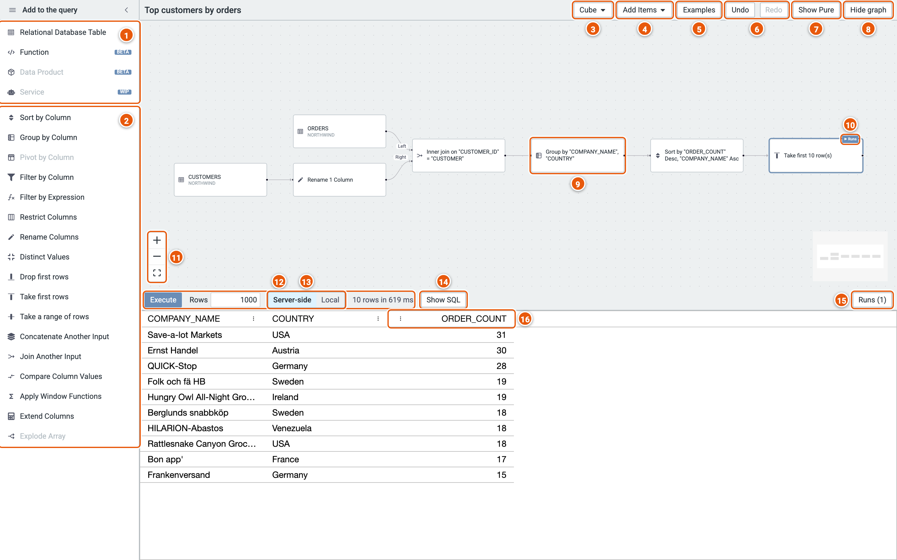
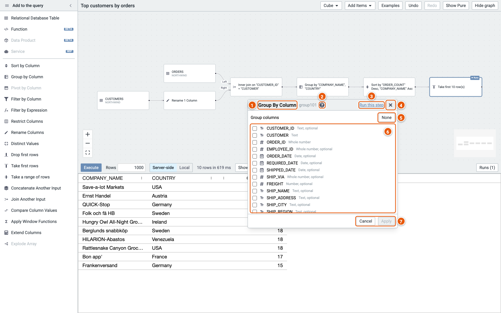

# The editor

The editor below shows the example **Top customers by orders** (Examples, then Northwind): it joins orders to
customers, counts each customer's orders and keeps the ten customers with the most. The query is on top, as a graph of
steps; its rows are below.

Click the image to see it full size.

## The palette

1. **Sources**: where the rows come from: a database table, a function, a data product or a service. Click one to
   pick it, or drop it on the canvas.
2. **Steps**: each works on the rows of the step before it. Click one to add it after the selected step, or drop it on
   the canvas; drop it on a step to add it after that step. A greyed-out step can't be added here; hover over it to
   see why, e.g. a database without JSON functions.

## The header

3. **Cube**: **New** starts an empty cube, **Import** opens a cube from its spec, **Import Pure** reads a Pure query
   into steps, and **Export** shows this cube's spec, to copy or download.
4. **Add Items**: the palette's sources and steps, as a menu.
5. **Examples**: ready-made cubes on sample data, to try things out.
6. **Undo** and **Redo**: every change, opening an example included (Ctrl+Z and Ctrl+Shift+Z, or Cmd on a Mac).
7. **Show Pure**: the Pure query that Execute runs.
8. **Hide graph**: more room for the results; **Show graph** brings it back.

## The graph

9. **A step**: click it to edit it. Its editor opens beside it (see [A step's editor](#a-steps-editor)).
10. **Runs**: marks the step Execute runs up to. A step's editor has **Run this step** to move it.
11. **Zoom in**, **zoom out** and **fit the graph to the view**.

## The results

12. **Execute** runs the query (F9) and shows its rows. **Rows** caps how many come back. Then how many rows came
    back, and how long the run took.
13. **Server-side** or **Local**: with Server-side, each sort and drill-down in the grid runs on the engine, over every
    row of the query; with Local, the grid groups, pivots and filters the rows already fetched, in the browser.
14. **Show SQL**: the SQL the run sent to the database.
15. **Runs**: the latest runs, fetches and exports, each with its SQL.
16. **A column's menu** (⋮): sort, pin, autosize, choose the columns shown, or reset them. Right-click a cell for
    more: drill down by its column; sort, group or filter by it, as a new step; format a number column; copy; or
    export the rows.

## A step's editor

Click a step on the graph to open its editor. This is the Group step's:

1. The step's kind, and its id.
2. **?**: hover over it to see what the step does.
3. **Run this step**: Execute runs up to this step, and shows its rows.
4. **Close** the editor.
5. **None**: untick every group column (one row for all the rows).
6. The columns to group by.
7. **Cancel** the changes, or **Apply** them to the cube.
