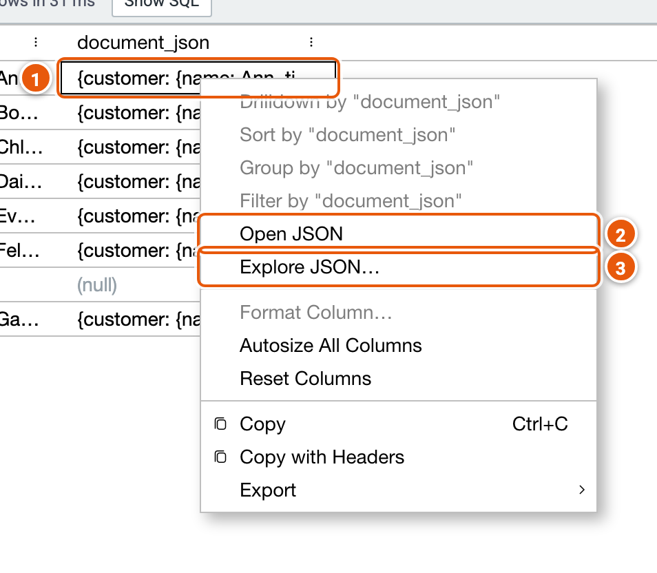
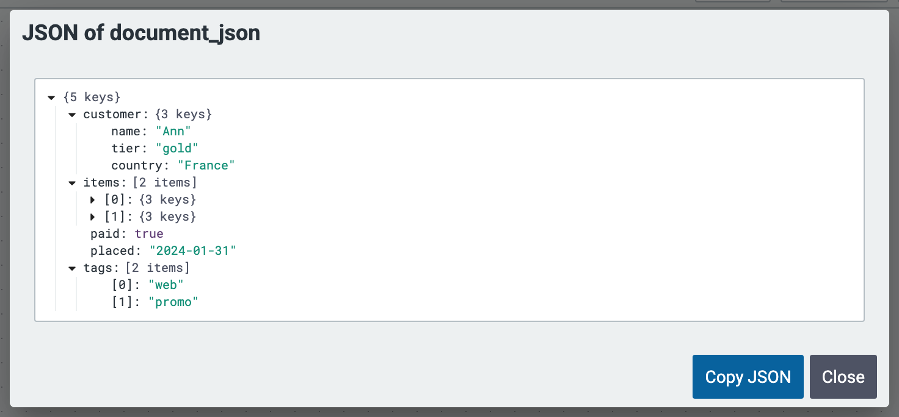
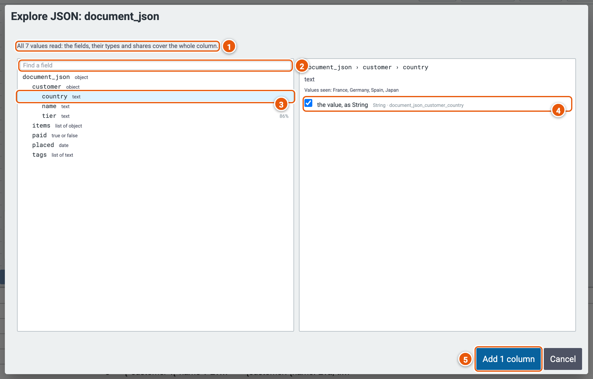
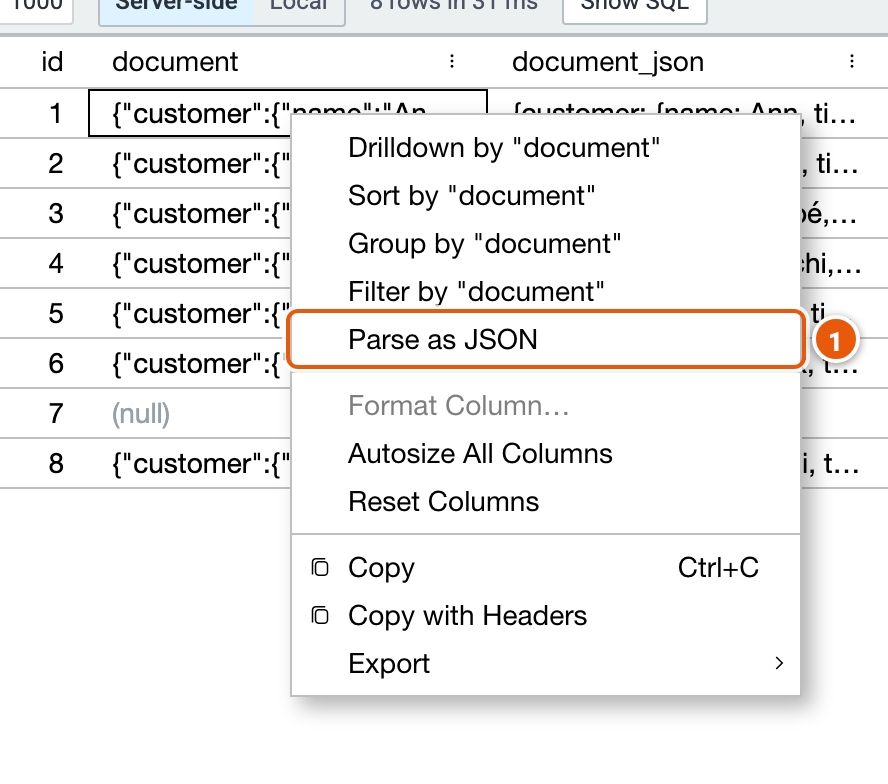
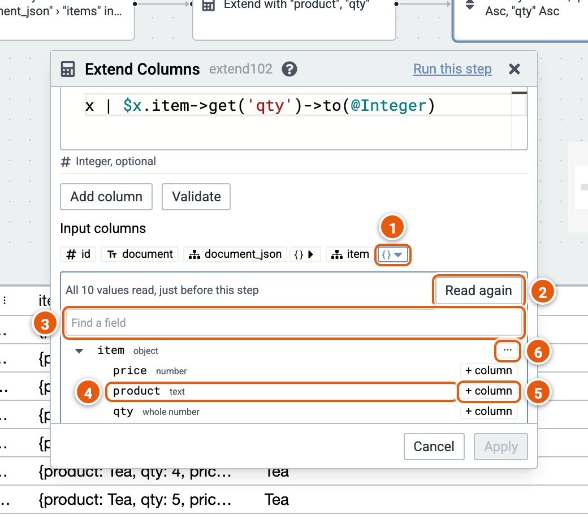

# JSON columns

A JSON (Variant) column holds a JSON document in each row. Legend Cube shows it on one line, opens it as a tree,
explores its fields across the column, and turns fields into columns of their own, or arrays into rows.

JSON columns work on Snowflake, Databricks, Postgres and DuckDB. The pictures below use the examples **Orders from JSON**
and **Order lines from JSON**, on sample orders.

## A JSON cell

1. **A JSON cell** reads on one line, without JSON's quotes.
2. **Open JSON**: the cell's document as a tree.
3. **Explore JSON…**: the column's fields, read from its values (below).

Open JSON shows the document as a tree, each object or array opened or closed with its arrow. **Copy JSON** copies it.

## Explore JSON

Explore JSON reads the column's first values, without running the whole cube, lists the fields they hold with their
types, and offers the columns each field can become.

1. **How much was read**: here every value, so the fields, their types and shares cover the whole column. When only
   the first values were read, **Read every row** reads the rest.
2. **Find a field** by its key.
3. **A field**, with its type, and the share of values that have it when not all do (here tier, 86%).
4. **The columns it can become**: tick one or more. An array also offers **Explode Array**, a row for each element.
5. **Add** the ticked columns: an Extend step, and an Explode Array step for an array, added as one change to undo.

The read is listed in [Runs](./results.md#runs), and can be stopped.

## Parse as JSON

A text column holding JSON documents becomes a JSON column with **Parse as JSON**, in its cell's menu: it adds an Extend
step with a new JSON column parsed from the text.

1. **Parse as JSON**.

## A JSON column's fields in an expression

In the [Extend Columns](./steps/extend.md) and [Filter by Expression](./steps/expressionFilter.md) editors, a JSON
column's **{}** opens its fields, read just before the step: no need to run the cube first.

1. **{}** opens or closes the column's fields.
2. **Read again**, e.g. after a change before the step.
3. **Find a field** by its key.
4. **A field**: click it to write its expression, such as `$x.item->get('product')->to(@String)`, into the expression
   last used.
5. **+ column** adds the field as a new column of the Extend.
6. **···** shows a field's other forms, such as its keys as text.

To make a row for each element of an array, use [Explode Array](./steps/explode.md).
