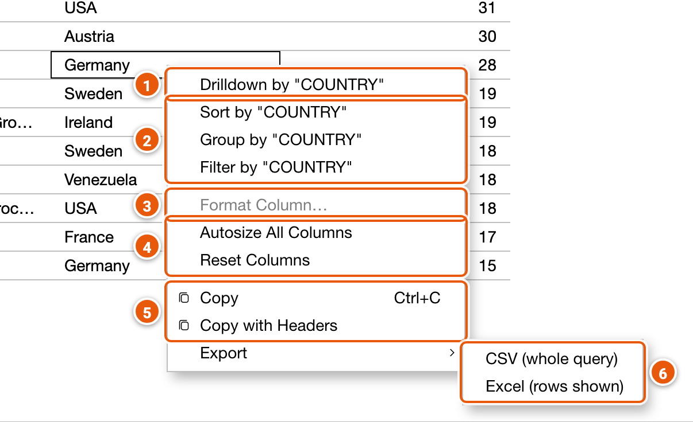
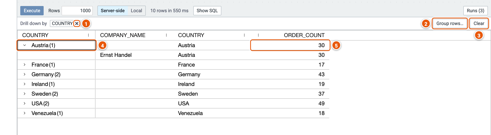
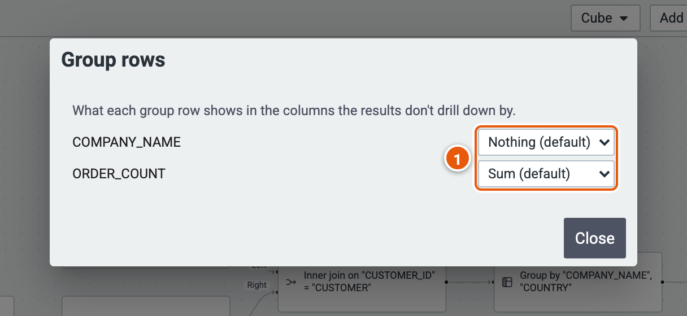
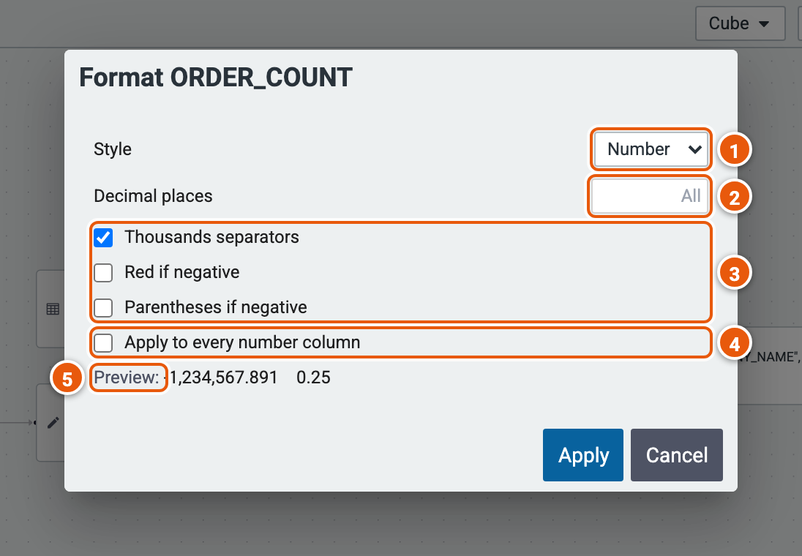
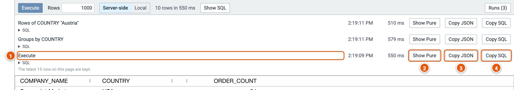
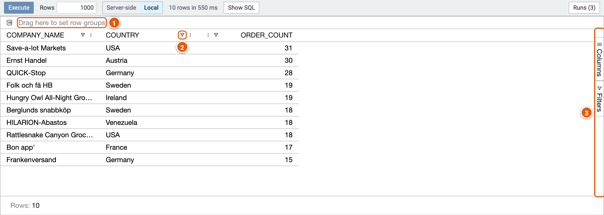

# The results

**Execute** (F9) runs the query up to the step marked **Runs**, and its rows show in the grid below the graph. **Rows**
caps how many come back. After a change, the results say they are stale until you execute again.

The pictures below use the example **Top customers by orders**.

## Server-side or Local

The grid works in one of two ways:

- **Server-side**: each sort and drill-down runs on the engine, over every row of the query, not only the rows fetched.
- **Local**: the grid groups, pivots and filters the rows already fetched, in the browser.

## A cell's menu

Right-click a cell:

1. **Drilldown by** the cell's column: see [Drilling down](#drilling-down).
2. **Sort by**, **Group by** or **Filter by** the cell's column: each adds that step after the step that runs, as one
   change to undo; Filter by keeps the rows holding the cell's value. Nothing runs until you execute.
3. **Format Column…**: how a number column's values show (greyed out on other columns); see
   [Formatting a column](#formatting-a-column).
4. **Autosize All Columns** to their contents, or **Reset Columns** to how they were.
5. **Copy** the cell, or **Copy with Headers**.
6. **Export**: **CSV (whole query)** runs the query on the engine with no row limit, sorted as the grid is, and saves
   every row; **Excel (rows shown)** saves the rows the grid shows.

A column header's menu (⋮) sorts the grid by the column, pins it, autosizes it, chooses the columns shown, or resets
them. That sorts the grid only; Sort by, in a cell's menu, adds a step to the query.

## Drilling down

**Drilldown by** a column groups the rows by its values: a group row for each value, opened to see its rows.

1. **Drill down by**: the columns drilled down by, a level each. **×** stops drilling down by one.
2. **Group rows…**: what each group row shows in the other columns (below).
3. **Clear** stops drilling down.
4. **A group row**, with how many rows it holds; open it to see them.
5. **The group's value** in another column: here the sum of its rows' ORDER_COUNT.

In Server-side mode, each level, and each group opened, runs on the engine.

### Group rows

1. For each column not drilled down by: Nothing, Count, Distinct Count, Distinct Value, Sum, Average, Min or Max. A
   number column shows its Sum by default; others show nothing.

## Formatting a column

1. **Style** of the numbers.
2. **Decimal places**; empty shows them all.
3. **Thousands separators**, **Red if negative**, **Parentheses if negative**.
4. **Apply to every number column** at once.
5. **Preview** of the format.

## Runs

**Runs** lists the latest runs, fetches and exports of the page, newest first; the latest 15 are kept.

1. **What ran**, when, and how long it took. **▸ SQL** under it shows the SQL it sent to the database.
2. **Show Pure**: the Pure query it ran.
3. **Copy JSON**: the query as it was sent to the engine, to debug it.
4. **Copy SQL**.

**Show SQL**, beside Execute, shows the SQL of the last run.

## Local mode

1. **Drag** a column's header **here** to group the rows by it.
2. **A column's filter**.
3. **Columns** and **Filters**: choose the columns shown, and see every filter.
