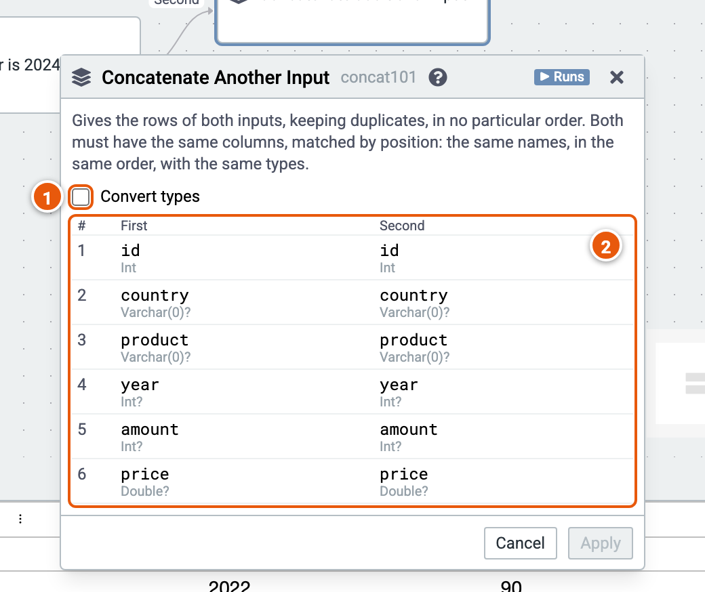

# Concatenate Another Input

Gives the rows of two inputs, keeping duplicates, in no particular order. Both must have the same columns, matched by position: the same names, in the same order, with the same types.

Here it puts the sales of 2022 and of 2024 together. The cube runs on the sample sales (country, product, year, amount and price; the example "Sales by country and year").

1. **Convert types**: converts types that differ within numbers, strings or dates to the type they share, e.g. Varchar(15) and Varchar(40) to String.
2. **The columns**, side by side, by position: the first input's and the second's. A name or type that differs is marked.
