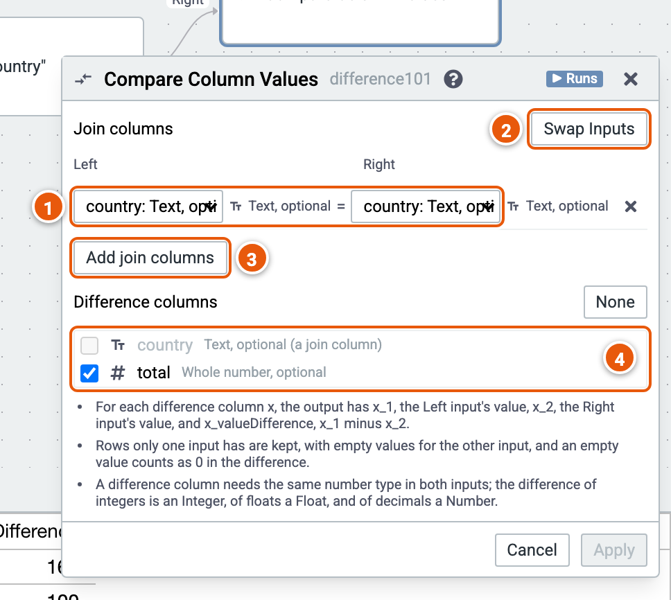

# Compare Column Values

Matches the rows of two inputs on join columns and, for each difference column, gives both values and their difference.

Here it compares each country's total amount in 2023 with 2024. The cube runs on the sample sales (country, product, year, amount and price; the example "Sales by country and year").

1. **Join columns**: the Left input's column, and the Right input's that must equal it.
2. **Swap Inputs**: the Left and Right inputs change places.
3. **Add join columns**.
4. **Difference columns**: number columns of both inputs. **None** unticks them all.

Good to know:

- For each difference column x, the result has x_1, the Left input's value, x_2, the Right input's, and x_valueDifference, x_1 minus x_2.
- Rows only one input has are kept, with empty values for the other input; an empty value counts as 0 in the difference.
