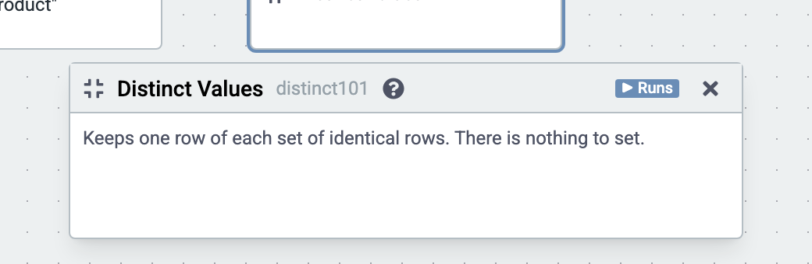

# Distinct Values

Keeps one row of each set of identical rows. It has nothing to set.

Here, after Restrict Columns keeps country and product, it gives each country and product sold once. The cube runs on the sample sales (country, product, year, amount and price; the example "Sales by country and year").

