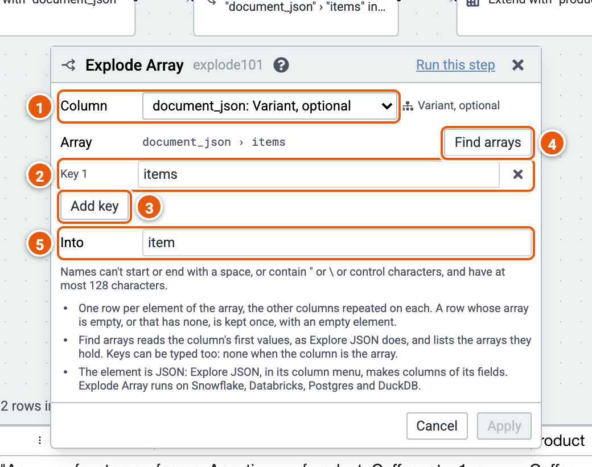

# Explode Array

Makes a row for each element of an array in a JSON (Variant) column, keeping the other columns and adding the element as a new column. A row whose array is empty, or missing, is kept once, with an empty element.

Here, from the example "Order lines from JSON", it makes a row for each item of each order.

1. **Column**: the JSON column holding the array.
2. **The keys** to the array inside it, one per level: here `items`. None when the column is the array itself.
3. **Add key**.
4. **Find arrays** reads the column's first values and lists the arrays they hold, to pick one.
5. **Into**: the new column's name.

Good to know:

- Explode Array runs on Snowflake, Databricks, Postgres and DuckDB.
- The element is JSON: Explore JSON, in its column's menu, makes columns of its fields. See [JSON columns](../json.md).
