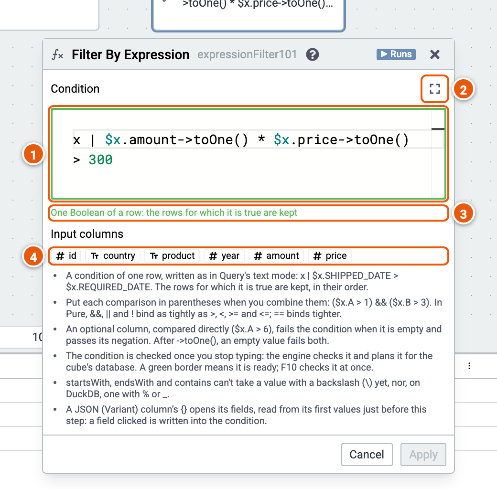

# Filter by Expression

Keeps the rows for which a Pure expression is true, for conditions Filter by Column can't express, such as arithmetic across columns.

Here it keeps the sales whose amount times price is over 300. The cube runs on the sample sales (country, product, year, amount and price; the example "Sales by country and year").

1. **The condition**, a lambda of one row, as in Query's text mode: `x | $x.amount->toOne() * $x.price->toOne() > 300`. It is checked once you stop typing: the engine checks it and plans it for the cube's database. Its border turns green when it is ready, red with a problem. F10 checks it at once. Apply needs it checked.
2. **Show more lines** of the condition.
3. **Its check**: what the condition is once ready, or the problem found.
4. **Input columns**: click one to write it at the condition's cursor, or at its end before you click into it.

Good to know:

- As you type, `$x.` lists the input's columns with their types, and `$x.COLUMN->` the functions of the column's type. Where the engine completes Pure code, its completions follow.
- Where the engine documents its functions, `$x.COLUMN->` lists every function of the column's type, each with its signature; Ctrl+Space shows what the one selected does. Point at a function's name to read its documentation; while you write a call's arguments, its signatures show, the argument you are writing in bold.
- An optional column needs `->toOne()` before arithmetic.
- Put each comparison in parentheses when you combine them: `($x.A > 1) && ($x.B > 3)`.
- A JSON (Variant) column's `{}` opens its fields; a field clicked is written into the condition. See [JSON columns](../json.md).
