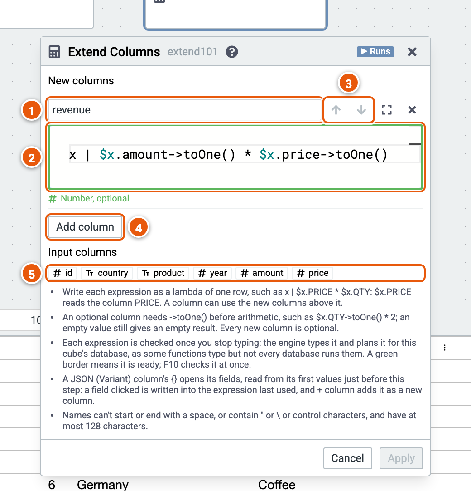

# Extend Columns

Adds columns computed from each row by Pure expressions.

Here it adds revenue, amount times price. The cube runs on the sample sales (country, product, year, amount and price; the example "Sales by country and year").

1. **The new column's name**.
2. **Its expression**, a lambda of one row: `x | $x.amount->toOne() * $x.price->toOne()`. It is checked once you stop typing: the engine checks and types it. Its border turns green when it is ready, red with a problem, and its type shows below it. F10 checks the expressions at once. Apply needs them checked.
3. **Move** a column **up** or **down**: a column can use the ones above it.
4. **Add column**.
5. **Input columns**: click one to write it in the expression last used, at its cursor, or at its end before you click into it.

Good to know:

- As you type, `$x.` lists the columns the expression can read, the input's and the new ones above it, with their types, and `$x.COLUMN->` the functions of the column's type. Where the engine completes Pure code, its completions follow.
- Where the engine documents its functions, `$x.COLUMN->` lists every function of the column's type, each with its signature and what it does. Point at a function's name to read its documentation; while you write a call's arguments, its signatures show, the argument you are writing in bold.
- An optional column needs `->toOne()` before arithmetic; every new column is optional.
- A JSON (Variant) column's `{}` opens its fields: a field clicked is written into the expression, and **+ column** adds it as a new column. See [JSON columns](../json.md).
