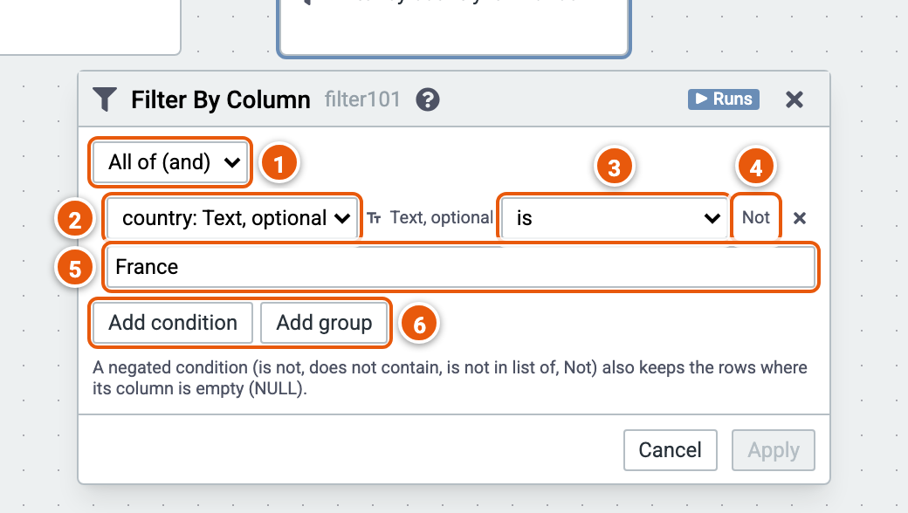

# Filter by Column

Keeps the rows that match conditions on their columns.

Here it keeps the sales in France. The cube runs on the sample sales (country, product, year, amount and price; the example "Sales by country and year").

1. **All of (and)** or **Any of (or)**: how the conditions combine.
2. **The column** a condition tests.
3. **The operator**, which depends on the column's type. For text: is, is not, starts with, does not start with, contains, does not contain, ends with, does not end with, is empty, is not empty, is in list of, is not in list of.
4. **Not** negates the condition.
5. **The value** to compare with; click it to change it.
6. **Add condition**, or **Add group**: a group of conditions with its own All of or Any of.

Good to know:

- A negated condition (is not, does not contain, is not in list of, Not) also keeps the rows where its column is empty.
