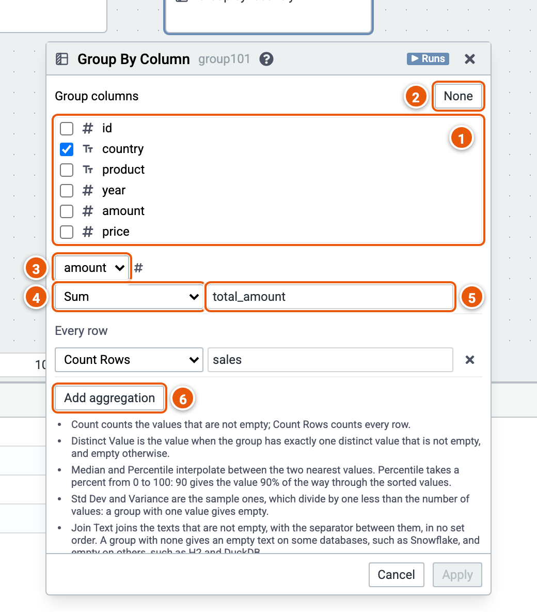

# Group by Column

Makes one row for each combination of the group columns' values, with aggregations of the rows in it.

Here it gives each country's total amount and number of sales. The cube runs on the sample sales (country, product, year, amount and price; the example "Sales by country and year").

1. **Group columns**: tick the columns to group by.
2. **None** unticks them all: one row for all the rows.
3. **The column** an aggregation reads.
4. **The aggregation**: Count, Distinct Count, Distinct Value, Sum, Average, Min, Max, Median, Percentile, Std Dev, Variance, Join Text, or Count Rows. Each column offers those that fit its type: Median to Variance on numbers, Join Text on text. Percentile takes a percent and Join Text a separator, in a field beside it. Count Rows reads no column, so it shows under **Every row**.
5. **The new column's name**.
6. **Add aggregation**.

Good to know:

- Count counts the values that aren't empty; Count Rows counts every row.
- Median and Percentile interpolate between the two nearest values: Percentile 90 is the value 90% of the way through the sorted values, and it names the column `P90`.
- Std Dev and Variance are the sample ones, so a group with one value gives empty.
- Join Text joins the texts that aren't empty, with the separator between them, in no set order. The separator can't hold a backslash.
- With no group column, the result is one row, even when there are no rows.
