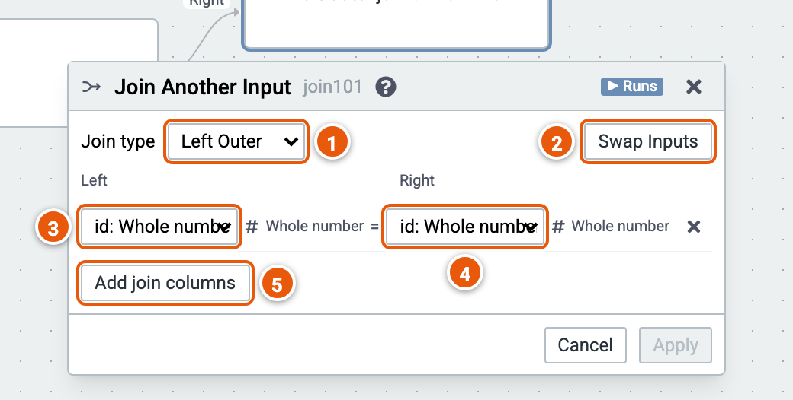

# Join Another Input

Joins two inputs on pairs of columns.

Here it joins each sale to the order with the same id, keeping the sales without one. The cube runs on the sample sales (country, product, year, amount and price; the example "Sales by country and year").

1. **Join type**: Inner, Left Outer, Right Outer or Full Outer.
2. **Swap Inputs**: the Left and Right inputs change places; the join columns follow them.
3. **The Left input's column**.
4. **The Right input's column**, whose value must equal the left one's.
5. **Add join columns**: another pair; rows match when every pair does.
