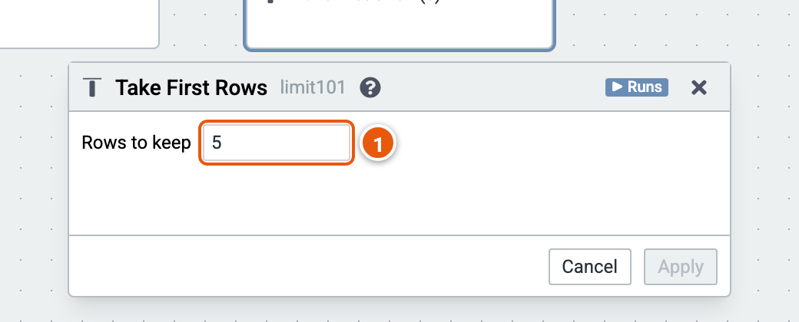

# Take first rows

Keeps the first rows.

Here it keeps the first 5 rows. The cube runs on the sample sales (country, product, year, amount and price; the example "Sales by country and year").

1. **Rows to keep**.

Good to know:

- Rows have an order only after a Sort by Column.
