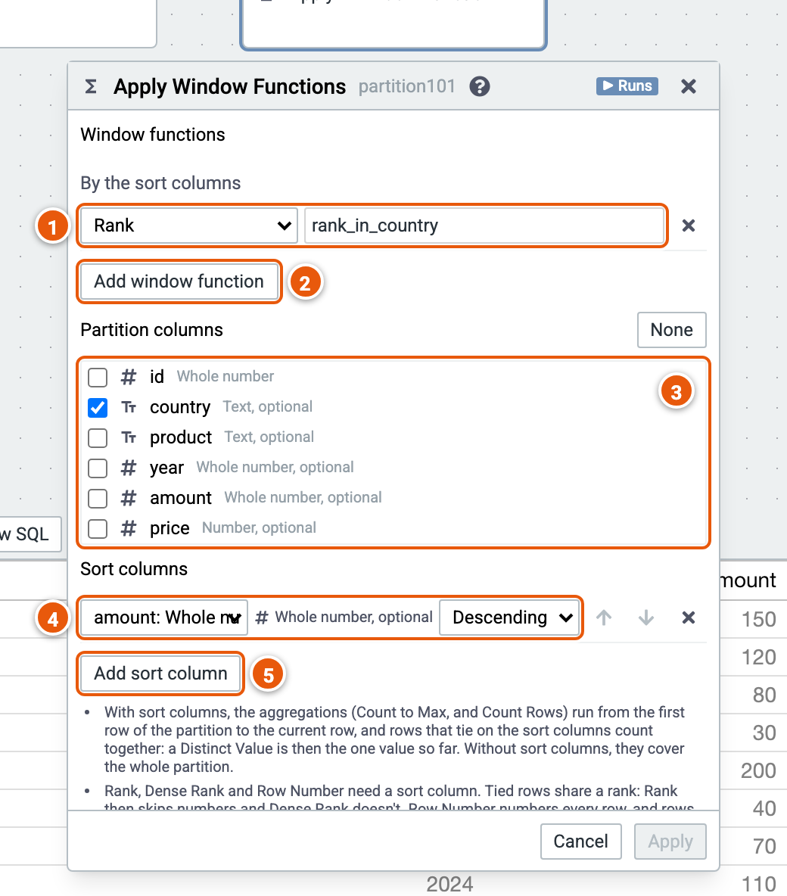

# Apply Window Functions

Adds columns computed over windows of rows, such as a rank or a running total, keeping every row.

Here it ranks each country's sales by amount, largest first. The cube runs on the sample sales (country, product, year, amount and price; the example "Sales by country and year").

1. **A window function** and its new column's name: Count, Distinct Count, Distinct Value, Sum, Average, Min, Max, Lag, Lead, First, Last, Count Rows, Rank, Dense Rank, Row Number, NTile, Percent Rank or Cumulative Distribution.
2. **Add window function**.
3. **Partition columns**: each combination of their values is a window. With none, every row is in one window.
4. **Sort columns**: the order of the rows in each window.
5. **Add sort column**.

Good to know:

- With sort columns, the aggregations run from the window's first row to the current row; without, they cover the whole window.
- Rank, Dense Rank and Row Number need a sort column.
