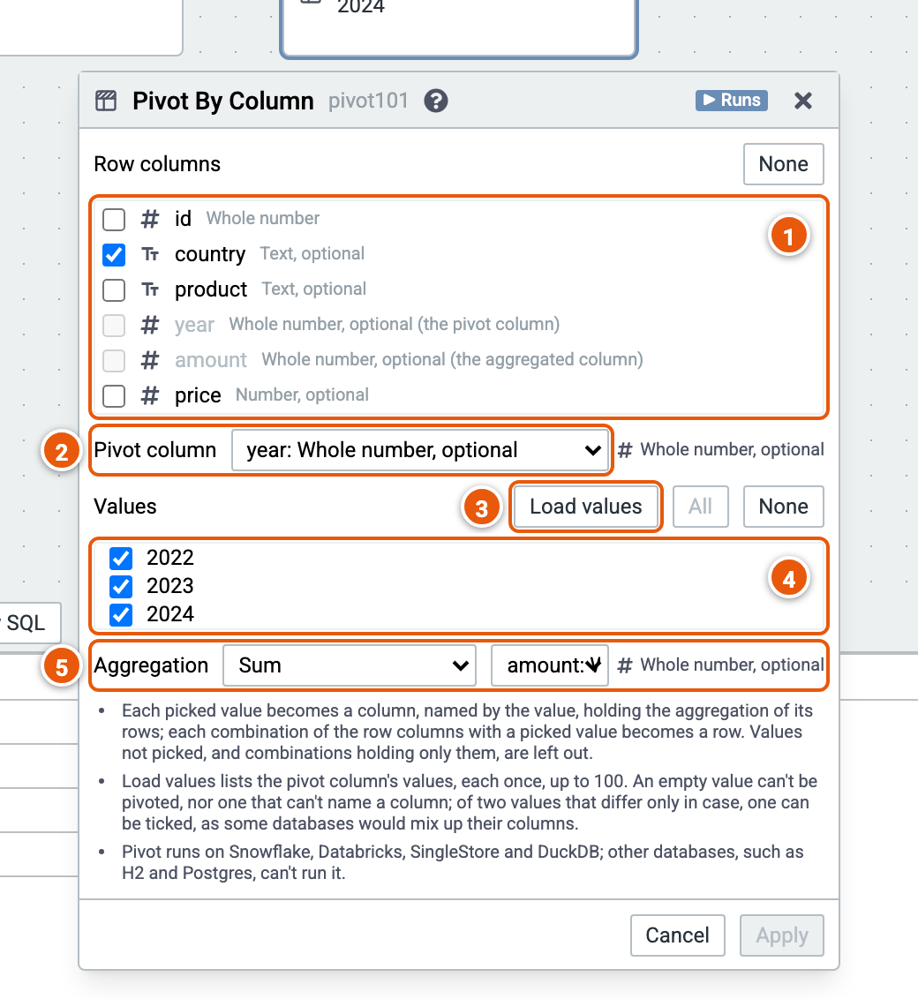

# Pivot by Column

Turns the values of one column into columns: a row for each combination of the row columns, and a column for each value picked, holding its aggregation.

Here it gives a row per country and a column per year, each holding that year's total amount. The cube runs on the sample sales (country, product, year, amount and price; the example "Sales by country and year").

1. **Row columns**: one row for each combination of their values. The pivot column and the aggregated column can't be row columns.
2. **Pivot column**: its values become the new columns.
3. **Load values** asks the engine for the pivot column's values, up to 100.
4. **Values**: tick the values that become columns. **All** and **None** tick or untick them all.
5. **Aggregation**: Count, Distinct Count, Sum, Average, Min, Max or Count Rows, and the column it reads.

Good to know:

- Pivot runs on Snowflake, Databricks, SingleStore and DuckDB, not on databases such as H2 and Postgres; the palette greys it out there.
