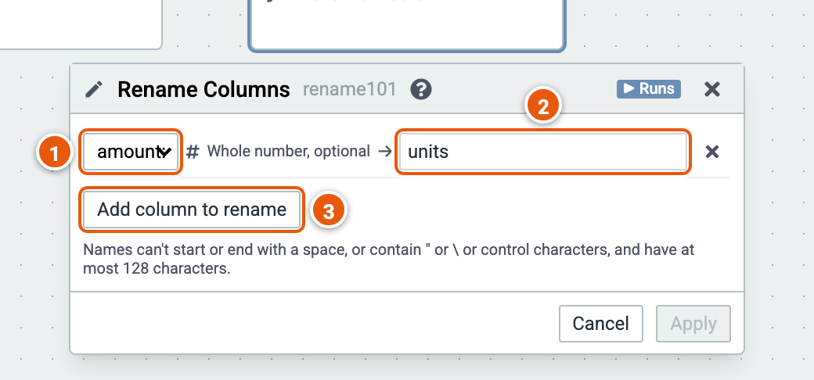

# Rename Columns

Gives columns new names.

Here it renames amount to units. The cube runs on the sample sales (country, product, year, amount and price; the example "Sales by country and year").

1. **The column** to rename.
2. **Its new name**.
3. **Add column to rename**.
