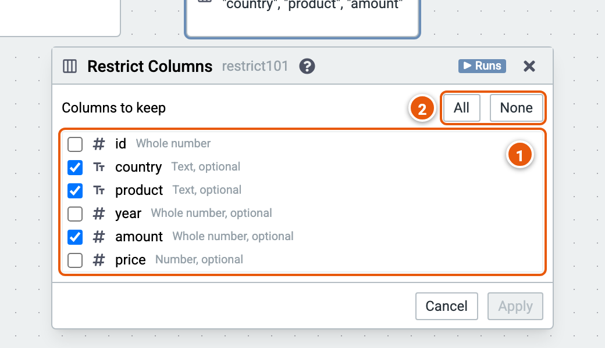

# Restrict Columns

Keeps only the columns ticked.

Here it keeps country, product and amount. The cube runs on the sample sales (country, product, year, amount and price; the example "Sales by country and year").

1. **Columns to keep**.
2. **All** ticks every column; **None** unticks them all.
