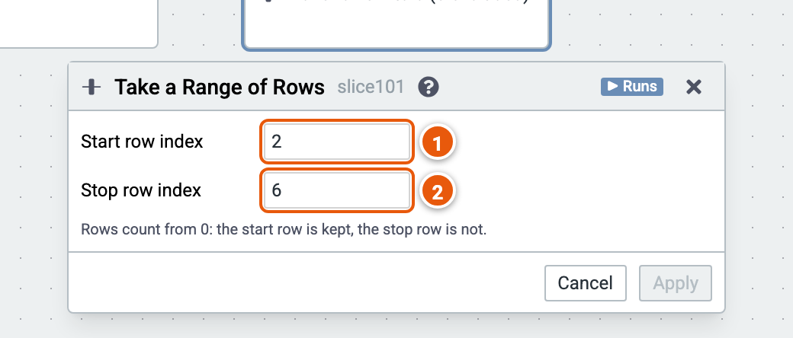

# Take a range of rows

Keeps the rows from a start row up to, but not including, a stop row, counting from 0.

Here it keeps rows 2 to 5. The cube runs on the sample sales (country, product, year, amount and price; the example "Sales by country and year").

1. **Start row index**: the first row kept.
2. **Stop row index**: the first row left out.

Good to know:

- Rows have an order only after a Sort by Column.
