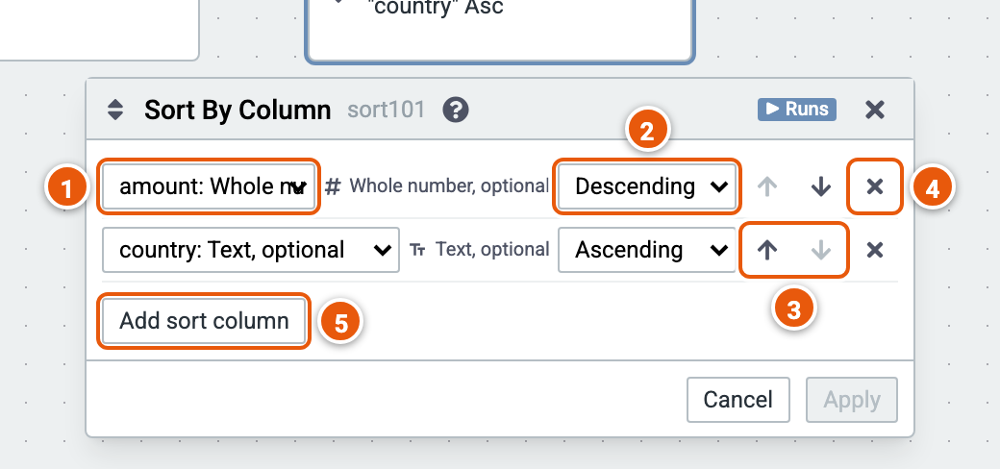

# Sort by Column

Reorders the rows by one or more columns, each ascending or descending.

Here it sorts the sample sales by amount, largest first, then by country. The cube runs on the sample sales (country, product, year, amount and price; the example "Sales by country and year").

1. **The column** to sort by.
2. **Ascending** or **Descending**.
3. **Move** a sort column **up** or **down**: rows are sorted by the first column, then by the next, and so on.
4. **Remove** a sort column.
5. **Add sort column**.
