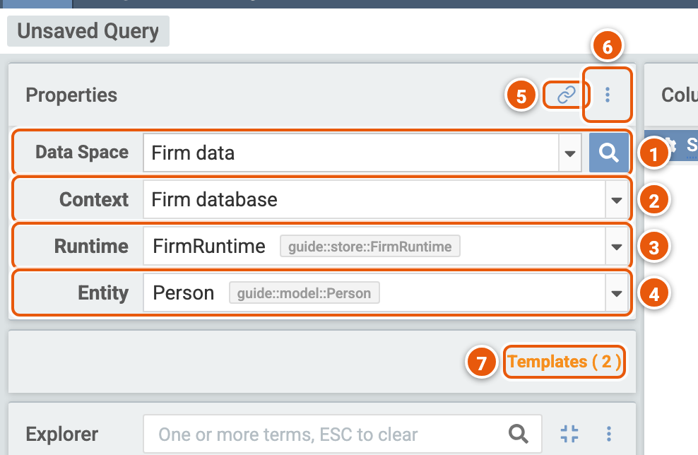
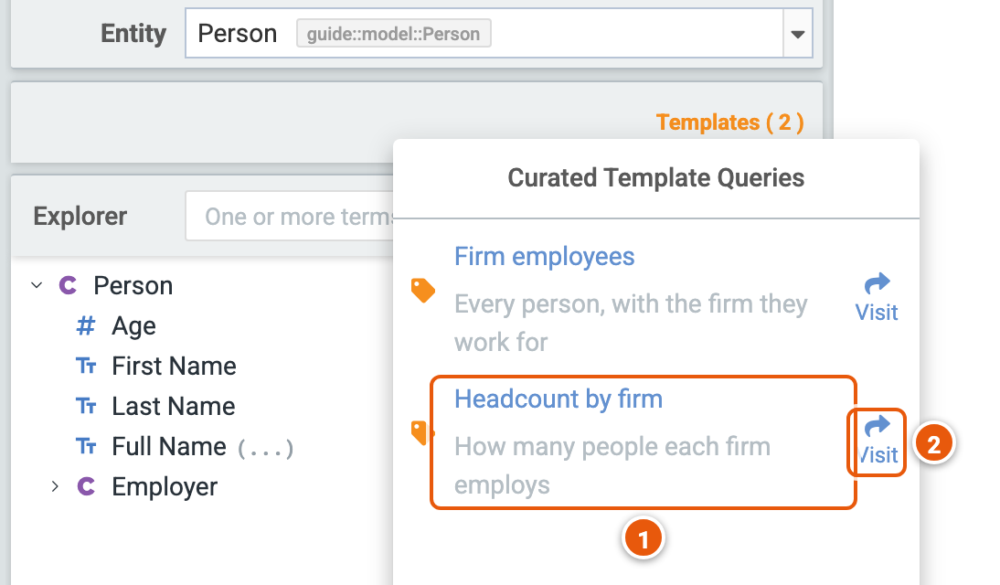
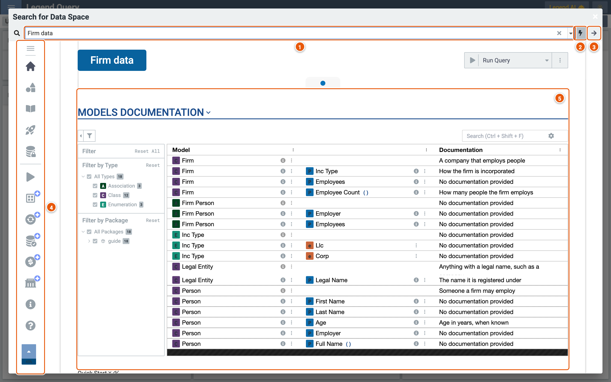
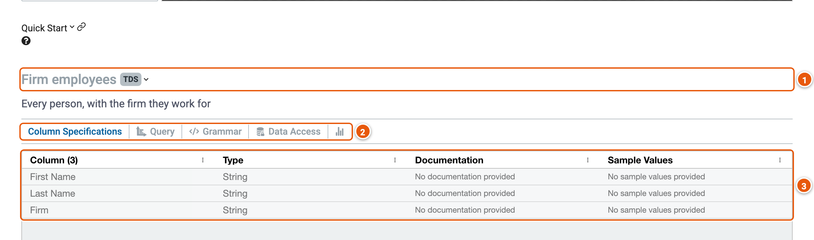
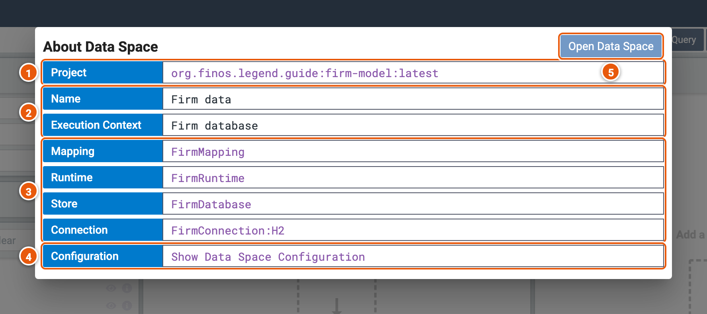

# Data spaces

A data space is what a model offers the people who use its data. It holds:

- the classes worth querying;
- the mappings and runtimes to query them with;
- documentation and diagrams that explain them;
- ready-made queries.

Its authors write it in Legend Studio (see the
[Legend Studio guide](https://legend.finos.org/guides/studio/data-space)). In Legend Query, you start a query from
one.

## Pick a data space

Pick a data space in **Data Space**. The **Properties** panel then shows what the query runs on.

1. **Data Space**: the data space you query. The magnifier beside it searches data spaces (see
   [Search for a data space](#search-for-a-data-space)).
2. **Context**: the execution context, the mapping and the runtime the query runs with, such as a database, or sample
   data to try queries on. It shows when the data space has more than one. Pick another to query its data instead: the
   entity stays if the new context's mapping maps it.
3. **Runtime**: the runtime the query runs with, among those that can run the context's mapping. It shows once you
   tick **Show Runtime Selector** (6). Pick one other than the context's default, and Legend Query keeps it for the
   context next time; an arrow beside it goes back to the default.
4. **Entity**: the class to query, among those the data space shows and the context's mapping maps.
5. **copy data space query set up link to clipboard**: copies a link that opens a new query on this data space,
   context, runtime and entity. On a saved query, it copies the query's link.
6. **Show Settings...**: **Show Runtime Selector** shows the **Runtime** row.
7. **Templates**: the data space's ready-made queries, with how many it has (see [Templates](#templates)).

## Templates

**Templates** lists the queries the data space's authors made ready: its services, and queries written in the data
space.

1. **A template**: click it to load its query in the query builder, in the execution context it names. If you changed
   the query, Legend Query asks before replacing it.
2. **Visit...**: opens the template in a new tab, at an address of its own, to bookmark or share.

## Search for a data space

The magnifier beside **Data Space** opens **Search for Data Space**. Pick a data space there to read what it
documents, then query it.

1. **Search for data space by name...**: the data spaces, by title.
2. **The lightning**: lists the data spaces of the projects' snapshots, their latest changes not yet released, rather
   than of their releases.
3. **Proceed to create query**: opens a new query on the data space, with the context and runtime picked in its
   **Execution Context** section.
4. **The sections**, one after the other. Click one to go to it:

   - **Description**;
   - **Diagrams**: the model's diagrams;
   - **Models Documentation** (5);
   - **Quick Start**: its ready-made queries (see [below](#quick-start));
   - **Data Access**: the data its queries read, and whether you can access it;
   - **Execution Context**: its contexts and their runtimes;
   - **Info**: the project and version it comes from;
   - **Support**: whom to ask, and where to read more.

   The sections marked **Work In Progress** aren't finished.

5. **Models Documentation**: the classes, properties, associations and enumerations the data space documents, with
   their documentation. Filter them by type and package on the left, or search them.

### Quick start

1. **A ready-made query**: its title, and the kind of result it returns, such as **TDS**, rows of a table.
2. **Its tabs**:
   - **Column Specifications**: the columns it returns.
   - **Query**: **Open in Query** opens a new query, in a new tab, with a copy of a service's query.
   - **Grammar**: its query in the Legend language.
   - **Data Access**: the data it reads.
   - The last tab, its usage statistics, is still in progress.
3. **The columns**: each one's name, type and documentation, and sample values where the data space's authors give
   them.

## About Data Space

**Help...** › **About Data Space** shows where the query's data comes from.

1. **Project**: the project and version the data space comes from. Click it to open the project in Legend Studio.
2. **Name** and **Execution Context**: the data space's title, and the context the query runs with.
3. **Mapping**, **Runtime**, **Store** and **Connection**: what the context queries through, with the kind of
   database, such as **H2**. Click one to open it in Legend Studio.
4. **Configuration**: **Show Data Space Configuration** opens the data space itself in Legend Studio.
5. **Open Data Space**: opens the data space in Legend Marketplace.
