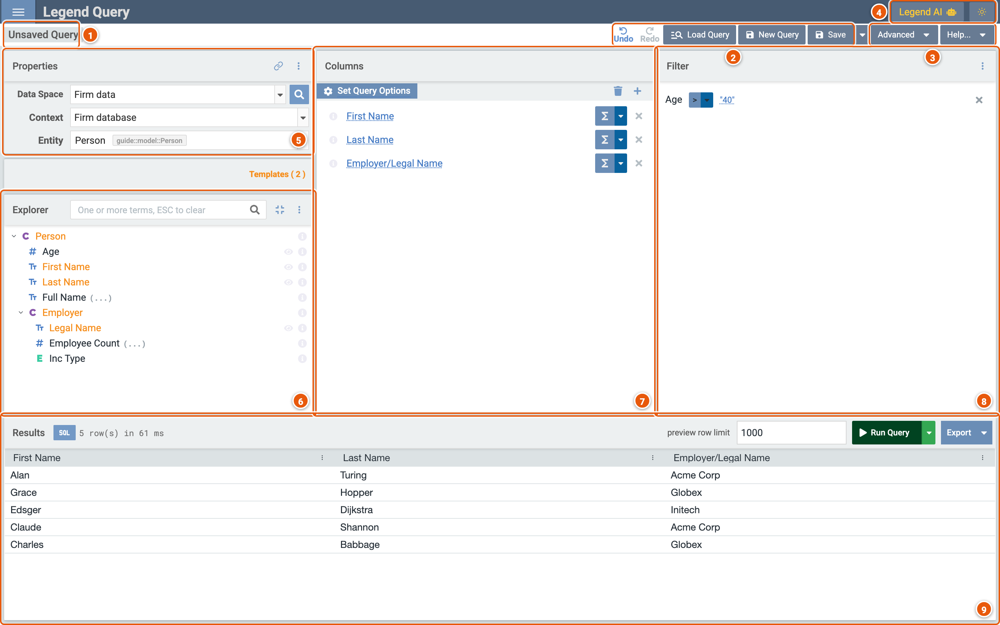
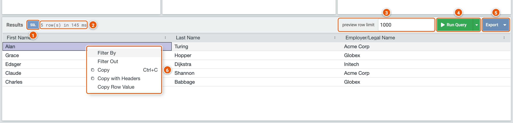
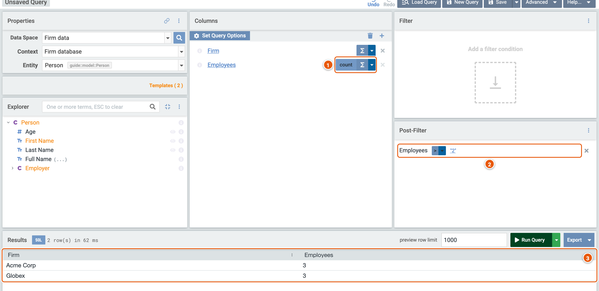
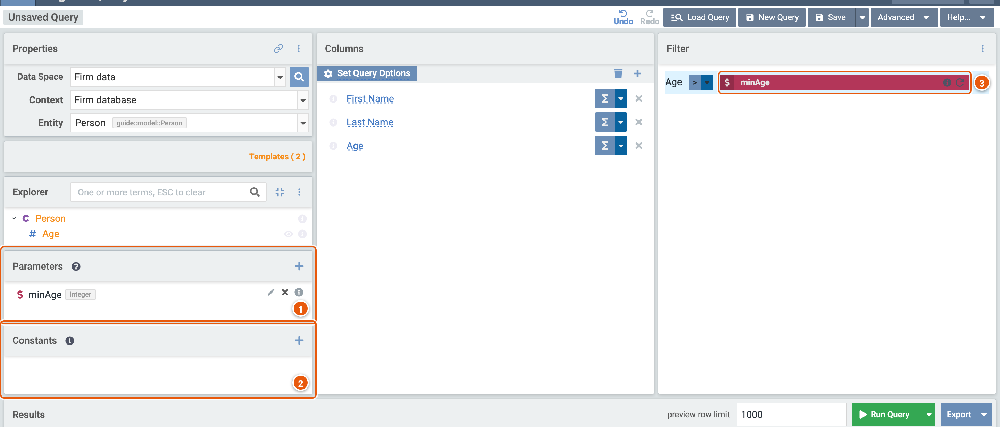
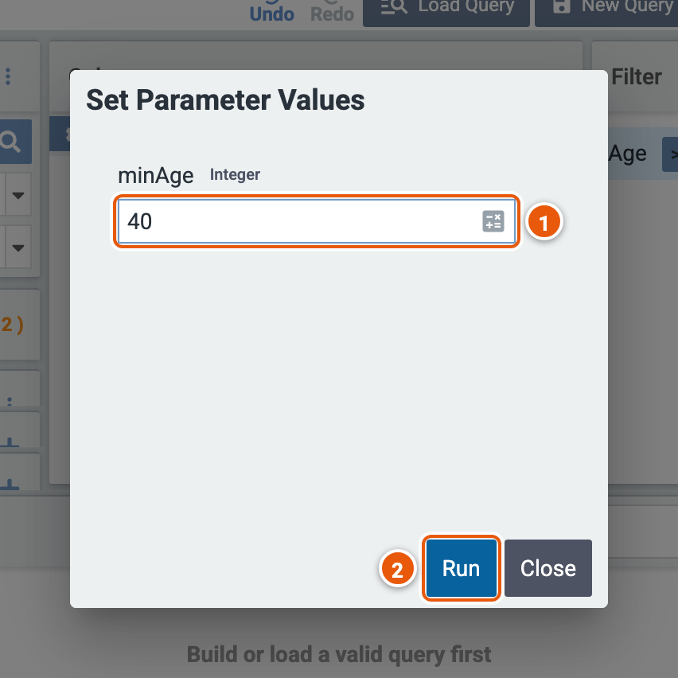

# The query editor

The query editor is where you build a query and run it. You drag properties from the explorer: to **Columns** for
what the query returns, and to **Filter** for the conditions the data must meet. Legend Query writes the query in the
Legend language for you, and the engine runs it on the data's store, through the context's mapping.

Click the image to see it full size.

1. **The query's name**: **Unsaved Query** until you save it (see [Saving and sharing](./save-and-share.md)).
2. **Undo** and **Redo**. **Load Query** opens a saved query, and **New Query** starts an empty one on the same data
   space. **Save** saves the query; the arrow beside it has **Save As New Query** (see
   [Saving and sharing](./save-and-share.md)).
3. **Advanced**: more a query can do, such as parameters and constants (see
   [Parameters and constants](#parameters-and-constants)), a post-filter (see [Post-filter](#post-filter)) and window
   functions. **Show Pure** shows the query in the Legend language, and **Edit Pure** edits it there. **Check
   Entitlements** checks that you can access the data the query reads. **Help...** has **About Data Space** (see
   [Data spaces](./data-space.md#about-data-space)), **About Legend Query**, **Open Documentation** and **Show Virtual
   Assistant**.
4. **Legend AI** opens a panel for an AI assistant, where your deployment of Legend adds one. The sun switches Legend
   Query between its light and dark themes.
5. **Properties**: the data space, context and entity the query runs on (see [Data spaces](./data-space.md)).
6. **Explorer**: the entity's properties. A class among them, such as **Employer**, opens on a click to show its own
   properties: here, those of the firm a person works for. `(...)` marks a derived property, which the model computes.
   Type in the box to find a property. **Preview Data**, the eye beside a property, describes its values: for a number,
   its count, sum, smallest, largest and average; otherwise, its ten most common values.
7. **Columns**: what the query returns, a column for each property dropped here. Click a column's name to rename it.
   **Σ** aggregates a column, such as to count or add up its values, grouped by the other columns (see
   [Post-filter](#post-filter)). **Set Query Options** sorts the rows, removes duplicate rows and limits how many come
   back.
8. **Filter**: the conditions the data must meet. Drag a property here for a condition, pick its operator, such as `>`,
   and click its value to change it. Several conditions are joined by **and**: click it to switch to **or**. The panel's
   menu groups conditions.
9. **Results**: what the query returned (see [Results](#results)).

## Build a query

The query above lists the people over 40, with their names and the firm that employs them:

1. In **Properties**, pick the data space **Firm data** and the entity **Person**.
2. Drag **First Name** and **Last Name** to **Columns**. Click **Employer**, and drag its **Legal Name** there too.
3. Drag **Age** to **Filter**. Pick the operator `>`, type `40` and press Enter.
4. Click **Run Query**.

## Results

1. **SQL**: the SQL the engine ran, which it made from the query and the mapping. **Copy SQL to Clipboard** copies it.
2. **How many rows** came back, and how long the query took.
3. **preview row limit**: the most rows the query returns here. Exports aren't limited.
4. **Run Query** runs the query. The arrow beside it has **Generate Plan**, the plan the engine makes to run the query;
   **Debug**, how it made the plan; and **View Lineage**, where the query's data comes from.
5. **Export**: saves the results in a file, such as **CSV**. The rest of the menu is for saved queries: **Legend
   DataCube** opens the query in Legend DataCube; **Curated Template Query** and **Productionized Query** take it to
   Legend Studio, to make it a template of the data space or a service; **DEV Service** registers it as a service for
   development.
6. **Right-click a cell**: **Filter By** and **Filter Out** add a condition that keeps, or leaves out, the rows with
   the cell's value. **Copy** copies the cell, **Copy with Headers** copies it with its column's name, and **Copy Row
   Value** copies the whole row.

## Post-filter

A post-filter applies to the query's results, such as to a count, where a filter applies to the data before the query
counts it. **Advanced** › **Show Post-Filter** shows it.

Below, the data space's template **Headcount by firm** (see [Templates](./data-space.md#templates)) counts the people
each firm employs, and a post-filter keeps the firms with more than 2.

1. **count**: the column's aggregation, picked with **Σ** and its arrow, among others such as sum, average, smallest,
   largest and distinct count. The other columns, here **Firm**, group the rows.
2. **Post-Filter**: drag a column from **Columns** here for a condition on it. **Filter By** and **Filter Out**, on
   such a column's cell, add their condition here.
3. **The results**: the firms with more than 2 people.

## Parameters and constants

A parameter is a value the query asks for each time it runs, such as the age in its filter. A constant is a value
named once, which stays the same at every run. **Advanced** › **Show Parameter(s)** and **Show Constant(s)** show
them.

1. **Parameters**: **+** adds one, with its name and type, such as **minAge**, an **Integer**. Drag it onto a
   condition's value to use it there.
2. **Constants**: **+** adds one, with its name, type and value.
3. **A parameter in use**: **minAge** is the value the condition on **Age** compares with.

**Run Query** then asks for the parameter's value.

1. **The parameter's value**, here `40`.
2. **Run**: runs the query with it.
