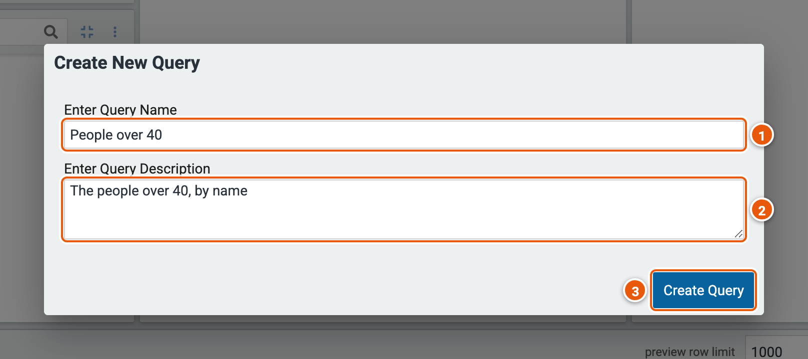
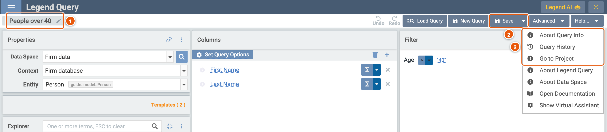
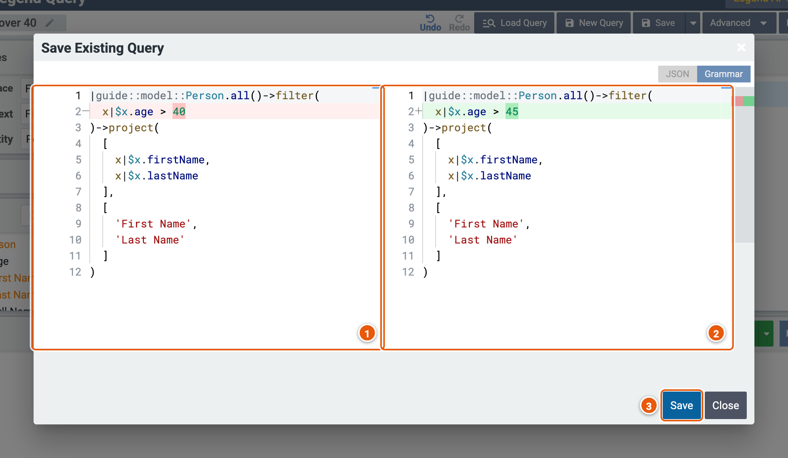
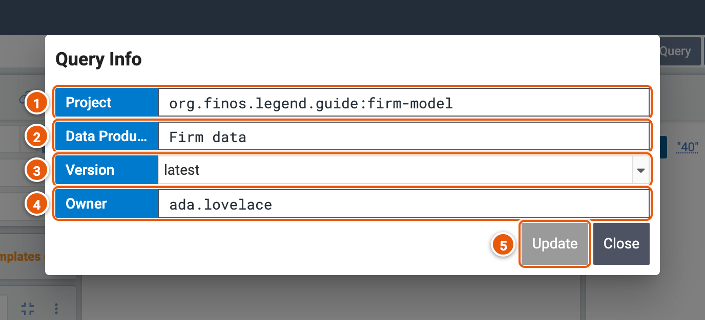
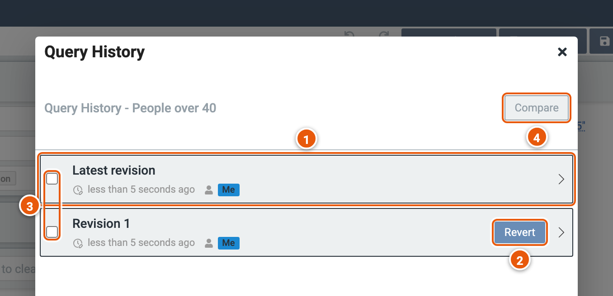
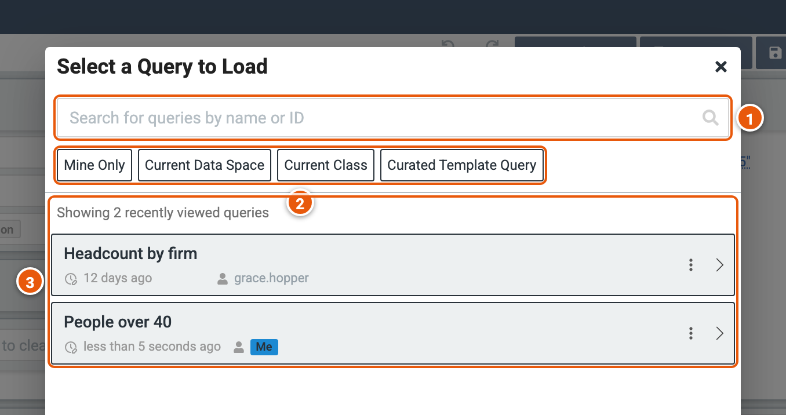

# Saving and sharing

A saved query keeps everything you built, with its data space and context, so you, or anyone you send it to, can open
it and run it again. Legend keeps saved queries in its query store, apart from the projects.

## Save a query

**Save** asks for a name and a description.

1. **Enter Query Name**: a name to find the query by, such as `People over 40`.
2. **Enter Query Description**: what the query returns, for whoever finds it.
3. **Create Query**: saves the query, then opens it.

A query with parameters keeps their values when you save it, and asks with them filled in the next time it runs.

## A saved query

1. **The query's name**. Double-click it, or click the pencil, to rename the query and change its description.
2. **Save**: saves your changes over the query (see [Save your changes](#save-your-changes)). The arrow beside it has
   **Save As New Query**, which saves them as another query, named **Copy of** this one's name until you change it.
3. **Help...** has more for a saved query: **About Query Info** (see [Query info](#query-info)), **Query History**
   (see [Query history](#query-history)), and **Go to Project**, which opens the query's project in Legend Studio.

## Save your changes

**Save**, on a saved query, shows the query as it was saved beside your changes.

1. **The query as it was saved**, in the Legend language. **JSON**, above, shows it as JSON instead.
2. **The query with your changes**, which are highlighted: here, the age the filter compares with.
3. **Save**: saves the changes over the query.

## Query info

**Help...** › **About Query Info** shows what the query runs on.

1. **Project**: the project the query's data space comes from.
2. **Data Product**: the data space it queries.
3. **Version**: the version of the project it runs on: **latest** is the project's most recent release.
4. **Owner**: who saved the query.
5. **Update**: saves the query on the version you picked in **Version**, then opens it again.

## Query history

Each save keeps the query as it was. **Help...** › **Query History** lists those revisions.

1. **The revisions**: the latest first, each with when it was saved and by whom. The arrow at the right opens a revision
   in the editor; its address opens that revision again.
2. **Revert**: saves the revision as the latest one.
3. **Pick two revisions** to compare.
4. **Compare**: shows how the two differ, in the Legend language.

## Load a query

**Load Query** opens another saved query, as **Open an existing query** does on the setup page (see
[Getting started](./start.md#open-an-existing-query)).

1. **Search for queries by name or ID**: type two characters or more to search every saved query.
2. **The filters**: **Mine Only**, the queries you saved; **Current Data Space** and **Current Class**, those saved on
   this data space, or on its entity; **Curated Template Query**, the data space's templates rather than saved
   queries.
3. **The queries**: before you search, the ones you opened last. Click one to open it. Its **More Actions...** has
   **Show Query Preview**, **Show Query History**, and, for your own queries, **Delete** and **Rename**.

## Share a query

A saved query's address opens it: copy it from your browser, or with **copy data space query set up link to
clipboard**, the link icon of the **Properties** panel, and send it. Whoever opens it gets the query as you saved it,
and can save their own copy with **Save As New Query**.

The address can also give the query's parameters other values than those saved with it, with `p:` and the
parameter's name. Add, for example, `?p:firm=Globex` to the address of the saved query **People at a firm** to run it
with **Globex** as its parameter **firm**. Write text as it is, without quotes, and dates as `2026-11-30`.
