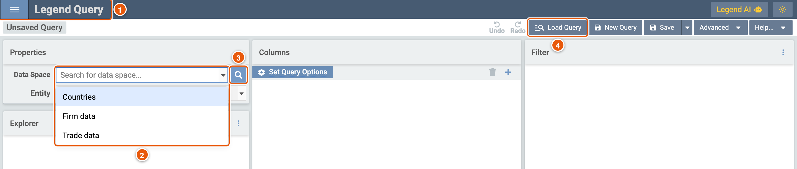
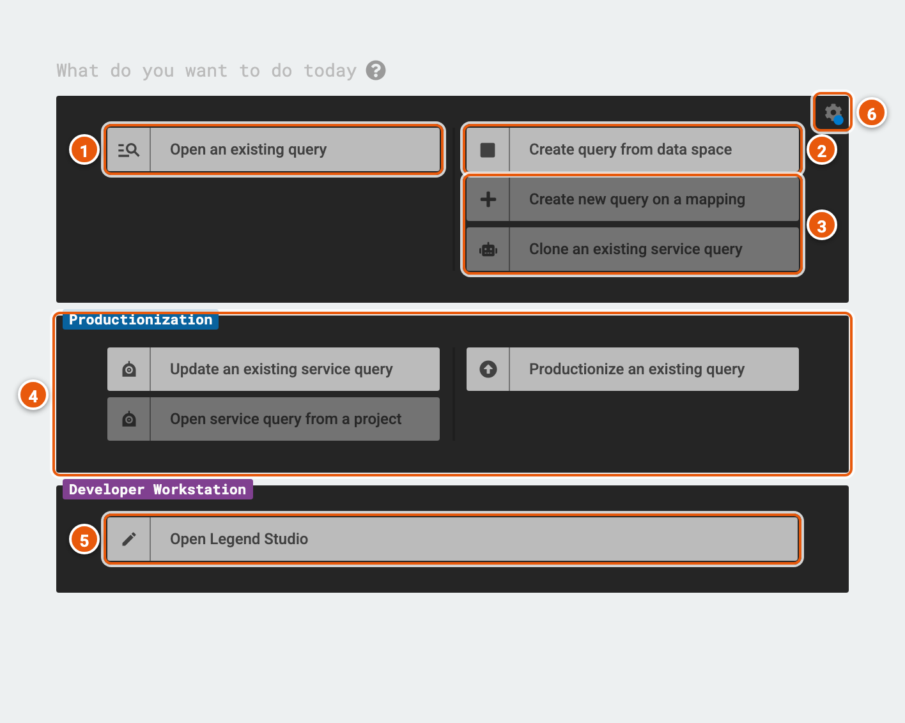
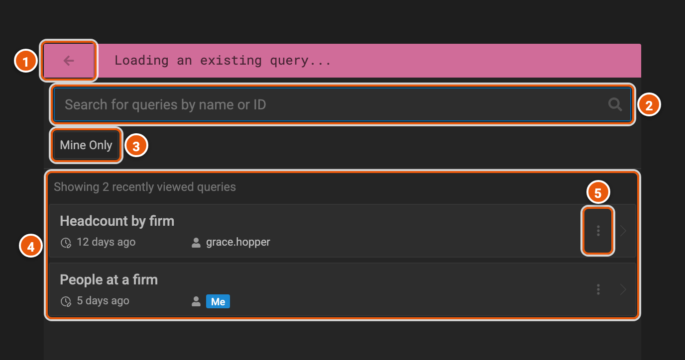
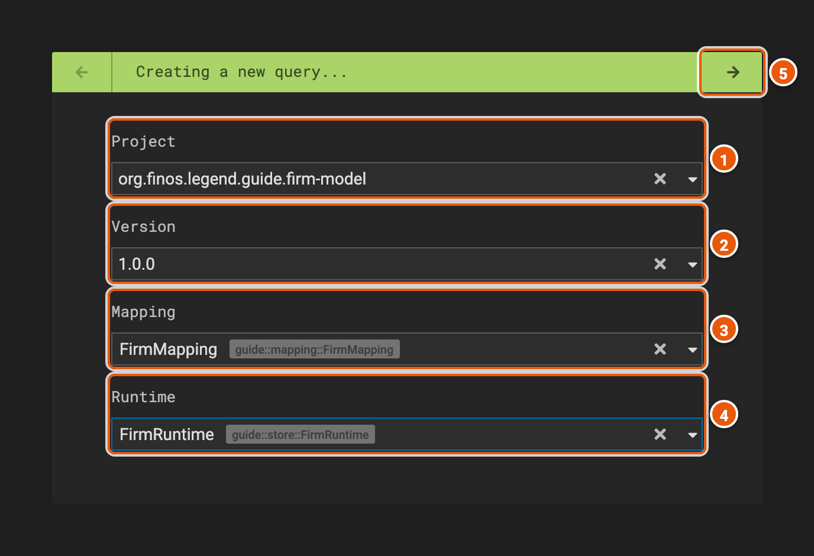

# Getting started

Legend Query opens on a new, empty query. To start, pick a data space: the data you want to query.

Click the image to see it full size.

1. **☰**: the menu. **Back to query setup** opens the setup page (see below) in a new tab, **Documentation** opens
   Legend's documentation, and **Dev Settings** holds settings for Legend's developers, such as which engine to call.
2. **Data Space**: the data spaces released in Legend's projects. Type part of a data space's title to find it, then
   pick it to start a query on it (see [Data spaces](./data-space.md)).
3. **Search for data space**: a larger search, which shows what a data space holds before you query it (see
   [Search for a data space](./data-space.md#search-for-a-data-space)).
4. **Load Query**: opens a query you or someone else saved (see [Load a query](./save-and-share.md#load-a-query)).

## The setup page

**☰** › **Back to query setup** opens the setup page, with other ways to start a query.

1. **Open an existing query**: finds a saved query and opens it (see [Open an existing query](#open-an-existing-query)).
2. **Create query from data space**: a new query, as Legend Query opens on.
3. **Create new query on a mapping** queries a mapping and a runtime you pick rather than a data space's (see
   [A query on a mapping](#a-query-on-a-mapping)). **Clone an existing service query** starts from a copy of a
   service's query.
4. **Productionization**: hands a query over to Legend Studio. **Productionize an existing query** makes a saved query
   a service in a project. **Update an existing service query** and **Open service query from a project** change a
   service's query.
5. **Open Legend Studio**.
6. **Show settings...**: which actions the page shows.

At first, the page shows only **Open an existing query** and **Create query from data space**. **Show advanced
actions**, the **...** under them, adds the actions on a mapping and on a service. **Show all action groups**, the
arrow below, adds **Productionization** and **Open Legend Studio**. The page keeps these choices in its address, so a
bookmark opens it the same way.

## Open an existing query

1. **Back to Main Menu**: back to the setup page.
2. **Search for queries by name or ID**: type two characters or more to search every saved query.
3. **Mine Only**: only the queries you saved.
4. **The queries**: before you search, the ones you opened last; before you've opened any, a few saved queries. Each
   shows how long ago it was last changed, and who owns it: **Me** for yours. Click a query to open it.
5. **More Actions...**: **Show Query Preview** shows the query in the Legend language, and **Show Query History** its
   earlier versions. **Delete** and **Rename** are for your own queries.

## A query on a mapping

A mapping says where a model's data comes from, and a runtime how to reach it. A data space chooses them for you; on
the setup page, **Create new query on a mapping** lets you choose them yourself.

1. **Project**: one of the projects in the depot, where Legend keeps the projects' released versions.
2. **Version**: one of the project's released versions, or **latest**, its most recent.
3. **Mapping**: the mapping to query through.
4. **Runtime**: the runtime to run the query with, among those that use the mapping. Picking a mapping picks the first.
5. **Create a new query**: opens the query in the editor.

**Clone an existing service query** asks for a project, a version and one of its services, then opens a new query
with a copy of the service's query, mapping and runtime.
