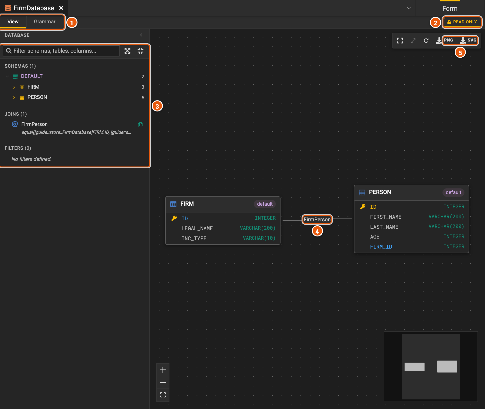
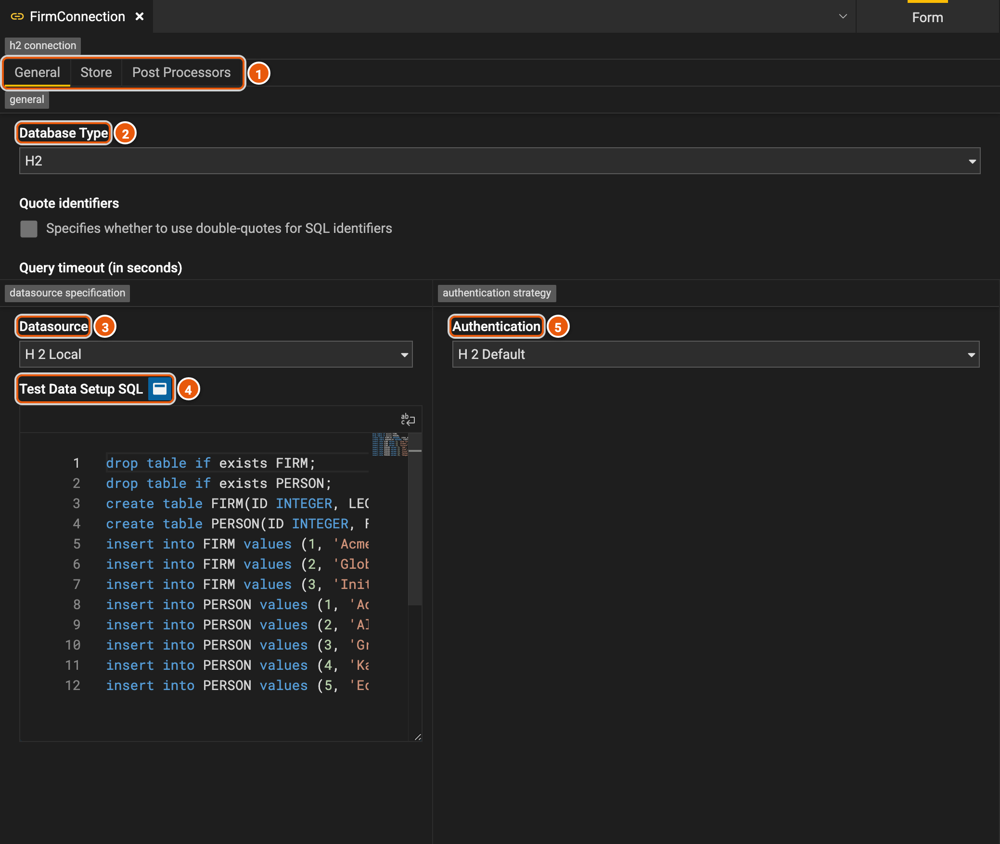
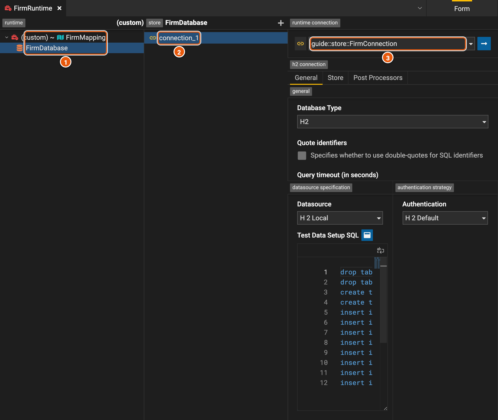
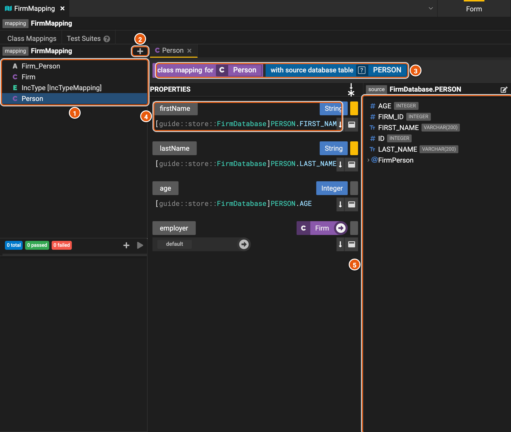
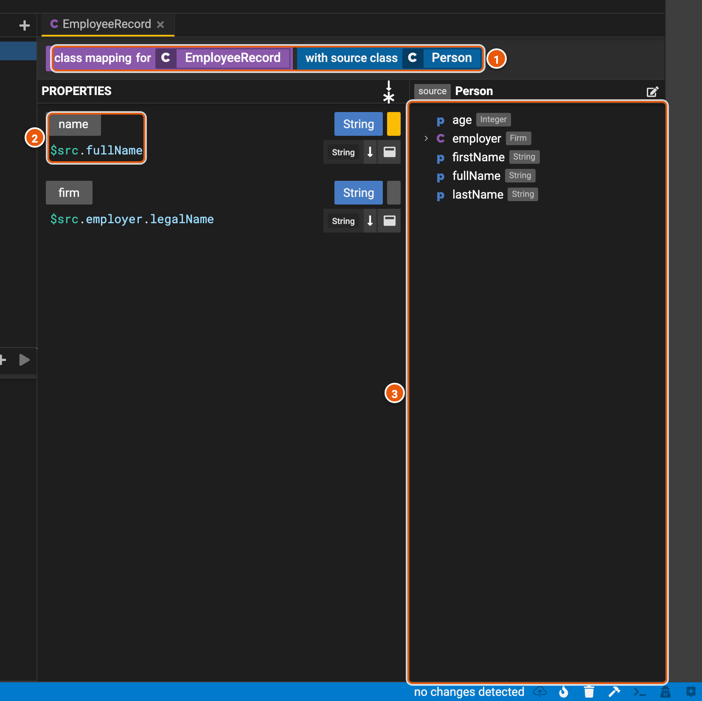

# Connecting to data

A model holds no data itself. To query it, you connect it to a store, where the data is kept. Four elements do it:

- **A store** describes where the data is kept. For a relational database, it is a database element, with its schemas,
  tables and joins.
- **A mapping** fills the model's classes from the store.
- **A connection** says how to reach the store and sign in to it.
- **A runtime** says which connection each store uses when a mapping reads from it.

The screenshots show the database **FirmDatabase**, with its tables **FIRM** and **PERSON**, the mapping
**FirmMapping**, the connection **FirmConnection** and the runtime **FirmRuntime**.

## A database

1. **View** draws the database; **Grammar** is its Legend language text, where you change it.
2. **READ ONLY**: the view only shows the database. Change it in **Grammar**, or in [text mode](./editor.md#text-mode).
3. **The database's contents**: its schemas, tables and columns, its joins and its filters. Type in the box to filter
   them by name.
4. **The tables**, drawn with their columns, and the joins between them, such as **FirmPerson** from a firm to the
   people it employs. Zoom and fit the drawing with the buttons at the bottom left.
5. **PNG** and **SVG** save the drawing as an image.

## A connection

1. **General**, **Store**, the database the connection is for, and **Post Processors**, which change the SQL the
   engine sends, such as to rename a schema.
2. **Database Type**, such as H2, Snowflake, Databricks, BigQuery, Postgres, SQL Server, Redshift, Spanner, Trino or
   DuckDB.
3. **Datasource**: where the database is, in the terms of its type, such as its host or its account. **H2 Local** is a
   database the engine creates in memory.
4. **Test Data Setup SQL**: for an H2 Local database, the SQL that creates its tables and fills them.
5. **Authentication**: how the engine signs in to the database, such as with a user name and a password.

## A runtime

1. **The runtime's mappings**, and under them the stores they read from. Click the runtime to change its mappings, or
   a store to see its connections.
2. **The store's connections**. **+** adds one.
3. **The connection**: here, a reference to **FirmConnection**, whose settings show below it.

## Mappings

A mapping's **Class Mappings** tab holds a class mapping for each class, association or enumeration it fills.
**Test Suites** holds its tests.

### From a database

1. **The class mappings**: click one to open it.
2. **Create new mapping element**: maps another class, association or enumeration.
3. **What the class mapping fills, and from where**: here, the class **Person**, from the table **PERSON**.
4. **A property, and how it is filled**: here, from the column **FIRST_NAME**. Drag a column from the source onto a
   property to fill it from that column. A yellow mark shows a required property; the button above the list switches
   between listing the required properties first and listing them by type.
5. **The source**: the table's columns, and its joins to other tables, such as **FirmPerson**, to the firm a person
   works for.

### From another model

A model-to-model mapping fills a class from another class, to change data from one shape into another. Here,
**EmployeeRecord**, a flat record for a report, is filled from **Person**.

1. **What the class mapping fills, and from where**: the class **EmployeeRecord**, from the class **Person**.
2. **A property, and how it is filled**: an expression where `$src` is the source instance. **name** takes the
   person's **fullName**.
3. **The source class's properties**: drag one onto a property of the same type to fill it from that property.
