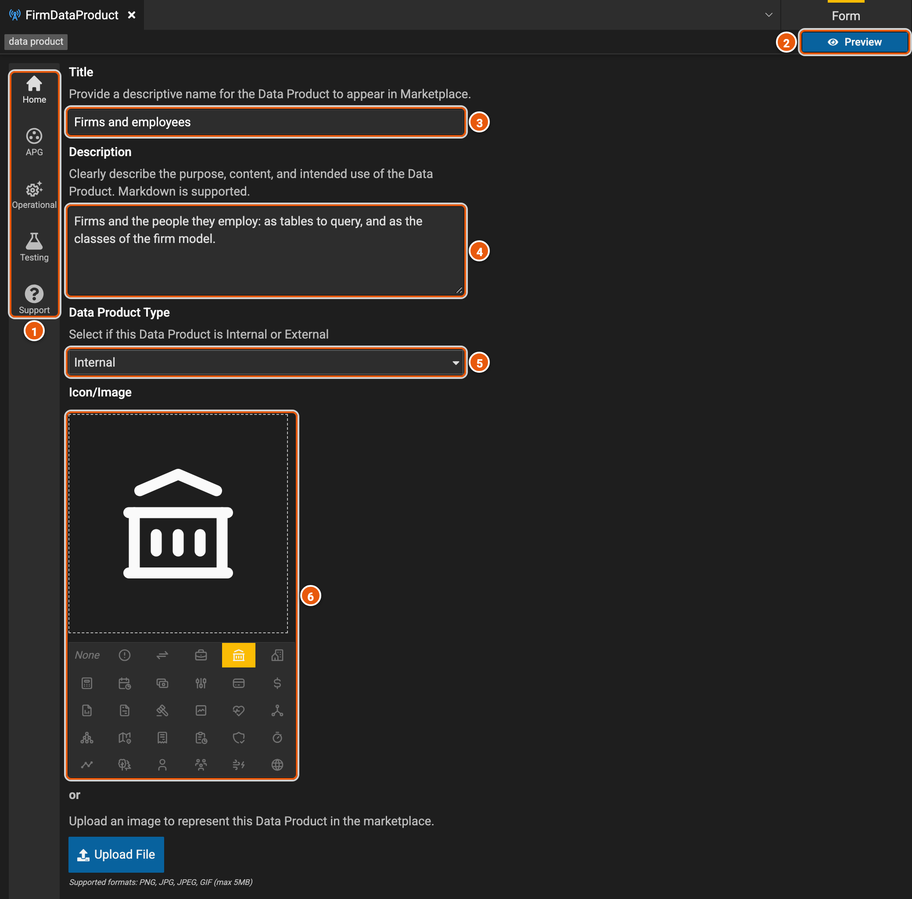
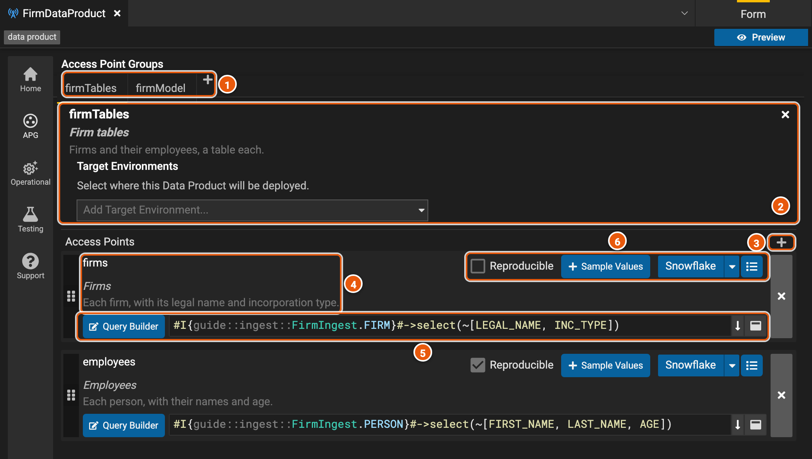
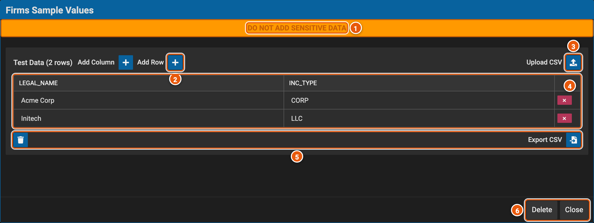
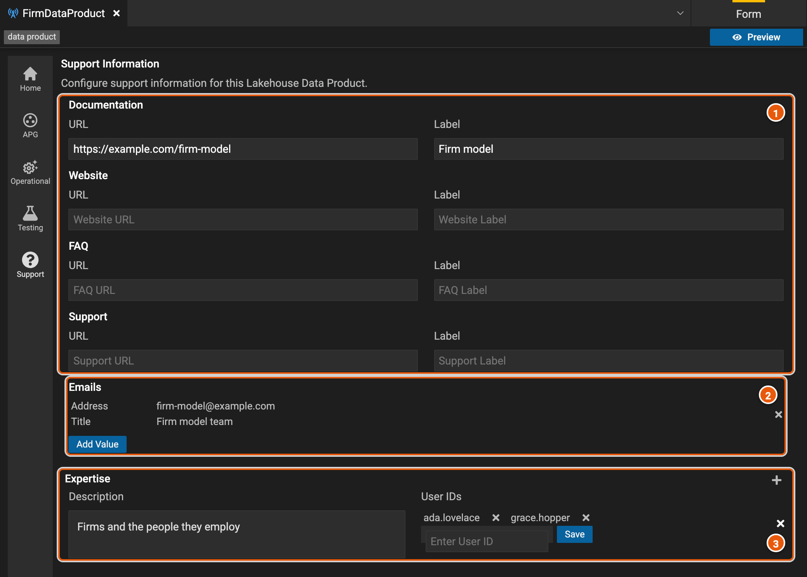

# Data products

A data product publishes data for people to find in Legend Marketplace and query. Its data is in access point groups,
and people request access to a group as a whole. Each access point in a group is a function that returns rows of the
data. A model access point group has a mapping instead, so that people query its data through a model's classes. Here,
**FirmDataProduct** publishes the firms and employees of **firm-model** both ways.

Create one with **New Element...** › **Lakehouse Data Product**, under **Query**, with a name and a title. **Modeled**
starts it with a model access point group rather than an access point group.

## Home

The editor opens on **Home**.

1. **The editor's pages**: **Home**; **APG**, the access point groups; **Operational**; **Testing**; and **Support**.
2. **Preview** shows the data product beside the form, as people see it in Legend Marketplace.
3. **Title**: the data product's name in Legend Marketplace.
4. **Description**: what the data product is for, what it holds and how to use it. It can use Markdown.
5. **Data Product Type**: **Internal**, or **External**, which adds a link: a URL and its label.
6. **Icon/Image**: the icon Legend Marketplace shows for the data product. **Upload File**, below, takes an image
   instead.

Below them, **Ownership** takes the IDs of the deployments that own the data product.

## Access point groups

**APG** shows the access point groups, one at a time.

1. **The groups**, one tab each. **+** adds a **New Access Point Group** or a **New Model Access Point Group**. A red
   mark on a tab means the group lacks a name, a title, a description or an access point, or one of its access points
   lacks a name, a title or a description.
2. **The group**: its name, its title, and its description, which people read when they request access to it. Click
   one to change it; **×** removes the group. **Target Environments**: where its access points are deployed. Adding
   one clears each access point's own environment (6), and setting an access point's environment clears the group's.
3. **+** adds an access point.
4. **The access point**: its name, its title and its description. Click one to change it. The handle at its left
   drags it, to reorder it or onto another group's tab, and **×**, at its right, removes it.
5. **Its function**, in the Legend language, which returns the access point's rows. Here, it reads the **FIRM** data
   set of the project's [ingest definition](./ingest-definition.md), **FirmIngest**, and keeps two of its columns. **Query Builder** opens it in
   the query builder, on the project's ingest definition, and **Save Lambda** puts it back. The buttons at its right
   expand the text and open it in a larger editor.
6. **Reproducible** lets people get the data as it was at any Lakehouse batch. **Sample Values** adds example rows of
   what the access point returns (see [Sample values](#sample-values)). The arrow beside its environment, here **Snowflake**,
   picks where the access point is deployed: **Snowflake**, **Databricks**, **BigQuery** or **DuckDb**. The last
   button has **AP Plan Generation**, the plan the engine makes to run the access point, and **Lineage Viewer**, where
   its columns' data comes from.

When Legend Studio is set up for them, an access point also has a data classification, and a group a switch that makes
its data enterprise data, which anyone in the organization can access without approval.

A model access point group has a **Mapping** instead of access points: people query its data through the model's
classes, with that mapping. The arrow beside it opens the mapping. Here, **firmModel** uses **FirmMapping**.

## Sample values

Sample values are a few example rows of what an access point returns. Legend Marketplace shows them beside each of the
access point's columns, under **Column Sample Values**. They're saved in the project, with the data product.

To add them, click **Sample Values** beside the access point. Legend Studio first asks the engine for the columns the
access point's function returns, so the function must compile and return rows; if it doesn't, Legend Studio says to fix
the function and adds nothing. The editor then opens with an empty row, under those columns. Here, **Firms** returns
**LEGAL_NAME** and **INC_TYPE**.

1. **Do not add sensitive data**: the values are saved in the project and shown in Legend Marketplace.
2. **Add Row** adds an empty row. Type each value in its cell. **Add Column**, beside it, adds a column, but the columns
   should stay the function's (see below).
3. **Upload CSV** replaces the table with a CSV file's rows. The file's first line names the columns.
4. **The table**: a column for each column the function returns, and a row for each example. **×** removes a row.
5. **Export CSV** saves the table as a CSV file, and the bin, after asking, removes every row.
6. **Delete** removes the access point's sample values, after asking. **Close** closes the editor and keeps them.

The button then shows a pencil, and opens them again. It has a red border while their columns differ from those the
function returns, such as after the function changes.

## Operational metadata

**Operational** describes the data: the regions it covers, **Coverage Regions** (APAC, EMEA, LAMR and NAMR), and how
often it is updated, **Update Frequency**, from **INTRADAY** to **YEARLY**, or **ON_DEMAND**.

## Tests

**Testing** holds test suites, which check what access points return. A suite gives rows of test data for the data sets
the access points read, and each test gives the rows its access point should return. **Add Test Suite** asks for the
name of the suite's first test and the access point it tests.

## Support

**Support** says where people can find help.

1. **Links**: **Documentation**, **Website**, **FAQ** and **Support**, each a URL, and a label to show for it once it
   has one.
2. **Emails**: who to write to, each an address and a title. **Add Value** adds one, and **×** removes it.
3. **Expertise**: people who know the data, by user ID, with a description. **+** adds another such group.
