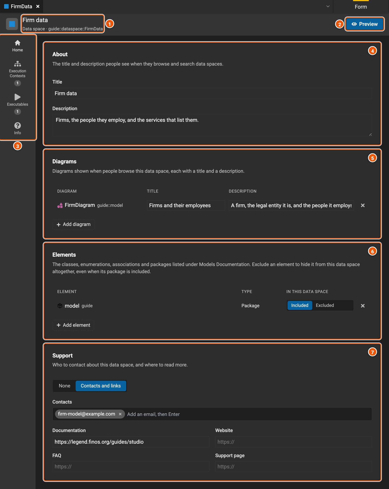
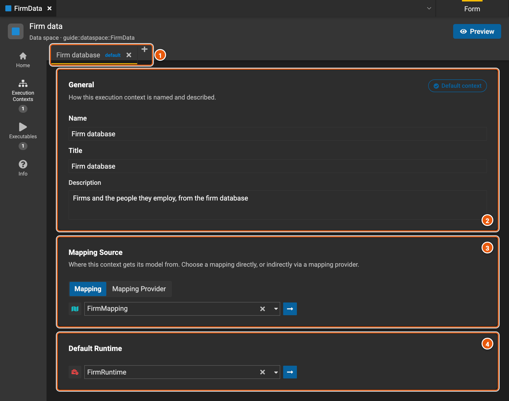
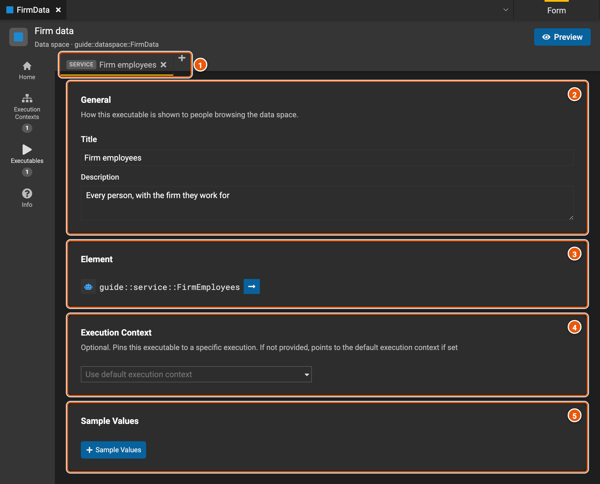
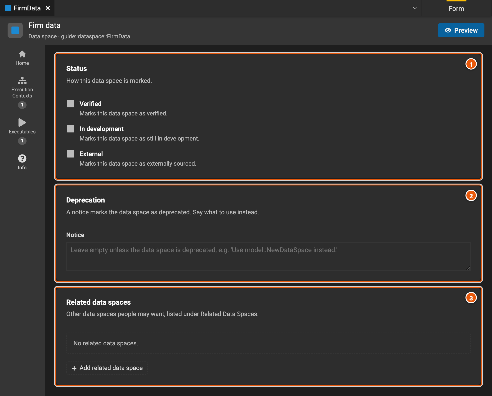
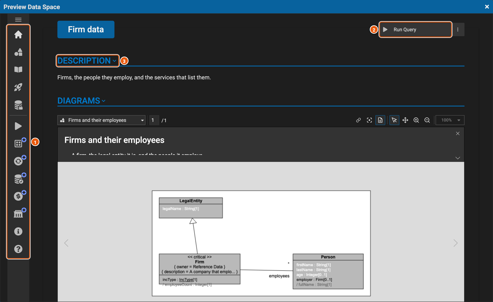

# Data spaces

A data space is how the people who use a model's data find it. It gathers what they need to query the model: the
mappings and runtimes to query with, the classes worth showing, diagrams that explain them, ready-made services, and
who to ask for help. Legend Query starts a query from a data space, and Legend Studio previews one as its users will
see it. Here, **FirmData** is the data space of **firm-model**.

Create one with **New Element...** › **Data Space**, under **Query**.

## Home

The editor opens on **Home**.

1. **The data space's title and path.**
2. **Preview** shows the data space as its users will see it (see [Preview](#preview)).
3. **The editor's pages**: **Home**; **Execution Contexts** and **Executables**, with how many of each the data space
   has; and **Info**.
4. **About**: the title and the description people see when they browse and search data spaces.
5. **Diagrams**: the diagrams people see, each with a title and a description. **Add diagram** picks one of the
   project's diagrams.
6. **Elements**: the classes, enumerations, associations and packages documented for people. A package brings in
   everything in it; mark an element **Excluded** to leave it out, even when its package is in.
7. **Support**: who to contact and where to read more, with emails and links to documentation, a website, an FAQ and a
   support page. **None** removes it.

## Execution contexts

An execution context is a mapping and a runtime to query the data space with. A data space has one or more, one of
them the default, so that its users can pick the data they query, such as another environment's database.

1. **The execution contexts**, one tab each, with **default** on the default one. **+** adds one, and **×** deletes
   it.
2. **General**: the context's name, which the data space refers to it by, its title and its description. **Default
   context** shows that this context is the default, or makes it so.
3. **Mapping Source**: the mapping the context queries through, picked directly (**Mapping**) or through another
   element that provides it (**Mapping Provider**). The arrow opens it.
4. **Default Runtime**: the runtime the context runs its queries with. The arrow opens it.

## Executables

An executable is something people can run from the data space as it is, such as a service.

1. **The executables**, one tab each, marked with their kind, such as **SERVICE**. **+** adds one, and **×** deletes
   it.
2. **General**: the title and the description people see.
3. **Element**: the service or function it runs. The arrow opens it.
4. **Execution Context**: which of the data space's execution contexts it runs with. Left empty, it runs with the
   default one.
5. **Sample Values**: a few example rows of what it returns.

## Info

1. **Status**: marks the data space **Verified**, **In development** or **External**, for its users to see.
2. **Deprecation**: a notice that marks the data space as deprecated, saying what to use instead.
3. **Related data spaces**: other data spaces its users may want, from the released versions of other projects.
   **Add related data space** picks one.

## Preview

**Preview** shows the data space as its users will see it, such as in Legend Query, from the editor's current state.

1. **Its sections**: Description, Diagrams, Models Documentation, Quick Start, Data Access and Execution Context; then
   Data Stores, Data Availability, Data Readiness, Data Cost and Data Governance, which are still in progress; then
   Info and Support. Click one to go to it.
2. **Run Query**: where its users start a query on the data space. The preview doesn't run queries.
3. **The sections**, one after the other, starting with the description and the diagrams.
