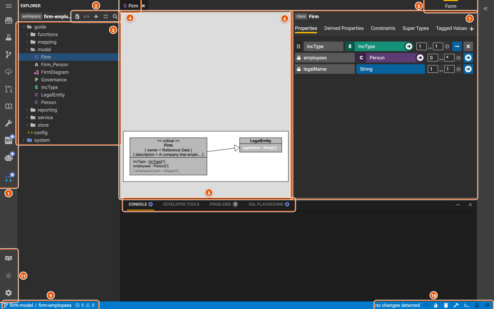
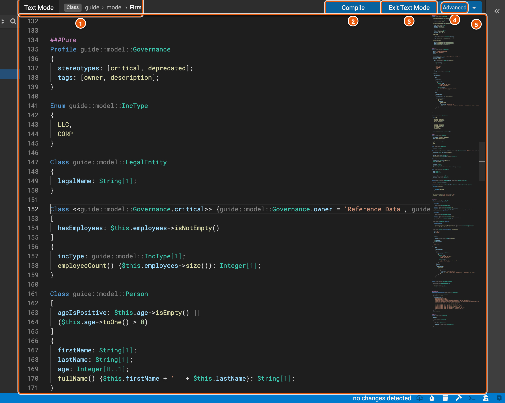

# The editor

The editor opens a workspace: the project's elements on the left, the elements you open in the middle, and the
workspace's state along the bottom. Below, the workspace **firm-employees** has the class **Firm** open.

Click the image to see it full size.

1. **The menu and the activity bar.** The menu, ☰, has **About**, **See Showcases**, **Documentation**, **Help...**
   and **Back to workspace setup**, which returns to the start screen. The activity bar under it switches the left
   side panel between:
   - **Explorer** (Ctrl+Shift+X): the workspace's elements.
   - **Test Runner**: runs the project's tests.
   - **Local Changes** (Ctrl+Shift+G): what you've changed and not yet pushed to the workspace.
   - **Update Workspace** (Ctrl+Shift+U): brings in what others have committed to the project since your workspace
     started.
   - **Review** (Ctrl+Shift+M): asks for the workspace's changes to be reviewed and committed to the project.
   - **Project**: the project's overview, its workspaces, its versions and patches, and releasing a new version.
   - **Workflow Manager**: the project's build pipelines.
   - **Dev Mode**, **Register Service** and **End to End Workflows**, which are in beta.
2. **The explorer's actions**:
   - **Open Model Importer** (F2): adds elements to the workspace from Legend language text or JSON.
   - **Project Configuration Panel**: the project's configuration, such as the projects it depends on.
   - **New Element...** (Ctrl+Shift+N): creates an element, such as a class or a mapping.
   - **Collapse All** folds the tree.
   - **Open Element...** (Ctrl+P): finds an element by name.
3. **The explorer**: the workspace's elements, by package. A letter or an icon shows each element's kind, such as
   **C** for a class, **A** an association, **E** an enumeration and **P** a profile. Click an element to open it, and
   right-click it for more. **config** opens the project configuration, and **system** holds what Legend itself
   provides, such as its built-in profiles; you can't change it.
4. **Tabs**: the elements you've opened. The arrow at the end of the tabs lists them all.
5. **Form**: how the open element shows. **Form** is its editor, **Grammar** its Legend language text and **JSON**
   the JSON the project stores. The list also has what Legend can generate from it, such as a JSON schema.
6. **The class's preview**: the class as a diagram draws it, with the class it extends.
7. **The class's editor**: one tab each for its **Properties**, **Derived Properties**, **Constraints**, **Super
   Types**, **Tagged Values** and **Stereotypes**. Every kind of element has an editor of its own.
8. **The panel** (Ctrl+\`): **Console** shows messages from compiling and generating, **Problems** lists the errors
   and warnings, **Developer Tools** has settings for how Legend Studio calls the engine, such as its URL, and **SQL
   Playground** runs SQL against a connection of the project.
9. **The project and the workspace** you're in, and how many errors and warnings the workspace has.
10. **The workspace's state and actions**:
    - **no changes detected**, or how many changes you haven't pushed yet. **Push local changes** (Ctrl+S) saves them
      to the workspace.
    - **Generate** (F10) runs the project's generations, and **Clear generation entities** removes what they made.
    - **Compile** (F9) checks the whole workspace.
    - **Toggle panel** (Ctrl+\`) shows or hides the panel.
    - **Toggle text mode** (F8): see [Text mode](#text-mode).
    - **Toggle assistant** shows or hides the assistant, which searches Legend's documentation and shows help for the
      screen you're on.
11. **Open Showcases** (F7), the light or dark theme, and **Settings**.

## Text mode

Text mode shows the whole workspace as Legend language text, in one editor. Press F8, or **Toggle text mode** in the
status bar.

1. **Text Mode**, and the element the cursor is in: its kind and its path.
2. **Compile** (F9): checks the text, and lists any problems in the panel.
3. **Exit Text Mode**: back to the form editors. The text must compile first.
4. **Advanced**: **Wrap Overflowing Words** and **Auto Fold Elements**.
5. **The text**: every element of the workspace, under a header for its kind, such as `###Pure` for classes or
   `###Relational` for databases.
