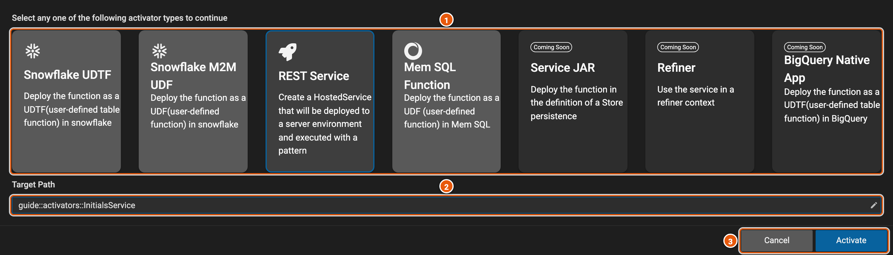
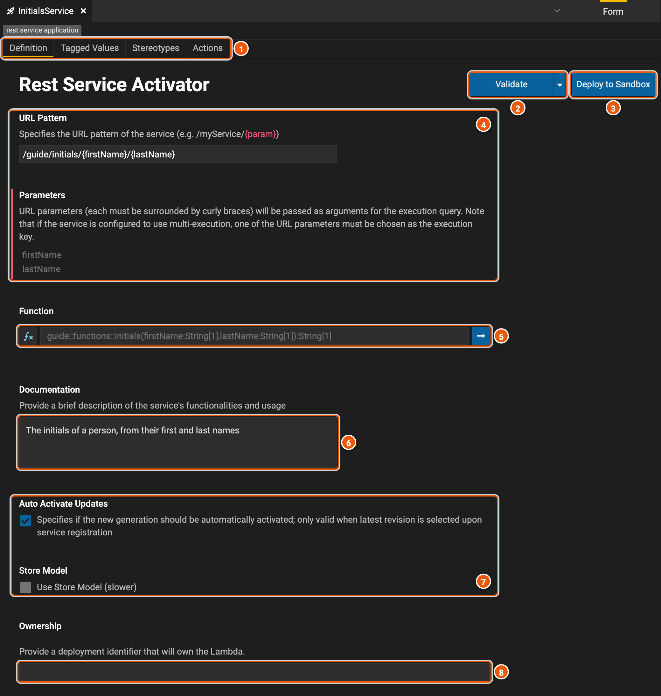
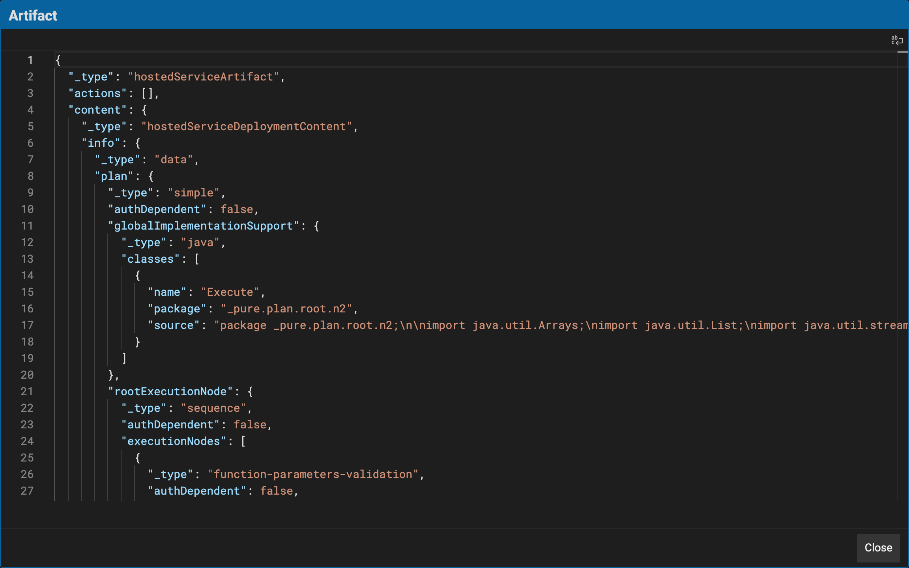

# Function activators

A function activator deploys a function so that it runs outside Legend Studio: as a REST service that applications
call, or as a function inside a Snowflake or MemSQL database. It names the function, says how and where it runs, and
who owns it. Here, **InitialsService** makes [initials](./tests.md#a-functions-tests), which turns a first and a last
name into their initials, a REST service.

## Activate a function

**Activate**, at the top right of a function's editor, creates an activator for the function.

1. **The kinds of activator**. **Snowflake UDTF**, the default, deploys the function as a user-defined table function
   in Snowflake; **Snowflake M2M UDF** as a user-defined function in Snowflake; **REST Service** as a service that
   answers at a URL; and **Mem SQL Function** as a user-defined function in MemSQL. **Service JAR**, **Refiner** and
   **BigQuery Native App** are coming soon.
2. **Target Path**: the new activator's package and name. It starts as **NewActivator**, in the function's package.
3. **Activate** creates the activator and opens it. It stays disabled for a kind that needs a database connection the
   project doesn't have: a Snowflake one for the Snowflake kinds, a MemSQL one for **Mem SQL Function**.

A new REST service gets a random URL pattern, and an owner to fill in.

## A REST service

1. **The tabs**: **Definition**, below; **Tagged Values** and **Stereotypes**, as on a class (see
   [Profiles](./modeling.md#profiles)); and **Actions**, which run after the service is deployed. The kinds of action
   come from extensions to Legend Studio, so a Legend Studio without them offers none.
2. **Validate** has the engine check the activator before you deploy it: for instance, that the parameters in the URL
   pattern are the function's. It then says **Hosted Service is valid**, or what is wrong. The arrow beside it has
   **Render Artifact** (see [The artifact](#the-artifact)).
3. **Deploy to Sandbox** deploys the activator, as it is in your workspace, to a sandbox, to try it out.
4. **URL Pattern**: the path the service answers at. A part in braces, as in `/guide/initials/{firstName}/{lastName}`,
   is a parameter: its value, from the URL, goes to the function's parameter of the same name. **Parameters** lists
   them.
5. **Function**: the function the service runs. The arrow opens it.
6. **Documentation**: what the service does, and how to use it.
7. **Auto Activate Updates**: when the service is registered from the project's latest revision, each new registration
   of it is used at once. **Store Model** makes it use the store model, which is slower.
8. **Ownership**: the identifier of the deployment that owns the service.

## The artifact

**Render Artifact** shows what the activator deploys, as JSON. For a REST service, that is the engine's plan to run its
function, then the service's URL pattern, its owner and the service itself.

## Snowflake and MemSQL activators

A **Snowflake UDTF**, a **Snowflake M2M UDF** and a **Mem SQL Function** have the same function and owner as a REST
service, and the same **Validate**, **Render Artifact** and **Deploy to Sandbox**. They also have the **Connection** to
the database they deploy to, the name of the function to create there, and a description. A Snowflake UDTF also has a
**Permission Scheme**, a **Usage Role** and a **Deployment Schema**, and a Snowflake M2M UDF a **Deployment Schema** and
a **Deployment Stage**.
