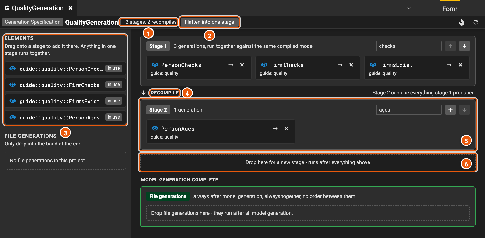
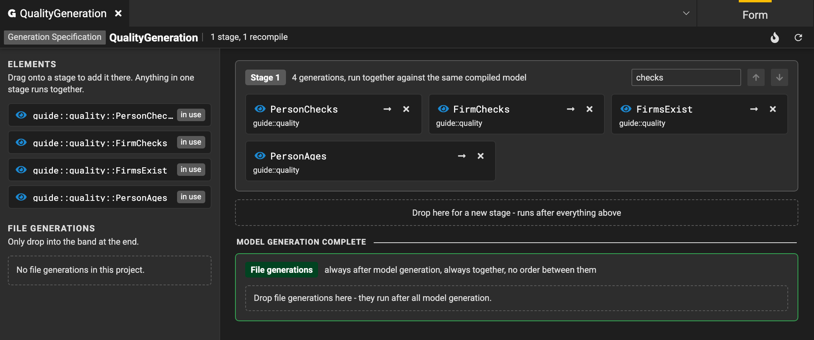

# Generation specifications

A generation specification runs a project's model generations when the project builds, in stages, and its file
generations after them. Each stage costs the build a compile of the whole project, so putting the generations that
don't need each other in one stage makes the build faster. Here, **QualityGeneration** runs four data quality checks
of the guide's database in two stages.

## The stages

[](./images/generation-specification.png)

1. **The count**: how many stages the specification has, and how many times the build compiles the project to run
   them, one per stage.
2. **Flatten into one stage** moves every generation into stage 1 (see [One stage](#one-stage)).
3. **Elements**: the project's elements that generate models, each marked **in use** once a stage runs it. Drag one
   onto a stage to add it there. They come from extensions to Legend Studio, such as data quality, so a Legend Studio
   without them lists none.
4. **Recompile**: after each stage, the build compiles the project again, with what the stage generated, so the next
   stage can use it.
5. **A stage**: its generations run together, against the same compiled project, so none of them can use what another
   one generates. The field at the top right names the stage, and its arrows **Run this stage earlier** or **Run this
   stage later**. On a card, the arrow opens the element and **Remove from this stage** takes it out. A stage goes once
   nothing is left in it.
6. **Drop here for a new stage**: an element dropped here gets a stage of its own, which runs after everything above.

File generations, below **Model generation complete**, run after all the stages, together, and add no compile.

## One stage

**Flatten into one stage** puts every generation in stage 1, so the build compiles the project once for them all, and
the count reads **1 stage, 1 recompile**.

[](./images/generation-specification-one-stage.png)

Flatten only when no generation needs another one's output. One that does then fails, and its card offers to move it
back into a stage of its own. Legend Studio doesn't offer **Flatten into one stage** when two stages run the same
element, or when the specification is read-only.

## What can share a stage

- **A generation that uses another one's output** needs a later stage than it.
- **Two generations in one stage can't generate the same element.** The build fails, naming both.
- **Merging two stages can turn a warning into a failure.** When generations in two stages generate the same element,
  the build keeps the first one and warns; in one stage, it fails.
- **An element runs once per stage.** It may be in more than one stage, marked **in N stages** under **Elements**.

## In text mode

In [text mode](./editor.md#text-mode), each stage is a node of `generationNodes`. `generationElements` lists the
generations of a stage that runs several, `generationElement` names a stage's only one, and `id` names the stage:

```pure
###GenerationSpecification
GenerationSpecification guide::quality::QualityGeneration
{
  generationNodes: [
    {
      id: 'checks';
      generationElements: [
        guide::quality::PersonChecks,
        guide::quality::FirmChecks,
        guide::quality::FirmsExist
      ];
    },
    {
      id: 'ages';
      generationElement: guide::quality::PersonAges;
    }
  ];
}
```

A stage without an `id` is named after its elements, separated by commas.
