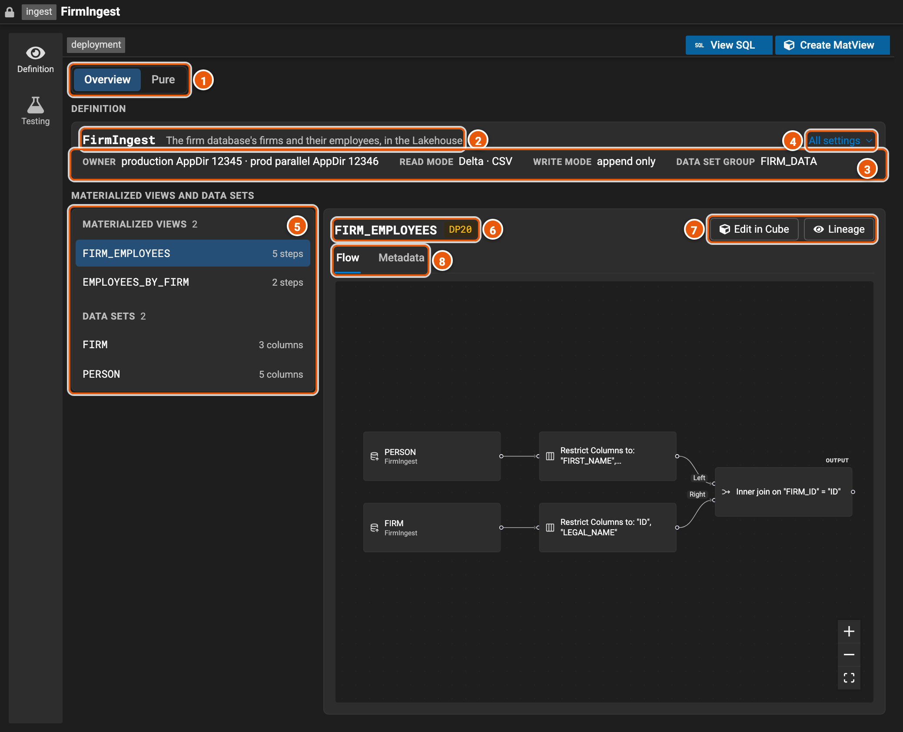
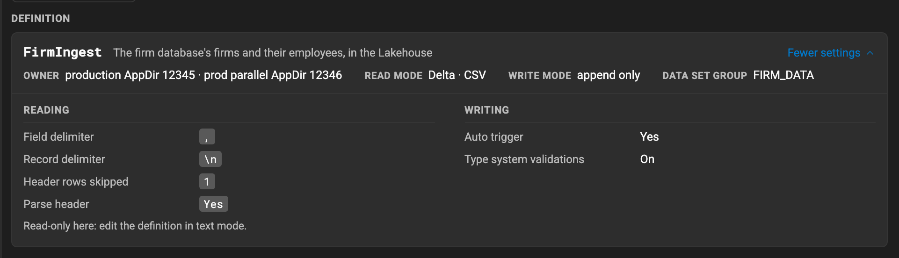
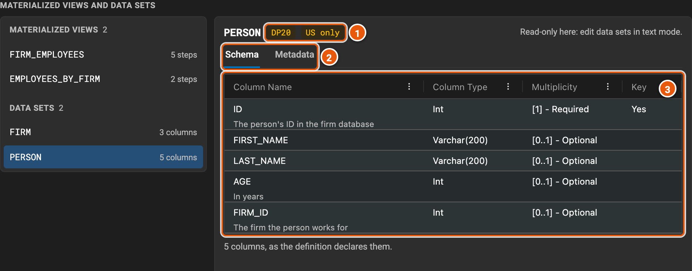
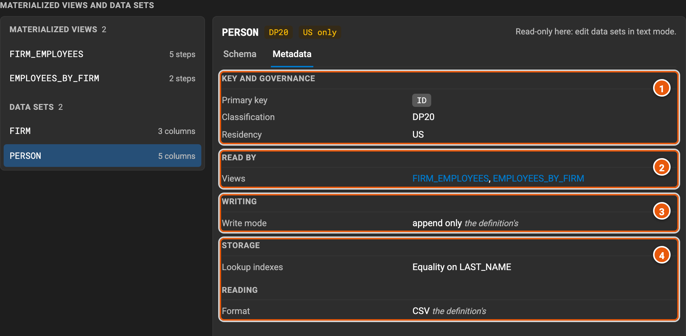

# Ingest definitions

An ingest definition brings data into the Lakehouse. Its data sets are the tables producers send files to, and its
materialized views are tables the Lakehouse computes from them, each with a function. Data products publish them in
their access points. Here, **FirmIngest** brings the firm database's two tables into the Lakehouse, as the data sets
**FIRM** and **PERSON**, and computes two views of them: **FIRM_EMPLOYEES**, each person with their firm's name, and
**EMPLOYEES_BY_FIRM**, how many people each firm employs.

Legend Studio shows an ingest definition read-only. A view is built and changed in Legend Cube, and everything else is
written in [text mode](./editor.md#text-mode).

## Overview

The editor opens on the definition's **Overview**: the definition first, then its materialized views and data sets.

1. **Overview** and **Pure**: **Pure** shows the whole definition in the Legend language instead.
2. **The definition**: its name and its doc.
3. **Its main settings**, which every data set follows unless it sets its own: **Owner**, the deployments that own it;
   **Read mode**, how it reads the files it is sent, and their format; **Write mode**, how it writes them; and **Data
   set group**. A definition that names its compute shows it here too.
4. **All settings** opens the definition's other settings (see [All settings](#all-settings)).
5. **Its materialized views**, each with its number of steps, then **its data sets**, each with its number of columns.
   Click one to show it on the right.
6. **The view**: its name and the classification of its data.
7. **Edit in Cube** opens the view in Legend Cube, to change it. **Lineage** shows where its columns' data comes from.
8. **Flow** shows the view's function as Legend Cube draws it, read-only: here, the people's names and firm, joined to
   each firm's name. **Metadata** shows the rest of what the view says: its key, its classification, the data sets it
   reads (under **Reads**), and how it is written and stored. A view Legend Cube can't draw yet says why, and shows its
   function in the Legend language instead.

Above the Overview, **Create MatView** builds a new view in Legend Cube, from the project's data sets (see
[Building a view in Legend Cube](#building-a-view-in-legend-cube)). **View SQL** shows
what the engine generates for the views: each view's columns and its SQL. On **Pure**, the header also has **Lineage**,
for the first view, and the arrow beside **Create MatView** opens any view in Legend Cube.

## All settings

**All settings** opens the definition's other settings below its main ones, in groups: who runs it, the options of its
files' format (here, the CSV files' delimiters and header), how it writes, its batches, and its annotations. A group the
definition sets nothing in isn't shown. **Fewer settings** closes them.

## Data sets

Click a data set to show it. **Schema** shows its columns, and **Metadata** the rest of what it says. The tab stays as
you click another data set, so you can compare them.

1. The classification of its data, and where the data must stay: here, in the US.
2. **Schema** and **Metadata**.
3. **Its columns**: their names, their types, how many values each holds, and whether it is in the data set's key. A
   column's description shows under its name. The columns its write mode adds, such as a batch milestoned data set's
   **LAKE_IN_ID** and **LAKE_OUT_ID**, come last, greyed out.

1. **Key and governance**: its primary key, its classification and its residency.
2. **Read by**: the views that read it. Click one to show it.
3. **Writing**: its write mode, and, where it says so, which rows count as deleted. A setting it takes from the
   definition says _the definition's_; one it sets itself says _its own_.
4. **Storage**: how it is partitioned and clustered, and its lookup indexes. **Reading**: its files' format, and the
   steps that clean them before they are written.

A definition with no materialized views opens on its Overview too, on its first data set. **Create MatView** builds its
first view.

## Building a view in Legend Cube

**Create MatView** opens Legend Cube on the project's data sets, to build a new view, and a view's **Edit in Cube** opens
its function, to change it. The step that runs becomes the view:

- **Add MatView** asks for the new view's name, the classification of its data and its primary key, among the step's
  columns, then adds it to the definition.
- **Save MatView** puts the step in place of the view's function. It asks again only for what the view can't be saved
  with as it was: the classification of its data, or a primary key whose column is gone.
- **×** closes Legend Cube, adding or saving nothing.

The [Legend Cube guide](https://legend.finos.org/guides/cube) explains Legend Cube's steps.
