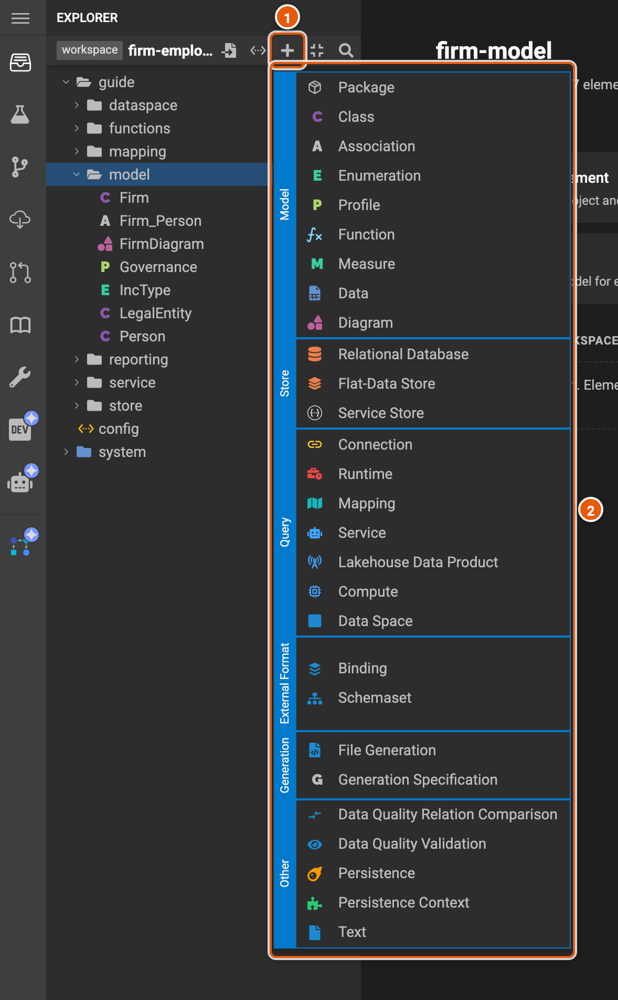
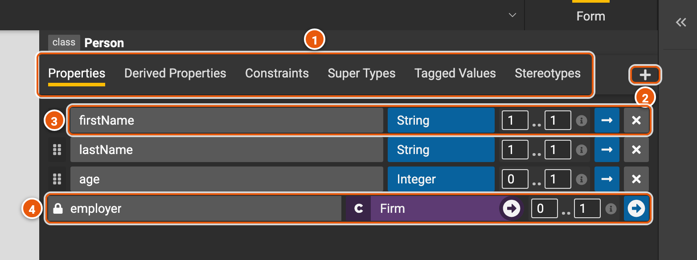
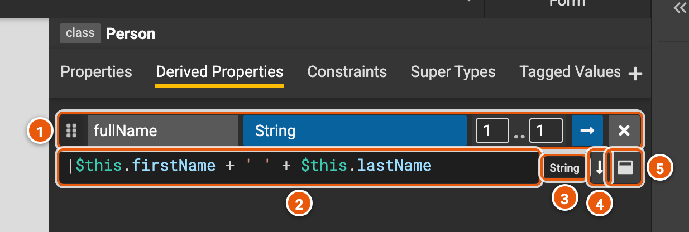
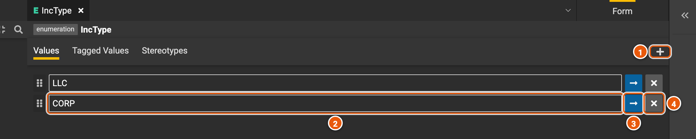
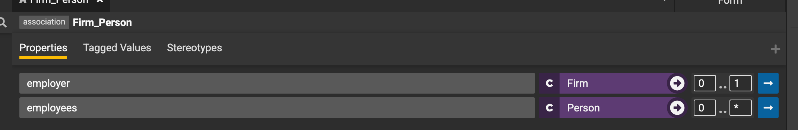
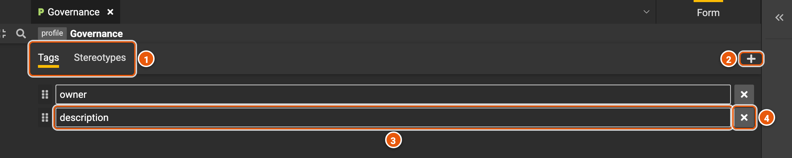
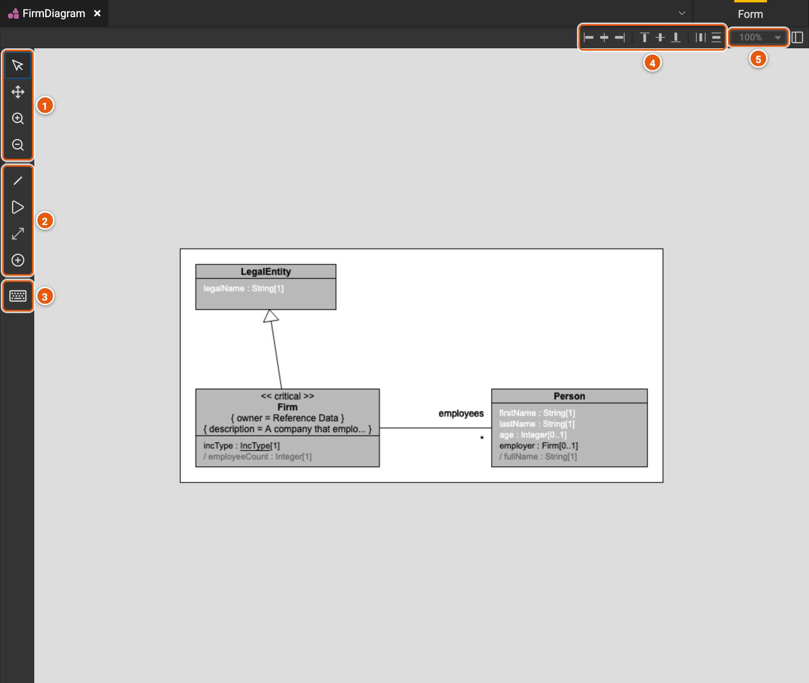

# Modeling

A model describes your data: the business concepts it holds, such as a firm and the people it employs, what each one
has, and the rules the data must follow. This page shows the elements a model is made of and their editors: classes,
enumerations, associations, profiles and diagrams.

## Create an element

Pick the package to create the element in, then click **New Element...** (Ctrl+Shift+N) at the top of the explorer.
Right-clicking a package lists the same kinds.

1. **New Element...**: opens the menu.
2. **The kinds of element** you can create, by group: **Model**, **Store**, **Query**, **External Format**,
   **Generation** and **Other**. With no package picked, the menu has **Package** only.

Pick a kind, then type the element's name, and **Create**. Type `::` to create it in a new package, as in
`reporting::Address`.

## Classes

A class is a business concept, such as a person. Its editor has a tab for each part of it.

1. **The tabs**:
   - **Properties**: the class's attributes.
   - **Derived Properties**: values computed from the others (see below).
   - **Constraints**: rules the class's data must follow (see below).
   - **Super Types**: the classes it extends. It has their properties too.
   - **Tagged Values** and **Stereotypes**: information about the class, from a [profile](#profiles).
2. **Add**: adds a property, or what the open tab lists.
3. **A property**, from left to right: drag the handle to reorder it; its name; its type, a primitive type such as
   **String** or **Integer**, an enumeration or a class, with an arrow to visit it; its multiplicity, from at least to
   at most, such as `0..1` for an optional value or `0..*` for a list (point at ⓘ for what it means); **See detail**, for
   the property's own tagged values and stereotypes; and **Remove**.
4. **A property from an association**: the lock shows it is defined elsewhere, in the association; the arrow visits
   it.

### Derived properties and constraints

A derived property is computed by an expression, written in the Legend language, from the class's other properties.
Here, a person's **fullName** joins their first and last names.

1. **Its name, type and multiplicity**, as for a property.
2. **The expression**, where `$this` is the instance of the class. A syntax error shows under it as you type; other
   errors show when you compile.
3. **The type the expression returns**.
4. **Toggle Expand**: more lines for a long expression.
5. **Open in a popup...**: edits the expression in a larger editor.

The **Constraints** tab works the same way: each constraint has a name and an expression that must be true, such as
`$this.age->isEmpty() || ($this.age->toOne() > 0)` for a person whose age, if known, is positive.

## Enumerations

An enumeration is a type with a fixed list of values, such as the kinds of firm.

1. **Add enum value**.
2. **A value**: type to rename it.
3. **See detail**: the value's tagged values and stereotypes.
4. **Remove** the value.

## Associations

An association links two classes and adds a property to each end. Here, **Firm_Person** gives a firm its
**employees** and a person their **employer**. Each end has a type and a multiplicity, as a property does.

## Profiles

A profile declares the tags and stereotypes that classes, properties and other elements can use. A tag gets a value
on the element, such as an **owner**; a stereotype is a label, such as **critical**.

1. **Tags** and **Stereotypes**: one list each.
2. **Add** a tag, or a stereotype.
3. **A tag**: type to rename it.
4. **Remove** it.

On a class, the **Tagged Values** tab picks a profile and one of its tags, then takes the value; the **Stereotypes**
tab picks a profile and one of its stereotypes.

## Diagrams

A diagram draws classes and the links between them. Diagrams aren't drawn for you: you add the classes each one is
about, by dropping them from the explorer onto it, or with the add class tool.

1. **View** (V), to select and move classes, **Pan** (M), to move around the diagram, and **Zoom In** and **Zoom
   Out**.
2. Tools that draw on the diagram: **Property** (P), a property from one class to another; **Inheritance** (I), a
   super type; and **Add class** (C).
3. **Show Hotkeys**: every keyboard shortcut of the diagram.
4. **Align** the selected classes, left, center or right, top, middle or bottom, and **space** them evenly.
5. **The zoom level**.
