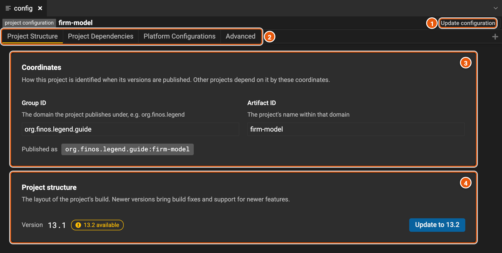
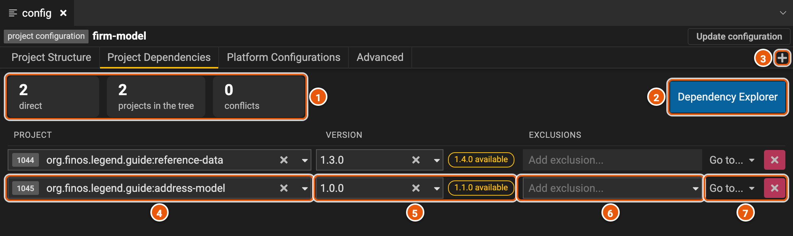
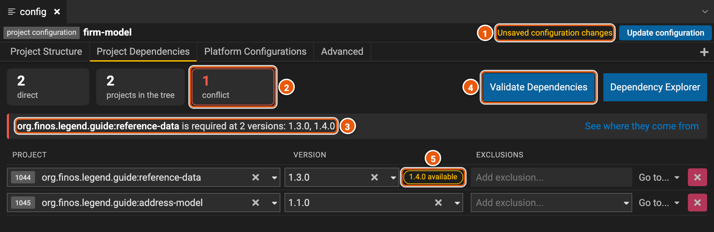
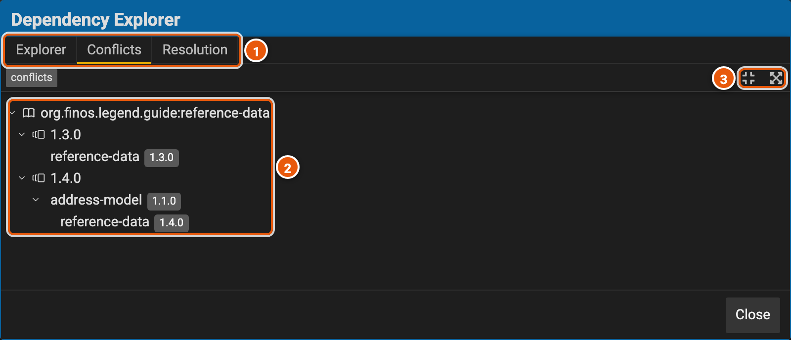
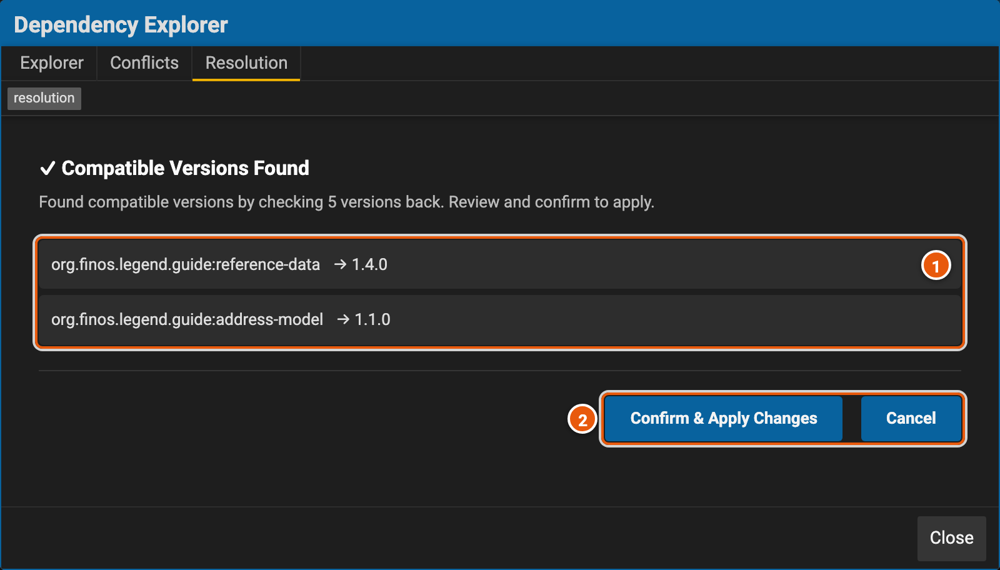
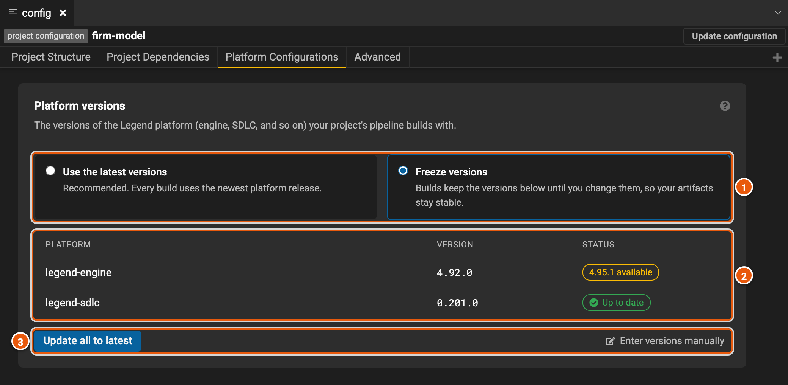
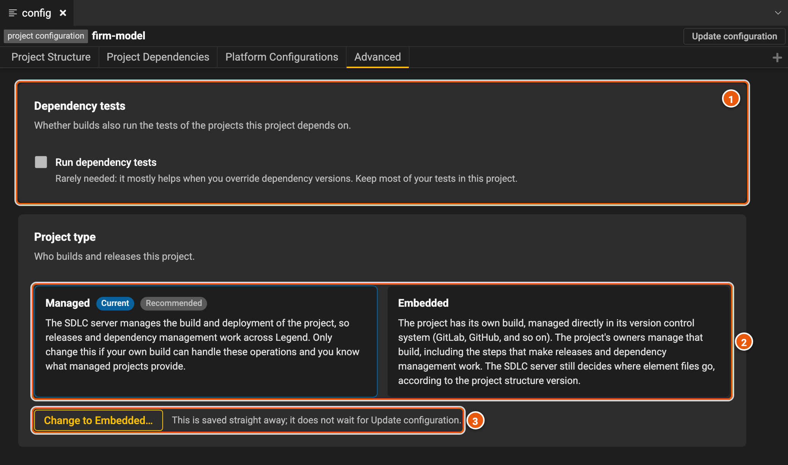

# Project configuration

A project's configuration says how the project is published and built: its coordinates, its project structure, the
projects it depends on, the versions of the Legend platform it builds with, and who builds it. Open it with **Project
Configuration Panel**, in the explorer's actions, or with **config**, in the explorer (see [The editor](./editor.md)).
Here, **firm-model** depends on two other projects of the guide: **reference-data**, for countries and currencies, and
**address-model**, for addresses.

## Project structure

The configuration first opens on **Project Structure**.

1. **Update configuration** saves your changes (see [Save your changes](#save-your-changes)). It works once you've
   changed something.
2. **The tabs**: **Project Structure**, **Project Dependencies**, **Platform Configurations** and **Advanced**. An
   embedded project has no **Platform Configurations** (see [Advanced](#advanced)).
3. **Coordinates**: the **Group ID** and the **Artifact ID** the project's versions are published under, which
   **Published as** shows together: `org.finos.legend.guide:firm-model`. Other projects depend on the project by them.
   Changing either one starts a new artifact: the earlier versions stay under the old coordinates, and the projects
   that depend on this one must be updated. The section warns you as soon as you change them.
4. **Project structure**: the version of the project's build layout, here **13.1**. It shows **Up to date**, or
   the SDLC server's latest version, such as **13.2 available**. Newer versions bring build fixes and support for newer
   features. **Update to 13.2** updates the project to it at once, without **Update configuration**.

## Project dependencies

A project uses other projects' elements by depending on a version of each. The projects it depends on bring their own
dependencies with them, so the project depends on those too: they make its dependency tree. Their elements show in the
explorer, under **dependencies**, and you can't change them. Legend Studio gets their versions and the tree from the
depot, the server that holds the projects' released versions.

1. **The summary**: **direct**, the projects this one depends on itself; **projects in the tree**, every project it
   depends on, directly or through another one; and **conflicts**, the projects the tree holds at more than one version.
   Click **projects in the tree** to open the [dependency explorer](#the-dependency-explorer), and **conflicts** to open
   its conflicts.
2. **Dependency Explorer** opens the whole tree (see [The dependency explorer](#the-dependency-explorer)).
3. **+** adds a dependency. Pick its project and its version in the row it adds.
4. **Project**: the project depended on: its ID in the SDLC server, then its coordinates. Pick another one to depend
   on it instead.
5. **Version**: the version of the project depended on. **1.1.0 available** shows when the project has released a
   newer version: click it to use that one. The list has every version, newest first. **HEAD**, when the list has it,
   is the latest state of the project, not a release.
6. **Exclusions**: projects to leave out of what the dependency brings in. **Add exclusion...** lists the projects it
   depends on in turn. Each exclusion shows under the dependency's row, where **×** removes it. **Validate
   Dependencies** then updates the tree.
7. **Go to...** opens the project at that version in a new tab: as published (**Project**), or in its SDLC project
   (**SDLC project**). **×** removes the dependency.

## Update a dependency

Pick another version in a dependency's **Version**, or click its newer version, such as **1.1.0 available**. Legend
Studio gets the new tree from the depot at once. Here, **address-model** was updated to 1.1.0, which depends on
reference-data 1.4.0, while **firm-model** depends on reference-data 1.3.0:

1. **Unsaved configuration changes**: the configuration has changes you haven't saved. **Update configuration**, beside
   it, saves them.
2. **1 conflict**: a project the tree holds at two versions.
3. **The conflict**: the project, and its versions in the tree. **See where they come from** opens the dependency
   explorer on the paths that bring each version in.
4. **Validate Dependencies**, shown once you've changed the dependencies, gets the tree again, then checks that the
   project compiles with its dependencies' elements.
5. **1.4.0 available**: updating reference-data too ends the conflict, since both paths then bring in 1.4.0.

A project can't depend on two versions of the same project: Legend Studio can't load the dependencies' elements then.
When it opens a workspace whose dependencies it can't load, it says so, and opens **Project Dependencies** for you to
fix them.

## The dependency explorer

**Dependency Explorer** shows the project's dependency tree, on three tabs.

1. **The tabs**: **Explorer**, the tree itself, each project with its version; **Conflicts**, where each conflict comes
   from; and **Resolution**, versions of the dependencies that don't conflict.
2. **A conflict**: the project, each version of it the tree holds, and under each version, the paths that bring it
   in, from one of the project's own dependencies. Here, reference-data 1.3.0 is one of firm-model's own dependencies,
   and 1.4.0 comes through address-model 1.1.0.
3. **Collapse Tree** and **Expand All Conflict Paths**.

On **Explorer**, **View as Flatten List** lists the tree's projects in one list. In both trees, right-click a project
for **Visit Project** and **Visit SDLC Project**, which open it in a new tab.

**Resolve Compatible Dependencies**, at the top right of **Resolution**, asks the depot for versions of the project's
dependencies that don't conflict. It looks back through their latest versions: **versions to check** says how many, 5
unless you change it.

1. **The versions found** for the dependencies.
2. **Confirm & Apply Changes** sets the dependencies to them, as if you had picked them in **Version**. **Cancel**
   keeps your versions.

When it finds none, it lists the conflicting versions, the projects that require each one, and versions that may end
the conflicts.

## Platform configurations

A managed project's builds use the Legend platform: the engine, the SDLC, and so on. The SDLC server lists the
platforms, such as legend-engine, and their latest versions. Here, the project's versions were frozen a while ago, and
the SDLC server now has a newer legend-engine.

1. **Use the latest versions**, recommended: each build uses the newest platform release. **Freeze versions**: builds
   keep the versions below until you change them, so the project's artifacts stay stable. Picking it freezes the
   latest versions.
2. **The platforms**, each with its version and its status: **Latest** when the project uses the latest versions,
   **Up to date** when it's frozen at the latest one, and the latest version, such as **4.95.1 available**, when it's
   frozen at an older one. Click that to freeze the platform at the latest version.
3. **Update all to latest** freezes every platform at its latest version. It shows while one of them is behind. **Enter
   versions manually** lets you type the versions, after a warning: **Freeze at these versions** applies them, and
   **Cancel** drops them. Do it only to unblock a project for a while.

## Advanced

1. **Dependency tests**: **Run dependency tests** makes the project's builds also run the tests of the projects it
   depends on. It's rarely needed, mostly when you override dependency versions. Keep most of your tests in the project
   itself.
2. **Project type**: who builds and releases the project. **Managed**, recommended: the SDLC server manages the
   project's build and its deployment, so releases and dependencies work across Legend. **Embedded**: the project has
   its own build, in its version control system, which its owners manage, with the steps that make releases and
   dependencies work. The SDLC server still decides where element files go, by the project structure version.
3. **Change to Embedded…** changes the project type, after a warning, at once: it doesn't wait for **Update
   configuration**. When a managed project becomes embedded, the SDLC server stops managing its build files: its build
   is then its owners' job. When an embedded project becomes managed, its build files are deleted and replaced with the
   SDLC server's.

## Save your changes

Changes to the configuration aren't local changes: **Local Changes** doesn't list them, and **Push local changes**
doesn't save them. **Update configuration**, at the top right, saves them to the workspace, then Legend Studio loads
the workspace again. It asks first when you have local changes you haven't pushed, which would be lost, and when you
changed the **Group ID** or the **Artifact ID**.

**Update to** a newer project structure, and **Change to** another project type, don't wait for **Update
configuration**: they save their change at once.
