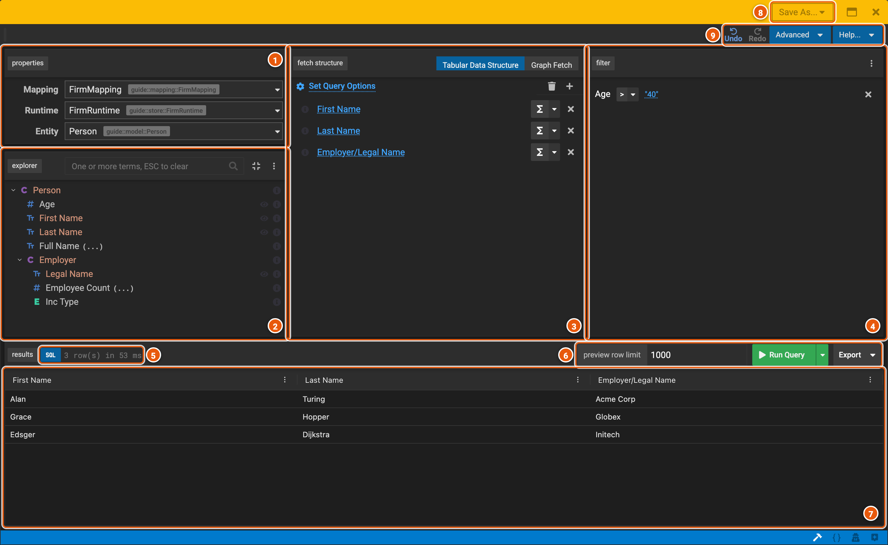
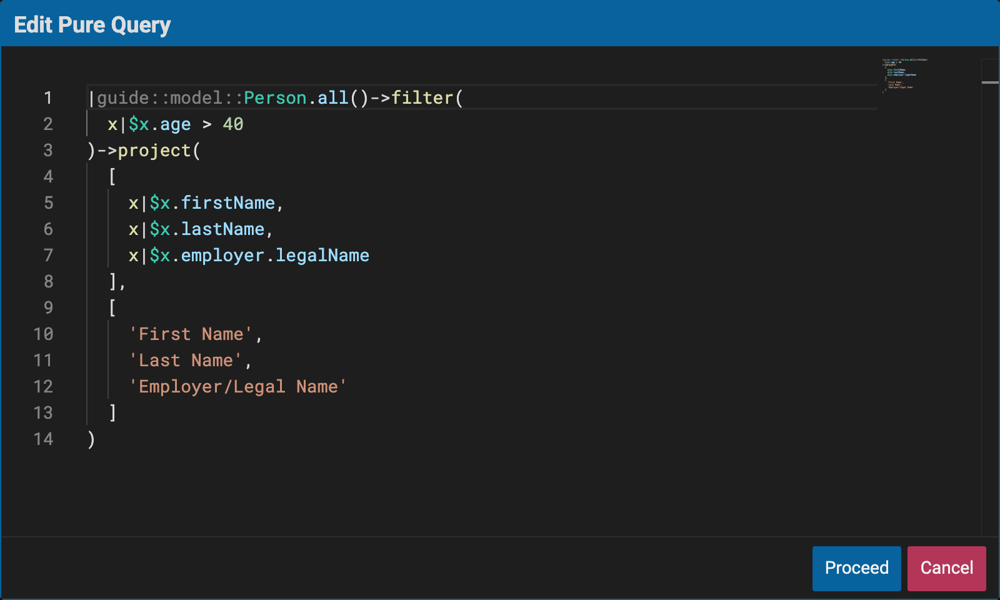
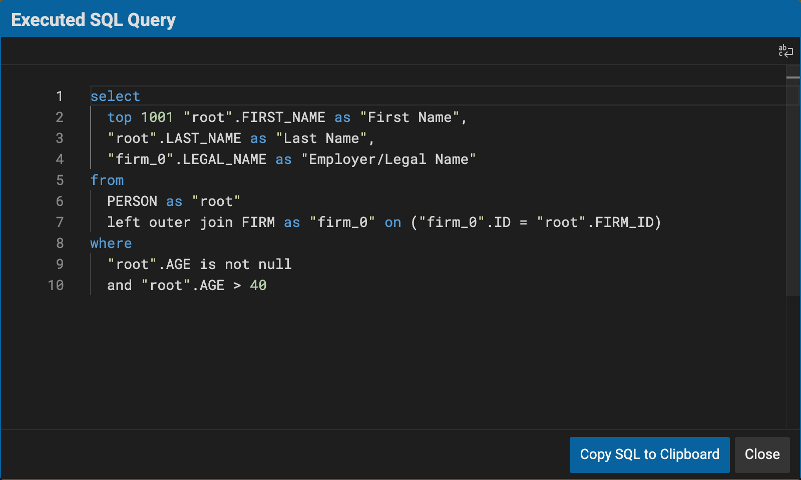

# Querying

The query builder runs a query on the model and shows what it returns, to see the data a class holds and check that
its mapping fills it as you expect. You build the query by dragging properties, and the query builder writes it in the
Legend language for you. The engine runs it on the store, through the mapping.

## Open the query builder

Right-click a class in the explorer, then **Query...**. The query builder opens on the class, with the first mapping
that maps it and the first runtime that can run that mapping. A mapping's tests and a service open their queries in the
same query builder, with **Edit Query**.

## Build a query

The query below lists the people over 40, with their first and last names and the name of the firm that employs them.
To build it, drag **First Name**, **Last Name** and, under **Employer**, **Legal Name** to the fetch structure, and
**Age** to the filter. Pick the operator `>`, click the value and type `40`, then **Run Query**.

1. **properties**: the **Mapping** and the **Runtime** the query runs with, and the **Entity**, the class it queries.
   Pick another in its list to change it.
2. **explorer**: the class's properties. A class among them, such as **Employer**, opens on a click to show its own
   properties: here, those of the firm a person works for, through the association. `(...)` marks a derived property.
   Type in the box to find a property. **Preview Data**, the eye beside a property, describes its values: for a number,
   its count, sum, smallest, largest and average; otherwise, its ten most common values.
3. **fetch structure**: what the query returns. **Tabular Data Structure** returns rows, with a column for each
   property dropped here; **Graph Fetch** returns the instances themselves, as JSON, with the properties you pick.
   **Σ** aggregates a column, such as to count or add up its values, grouped by the other columns. **Set Query
   Options** sorts the rows, removes duplicate rows and limits how many come back.
4. **filter**: the conditions the data must meet. Drag a property here for a condition, pick its operator, such as
   `>`, and click its value to change it. Several conditions are joined by **and**: click it to switch to **or**.
5. **SQL** shows the SQL the engine ran (see [The SQL](#the-sql)), beside how many rows came back and how long the
   query took.
6. **Run Query** runs the query, for at most **preview row limit** rows. The arrow beside it has **Generate Plan**,
   which shows the plan the engine makes to run the query, and **Debug**, which shows how it made it. **Export** saves
   the results as CSV.
7. **The results**: one row for each person over 40.
8. **Save As...**: saves the query in the workspace, as a function or a service (see [Save a query](#save-a-query)).
9. **Undo** and **Redo**. **Advanced** has more a query can do, such as parameters, constants and a filter on its
   results (**Show Post-Filter**), and **Edit Pure** (see below). **Help...** opens the assistant.

## The query in the Legend language

**Advanced** › **Edit Pure** shows the query as the query builder wrote it, in the Legend language. You can change it
there, then **Proceed**.

The query is a lambda, a function written in place: its parameters come before the `|`, and here it has none.
`Person.all()` takes every person, `filter` keeps those for whom `x|$x.age > 40` is true, `x` being the person, and
`project` makes a row of each, with three columns and their names.

## The SQL

**SQL**, above the results, shows the SQL the engine ran. The engine made it from the query and the mapping: the join
to **FIRM**, for the employer's name, is the mapping's join **FirmPerson**, and `top 1001` comes from the preview row
limit.

## Save a query

The query builder doesn't keep a query: closing it (×) warns that its changes will be lost. **Save As...** saves the
query in the workspace as a new element, which opens:

- **Function**: a function that runs the query, with its mapping and its runtime. It's named after the class, as in
  `Person_QueryFunction`, in the class's package. Type another name, or a path such as `reporting::olderEmployees`,
  then **Create**.
- **Service**: a [service](./services.md) that runs the query, with its mapping and its runtime. It's named after the
  mapping, as in `guide::mapping::FirmMappingService`. Type another path, then **Create**.
