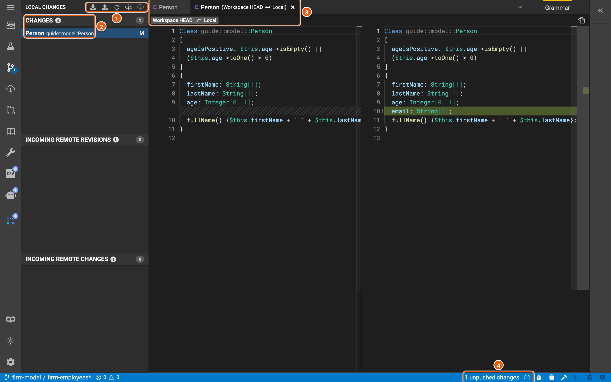
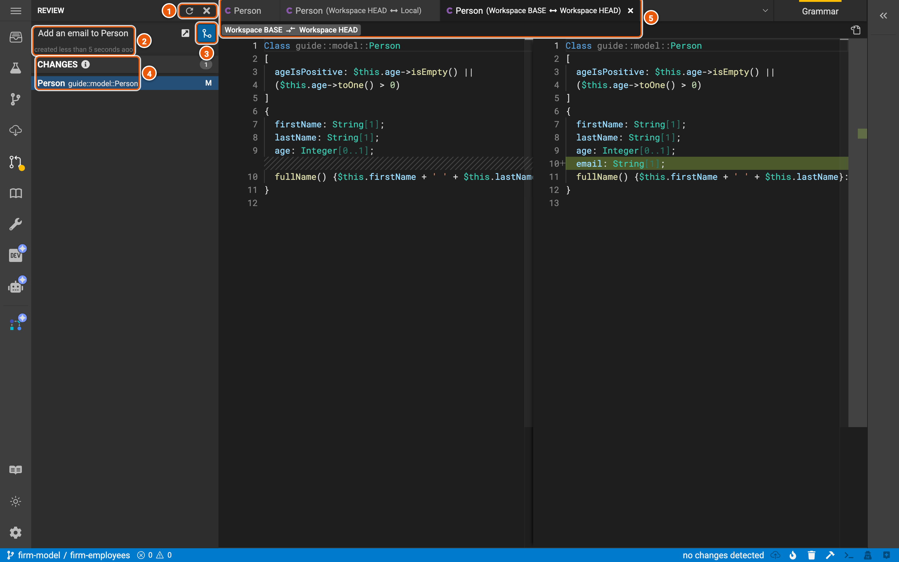
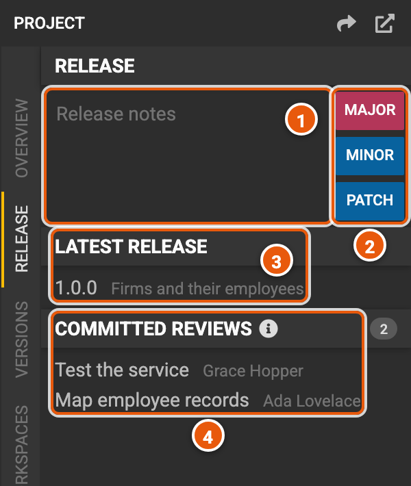

# Review and release

A change reaches the people who use a project in three steps. You push it to your workspace, the project's members
review it and commit it to the project, and a release makes a version of the project that other projects and
applications can depend on. Below, a change adds an email to **Person**, from the workspace **firm-employees** to the
project's next release.

## Local changes

What you change stays in your browser until you push it. The status bar counts it, and **Local Changes**
(Ctrl+Shift+G), in the activity bar, lists it.

1. **The panel's actions**: **Download local entity changes** saves your changes to a JSON file, and **Upload local
   entity changes** applies such a file's changes to the workspace. The others are **Refresh**, **Push local
   changes**, and **Pull remote workspace changes**, which brings in what others pushed to the same workspace.
2. **The changes**: each element you've changed, marked **N** when new, **M** when modified, **R** when renamed and
   **D** when deleted. Click one to see what changed. **Incoming remote revisions** and **Incoming remote changes**,
   below, list what others pushed to the workspace since you opened it.
3. **The difference**: the element as the workspace has it (**Workspace HEAD**), on the left, and as you've changed it
   (**Local**), on the right, where the new line shows in green.
4. **1 unpushed changes**: how many changes you haven't pushed. **Push local changes** (Ctrl+S) saves them to the
   workspace.

## Review

**Review** (Ctrl+Shift+M) asks for the workspace's changes to be committed to the project. Type a title, then
**Create review**. The SDLC server keeps the review as a merge request in the project's GitLab repository.

1. **Refresh**, and **Close review**, which closes it without committing it.
2. **The review**: its title and when it was created. The icon beside it opens the review in Legend Studio, where the
   project's members see its changes and **Approve review**.
3. **Commit review** commits the changes to the project, once the review is approved as the project requires. Legend
   Studio then offers to create the workspace again, from the project's latest revision.
4. **The changes** the review commits: what the workspace changed since it was created. Click one to see what changed.
5. **The difference**: the element when the workspace was created (**Workspace BASE**) and now (**Workspace HEAD**).

## Update your workspace

**Update Workspace** (Ctrl+Shift+U) lists what others committed to the project since your workspace was created: its
changes, and the reviews that committed them. **Update workspace** brings them into your workspace.

## Release a version

**Project**, in the activity bar, has the project's overview, its releases, its versions, its workspaces and its
patches. **Release** makes a new version of the project from its latest revision.

1. **Release notes**: what the version brings.
2. **MAJOR**, **MINOR** and **PATCH** create the version, numbered after the latest: a major release for changes that
   aren't backward compatible, a minor one for backward-compatible features, and a patch for backward-compatible
   fixes.
3. **Latest release**: the project's latest version and its notes. Click it to view the project at that version.
4. **Committed reviews**: the reviews committed since the latest release, which the new version brings.

**Versions** lists every version of the project. Other projects depend on a version, in their project configuration.
