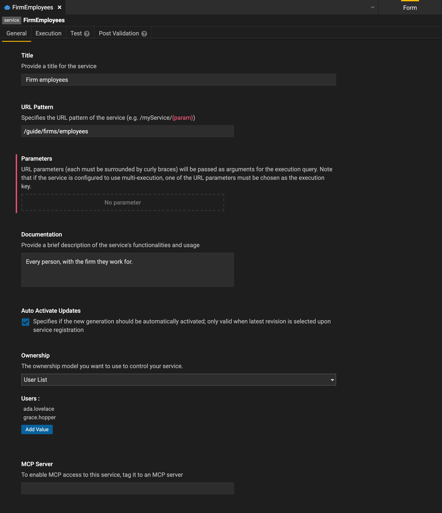
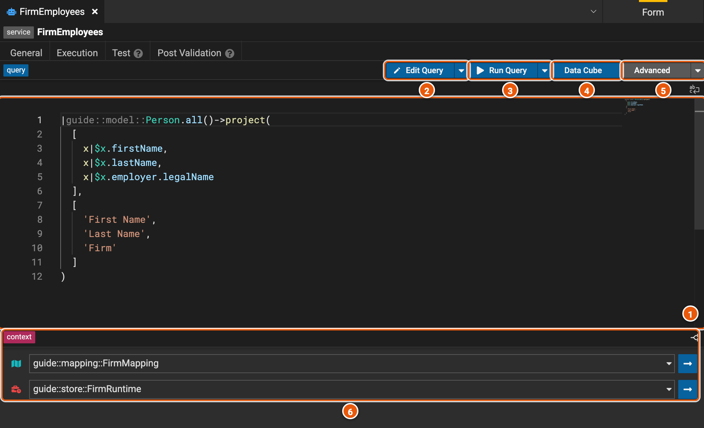
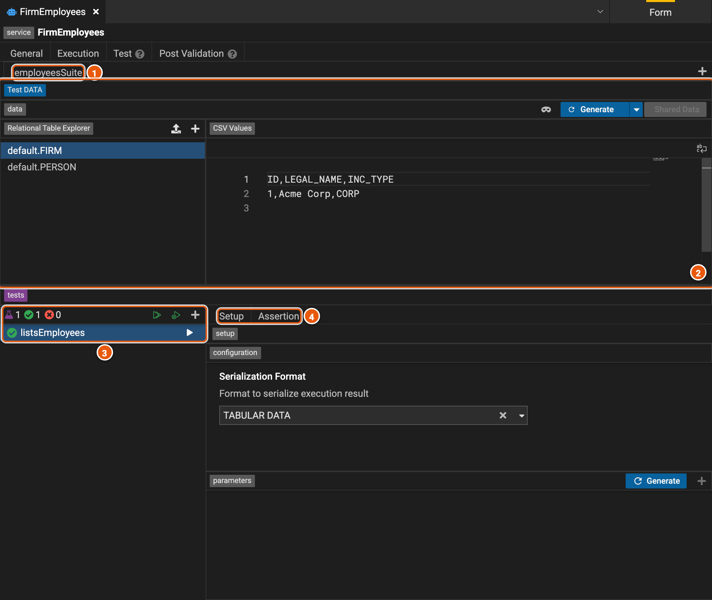

# Services

A service gives a query to applications: it runs the query, with a mapping and a runtime, at a URL of its own, and its
tests check what it returns. Once the service is registered on an execution server, applications call it at that URL.
The screenshots show the service **FirmEmployees**, which lists every person with the firm they work for.

To create a service, save a query from the query builder with **Save As...** › **Service** (see
[Querying](./query.md#save-a-query)), or pick **Service** in **New Element...**, with a mapping and a runtime, then
build its query with **Edit Query**.

## General

- **Title**: the service's name, for people.
- **URL Pattern**: the path the service answers at, such as `/guide/firms/employees`. A part in braces, as in
  `/firms/{firm}`, is a parameter: its value, from the URL, goes to the query's parameter of the same name.
- **Parameters**: the URL pattern's parameters.
- **Documentation**: what the service returns, and how to use it.
- **Auto Activate Updates**: when the service is registered from the project's latest revision, each new registration
  of it is used at once.
- **Ownership**: who owns the service: a **User List** of people, or a **Deployment**, by its deployment identifier.
- **MCP Server**: tags the service to an MCP server, so AI tools can call it through that server.

## Execution

1. **The query** the service runs, in the Legend language. You can't type in it here: change it with **Edit Query**.
2. **Edit Query** opens the query in the query builder (see [Querying](./query.md)). The arrow beside it has **Text
   Mode**, to open it as Legend language text.
3. **Run Query** runs the query and shows what it returns, as JSON. The arrow beside it has **Generate Plan**, the
   plan the engine makes to run the query, **View Lineage**, where each column's data comes from, and **Debug**.
4. **Data Cube** shows what the query returns in DataCube, to sort, filter, group and pivot it.
5. **Advanced**: **Import Query** replaces the service's query with a query saved in Legend Query, and **Create an
   Ad-hoc Query** opens the service's query in Legend Query, when Legend Studio knows where Legend Query is.
6. **context**: the mapping and the runtime the query runs with. Pick another in its list to change it; the arrow
   beside it opens it.

## Test

A service's tests run its query on data of their own, given for each connection of its runtime, and check what it
returns. Here, the suite **employeesSuite** has one test, **listsEmployees**, and it has just passed.

1. **The suites**: one tab each. **+**, at the right, adds a suite.
2. **The test data**: for each connection, the rows each table holds, as CSV. Pick a table under **Relational Table
   Explorer** to see its rows. **Generate** makes test data for the query, when it can, and **Shared Data** uses rows
   kept in a data element instead.
3. **The tests**: how many, how many passed and how many failed, then **Run Suite Tests**, **Run All Failing Tests**
   and **Add Service Test**. The arrow beside a test runs it.
4. **Setup**: the format the test compares the result in (**Serialization Format**), and the values it gives the
   query's parameters, which **Generate** fills in. **Assertion**: what the test expects, and whether it passed.

The [Test Runner](./tests.md#the-test-runner) runs a service's tests with the project's others.

## Post Validation

**Post Validation** holds checks on the data the service returns. Each one gives values for the service's parameters,
and assertions that list the rows breaking a rule: a check passes when they list none. Unlike tests, they run on the
real data, through the service's mapping and runtime.
