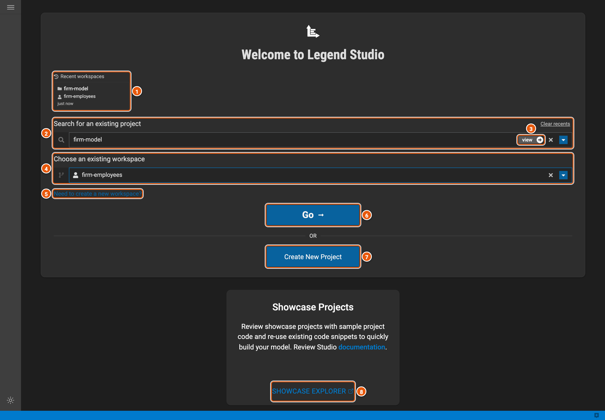
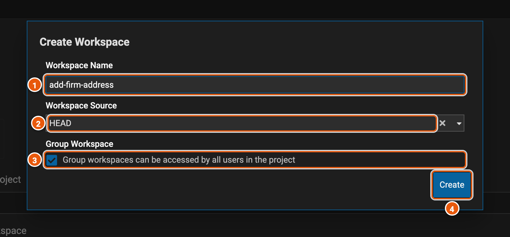

# Projects and workspaces

A project holds a model and everything built on it. You don't change a project directly: you change it in a
workspace, a copy of the project kept as a branch of its GitLab repository. When your changes are reviewed and
approved, they are committed to the project.

Legend Studio opens on its start screen, where you pick a project and one of its workspaces.

Click the image to see it full size.

1. **Recent workspaces**: the workspaces you opened last. Click one to open it again. **Clear recents**, above the
   project search, empties the list.
2. **Search for an existing project**: type part of a project's name, then pick the project from the list.
3. **view**: opens the project read-only, without a workspace.
4. **Choose an existing workspace**: your workspaces in the project, and its group workspaces, which everyone in the
   project shares.
5. **Need to create a new workspace?**: creates a workspace in the project (see below).
6. **Go**: opens the workspace in the [editor](./editor.md).
7. **Create New Project**: creates a project.
8. **Showcase explorer**: small working projects, one for each Legend feature, to read and copy from.

## Create a workspace

Pick the project, then click **Need to create a new workspace?**.

1. **Workspace Name**: a name for your change, such as `add-firm-address`.
2. **Workspace Source**: where the workspace starts. **HEAD** is the project as it is now. A `patch/` source starts
   from a released version, to fix that version.
3. **Group Workspace**: ticked, the workspace is shared, so everyone in the project can open it and push changes to
   it. Untick it for a workspace of your own.
4. **Create**: creates the workspace and opens it.
