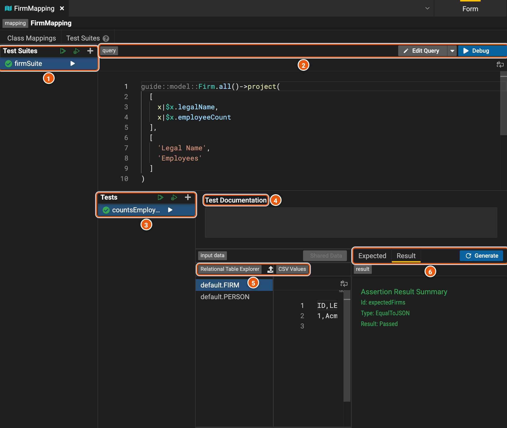
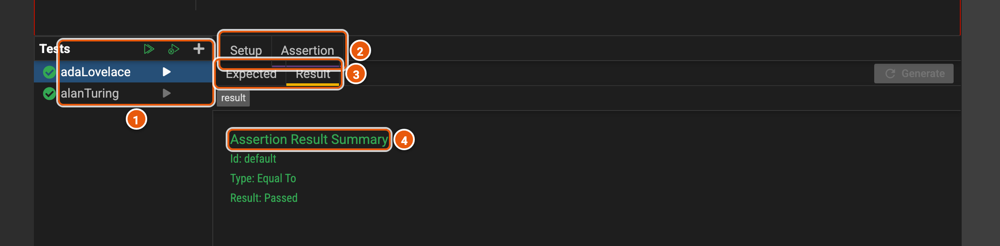
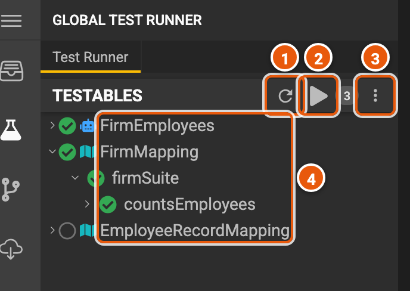

# Tests

Mappings, services and functions have test suites. Each test gives the data to run on and says what result to expect,
so a change that breaks a mapping or a service shows up before anyone depends on it. You run tests in Legend Studio,
and the project's build runs them all again.

## A mapping's tests

A mapping's **Test Suites** tab holds its suites. A suite has a query, and tests that run it on data of their own.
Here, the suite **firmSuite** of **FirmMapping** counts each firm's employees, and its test has just passed.

1. **The suites**: **Run All Suites**, **Run All Failing Tests** and **Add Mapping Suite**. A tick shows a suite that
   passed, a cross one that failed.
2. **The query** the suite's tests run. **Edit Query** opens it in the query builder, and **Debug** runs the selected
   test and shows what the engine returned, to find out why a test fails.
3. **The suite's tests**: **Run All Tests**, **Run All Failing Tests** and **Add Mapping Test**, and the arrow beside
   each test runs it.
4. **Test Documentation**: what the test checks, in words.
5. **The input data**: the rows each table holds for the test, written as CSV. **Import CSV** and **Add Relational
   Table Data** add a table's rows. **Shared Data** uses rows kept in a data element, which several tests can share;
   it needs a data element in the project.
6. **Expected** is the result the test expects, and **Result** shows whether it passed. **Generate** fills in
   **Expected** by running the query on the input data.

## A function's tests

A function's **Test Suites** tab works the same way. Here, the tests of **initials** check that it turns `'Ada'` and
`'Lovelace'` into `'AL'`.

1. **The tests**: **Run All Tests**, **Run All Failing Tests** and **Add Function Test**.
2. **Setup** gives the values the test passes to the function; **Assertion** says what it expects.
3. **Expected** and **Result**.
4. **The result**: whether the test passed and, when it fails, the difference between what it expected and what came
   back.

A service's tests are on its own editor: its query runs on test data for each of its connections.

## The Test Runner

**Test Runner**, in the activity bar, runs every test of the project at once.

1. **Reset** clears the results.
2. **Run All Tests**, beside how many elements have tests.
3. **The options menu**, such as to also run the tests of the projects this one depends on.
4. **The project's services and mappings**, with their suites and tests: a tick when they passed, a cross when they
   failed. **EmployeeRecordMapping** has no tests yet.
