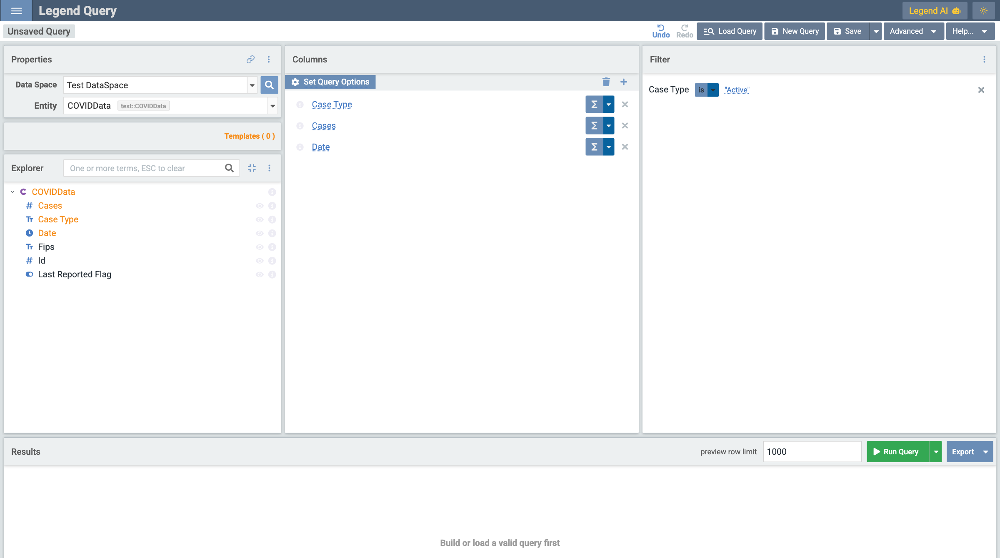
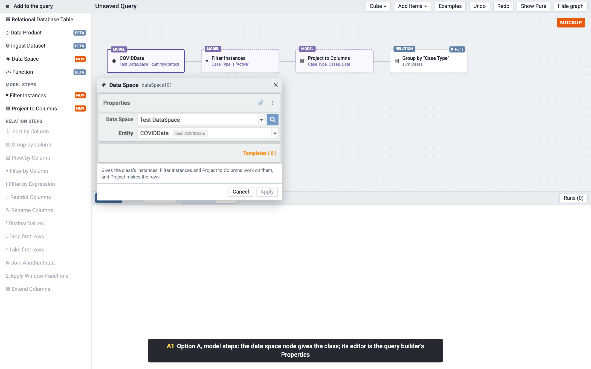
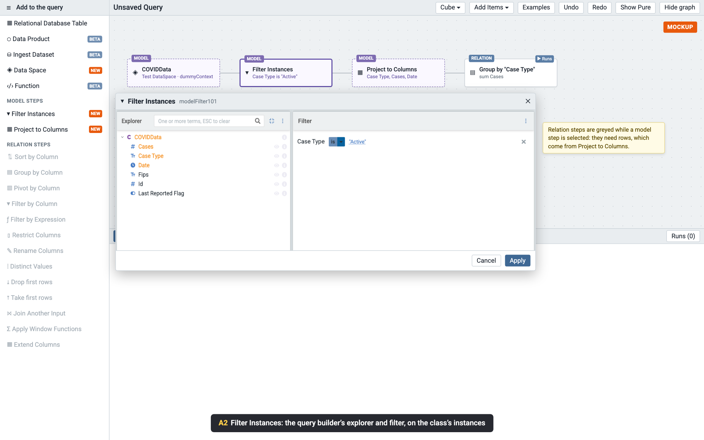
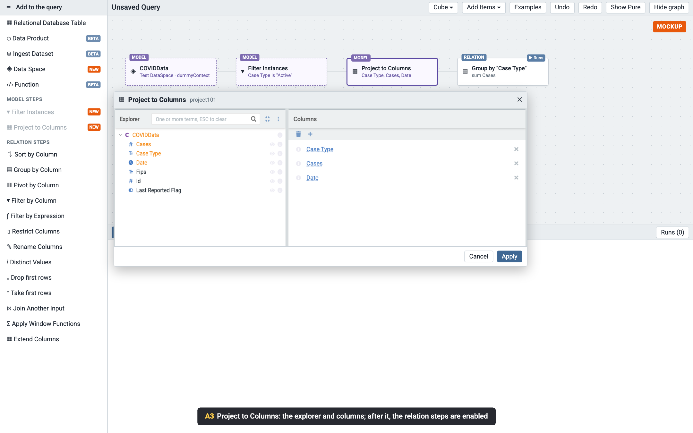
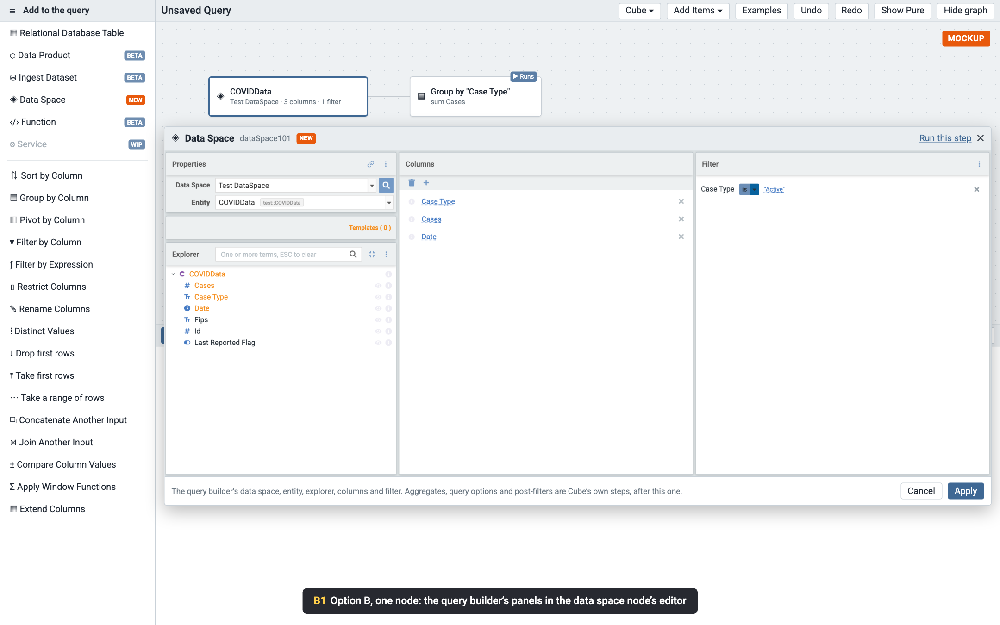

# Legend Cube: a data space as a source (proposal, for feedback)

> **Status:** two proposals, 2026-10-21, for feedback. Nothing is built. The screenshots are mockups: the query builder's
> panels in them are real, captured from Legend Query, and placed into Legend Cube's graph and editors.

## Why

A Legend Cube query starts from a source: today a database table, a data product, an ingest data set or a function.
In Legend Query, a model is usually reached through a **data space**: a curated entry point that names a model's
classes, its execution contexts (a mapping and a runtime each), and its template queries. This proposal adds a data
space as a source.

Legend Query already has the experience people know for this: pick a data space, pick an entity (a class), then choose
its properties as columns in the explorer, and filter them. Rather than build that again, Cube would **reuse Legend
Query's query builder** (`legend-query-builder`, and the data space query builder of `legend-extension-dsl-data-space`).

Only part of it, though. Cube already has its own steps for the rest, so a data space source would show:

| Shown                                               | Not shown: Cube's own steps do it, after the source                                     |
| --------------------------------------------------- | --------------------------------------------------------------------------------------- |
| Data space, entity, templates                       | Aggregates on columns (Group by Column)                                                 |
| The explorer (the class's properties, associations) | Query options: sort, limit, distinct (Sort by Column, Take first rows, Distinct Values) |
| Columns (the projection)                            | Post-filter (Filter by Column, Filter by Expression)                                    |
| Filter (the pre-filter, on the class's instances)   | Window functions (Apply Window Functions)                                               |
|                                                     | Results (Cube's grid)                                                                   |

This is the query builder as Legend Query shows it today, on a test data space:

There are two ways to put it into Cube's graph.

## Option A: model steps

The data space is the first node of a **model** source: it gives the class's instances. Model steps work on the
instances (**Filter Instances**, **Project to Columns**), and Project to Columns turns them into rows, after which
Cube's relation steps (sort, group, join and the rest) take over. While a model step is selected, the relation steps
are disabled in the palette; after Project to Columns, the model steps are.

**The data space node:** its editor is the query builder's Properties panel (data space, entity, templates).

**Filter Instances:** the explorer and the query builder's filter.

**Project to Columns:** the explorer and the columns; after it, the relation steps are enabled.

## Option B: one node

The data space is **one node**, whose editor is the query builder: Properties, Explorer, Columns and Filter, side by
side. The node gives the projected columns, and Cube's steps follow it as they follow any source.

## How they compare

|                                                          | A: model steps                                                                                                                                                                                                              | B: one node                                         |
| -------------------------------------------------------- | --------------------------------------------------------------------------------------------------------------------------------------------------------------------------------------------------------------------------- | --------------------------------------------------- |
| **On the graph**                                         | Every operation is a node, as elsewhere in Cube                                                                                                                                                                             | The source's filter and columns are inside one node |
| **Reusing the query builder**                            | Splits it: the query builder keeps the explorer, columns, filter, dates and parameters in one state (`QueryBuilderState`), so each model node would show one panel of the same state, or model steps would be written again | Uses it whole, as Legend Query does                 |
| **Model nodes in practice**                              | Since they share one state: one filter and one projection per source, in that order; no second filter, no reordering, no branching                                                                                          | Not needed                                          |
| **Cube's core**                                          | A second kind of value between nodes (instances, not rows): type checking, validation, the Pure it writes, the canvas and the saved format all change                                                                       | Unchanged: the node is a source that gives rows     |
| **Later model operations** (e.g. more model-level steps) | A natural place for them                                                                                                                                                                                                    | Would go inside the node, or need A later           |

**Recommendation: B.** It reuses the query builder as it is, keeps Cube's core as it is, and A's separate nodes would
not be independent anyway, since they share the query builder's one state. A remains possible later, if model-level
steps beyond filter and projection are wanted.

## What both need

- **Embedding the query builder in Cube.** `legend-cube-builder` doesn't depend on `legend-query-builder` today (its
  README's rule). Either the host application (Legend Analytics) provides the data space editor to Cube, as it already
  provides the data product and ingest catalogs, so the builder package keeps no dependency on the query builder; or
  the builder depends on it directly. The first is recommended.
- **The project's model in the browser.** The query builder builds the data space project's model in the browser, as
  Legend Query does, so opening the editor takes as long as opening the data space in Legend Query. Cube doesn't build
  models in the browser today.
- **New query builder options.** The post-filter and window function panels are closed by default and opened from the
  query builder's Advanced menu, which Cube wouldn't show. The aggregates, the query options and the results have no
  option to hide them today; it would be added to `legend-query-builder`.
- **Turning its query into rows.** The query builder writes a TDS query (`Class.all()->filter(…)->project([…])`). The
  engine's `transformTdsToRelation` endpoint converts it to a Relation, and Cube's steps then run after it, ending in
  `from(mapping, runtime)`. Both were checked against the engine on 2026-10-20 (see the saved query plan,
  finos/legend-studio#5742). The query builder's `enableTypedTDS` option may write the Relation form directly; not
  checked yet.
- **Dates.** A class whose instances are versioned by date (milestoning) needs a date, which the query builder takes
  as a parameter. Whether the first version shows the parameters panel is a question below.

## Questions for feedback

1. **A or B?** Is one node (B) the right shape, or do you want model-level steps on the graph (A)?
2. **The panels:** are data space, entity, explorer, columns and pre-filter the right set? Should templates (a data
   space's template queries) be offered as a starting point?
3. **Embedding:** host-provided editor (recommended), or a direct dependency of Cube's builder on the query builder?
4. **Dates and parameters:** show the query builder's parameters panel in the first version, for date-versioned
   classes?
5. **Where:** Legend Analytics only, as for the saved query source (not Studio's embedded Cube)?

## How the screenshots were made

The query builder screenshots come from Legend Query, opened on the test data space of its end-to-end tests
(`legend-application-query-e2e`'s depot and engine mocks), with three columns and one filter added. For the Cube
screens, its panels were captured on their own, with the aggregates and query options hidden, and placed into a mockup
of Cube's graph, palette and node editors. Nothing in Cube runs this yet.
