# Data product IDs on search results and in the viewer

> **Status:** proposal, for discussion. Nothing here is built yet.
>
> **Covers:** **1. search results** on the Lakehouse Access and DataSpaces tabs (options A, B, C) and **2. the data product viewer** (options 1, 2, 3).

The mockups are the real Marketplace components on a local prototype branch, with mocked search, Lakehouse and Depot responses. All names, IDs and DIDs are made up, and the ranking in the mock is illustrative. The mockups are in the light theme; the implementation sets the dark-theme colours.

Users often search the **Lakehouse Access** tab for the exact ID of a data product (`TRADE_POSITIONS_EOD`) or for a deployment ID (DID, `30455`). Results come back, but each card shows only the title, and several products often share a title. The user can't tell which card is the one they searched for.

## Where the IDs show today

Each search result already carries its data product ID and DID. Today the cards hide them:

| What                                   | Where it shows today                                                                            |
| -------------------------------------- | ----------------------------------------------------------------------------------------------- |
| Title                                  | card and list row                                                                               |
| Data product ID                        | only in the (i) popover; it becomes the title when there is no title                            |
| DID                                    | only in the (i) popover. The sidebar's **Deployment ID** filter takes one, but no card shows it |
| The (i) popover                        | appears on hover only: a faint icon in the tile's hover panel, or at the end of a list row      |
| Which result matched the query         | nowhere. The search response doesn't say which field matched                                    |
| Copying an ID                          | select the text in the popover by hand                                                          |
| Viewer: data product ID                | only at the end of the element path, in the title's hover tooltip                               |
| Viewer: access point group / point IDs | only when the group or access point has no title (the ID then is the title)                     |
| Autosuggest                            | off on the Lakehouse Access tab                                                                 |

| Searching an exact ID: three "Trade Positions" cards, one of them is `TRADE_POSITIONS_EOD`                                       | The IDs today: hover, then click the (i) icon                                                     |
| -------------------------------------------------------------------------------------------------------------------------------- | ------------------------------------------------------------------------------------------------- |
| 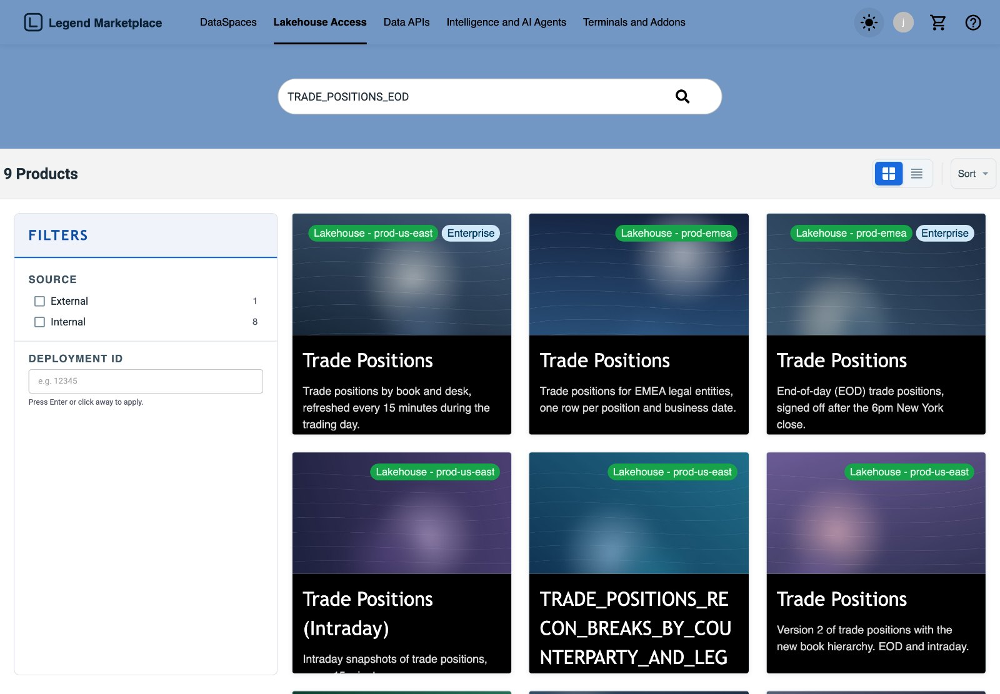 | 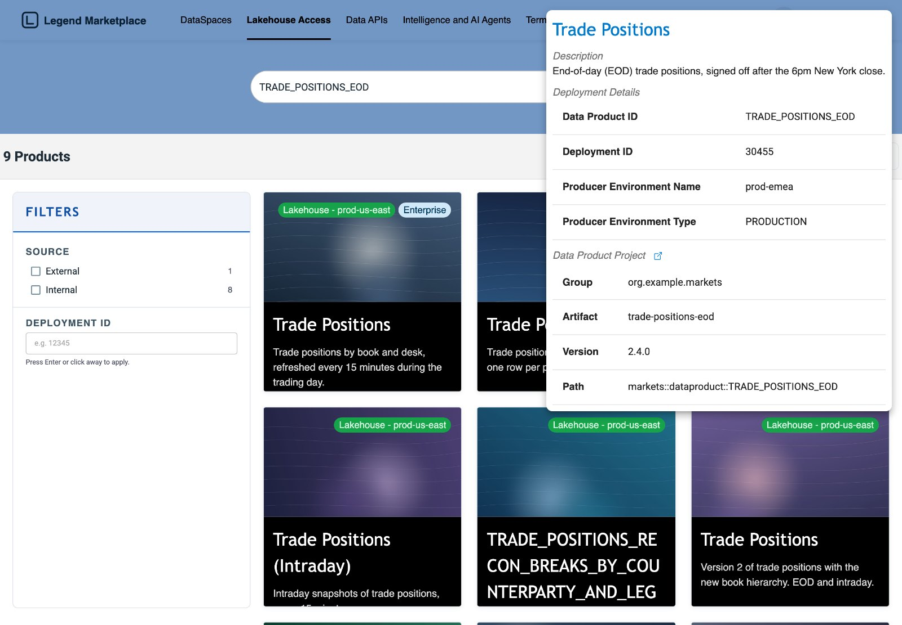 |

## Goals

- Every result shows its data product ID and DID, without hovering or clicking.
- The result you searched for is easy to spot.
- One click copies an ID, and that click never opens the product.
- The title stays the primary text.
- Long IDs stay readable: they end in an ellipsis, with the full value in the tooltip.

## 1. Search results

### Option A · An ID line under the title

_Borrowed from:_ cloud consoles (AWS, Google Cloud), which show a resource's ID next to its display name.

- **One quiet line under the title:** `TRADE_POSITIONS_EOD · DID 30455`, monospace and muted.
- **Click a value to copy it.** The tooltip says "Copy data product ID", then "Copied". The click doesn't open the product.
- **Long IDs end in an ellipsis**, and the DID always stays visible.
- **No title?** The title already shows the ID, so the line shows only the DID. A long ID in the title wraps after underscores instead of mid-word.
- **List view:** the same line, between the title and the description.
- **DataSpaces tab:** the line could show the element path (see the questions).

| Tiles                                                                     | List                                                                  |
| ------------------------------------------------------------------------- | --------------------------------------------------------------------- |
| 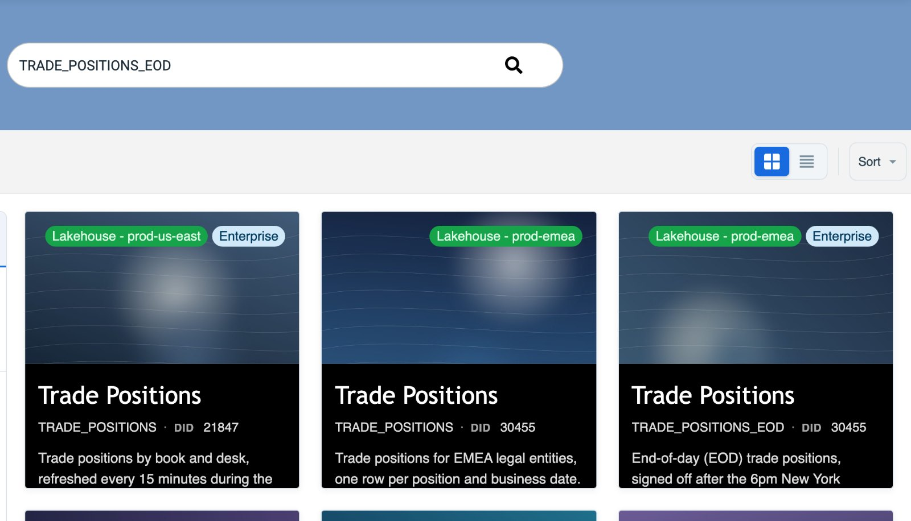 | 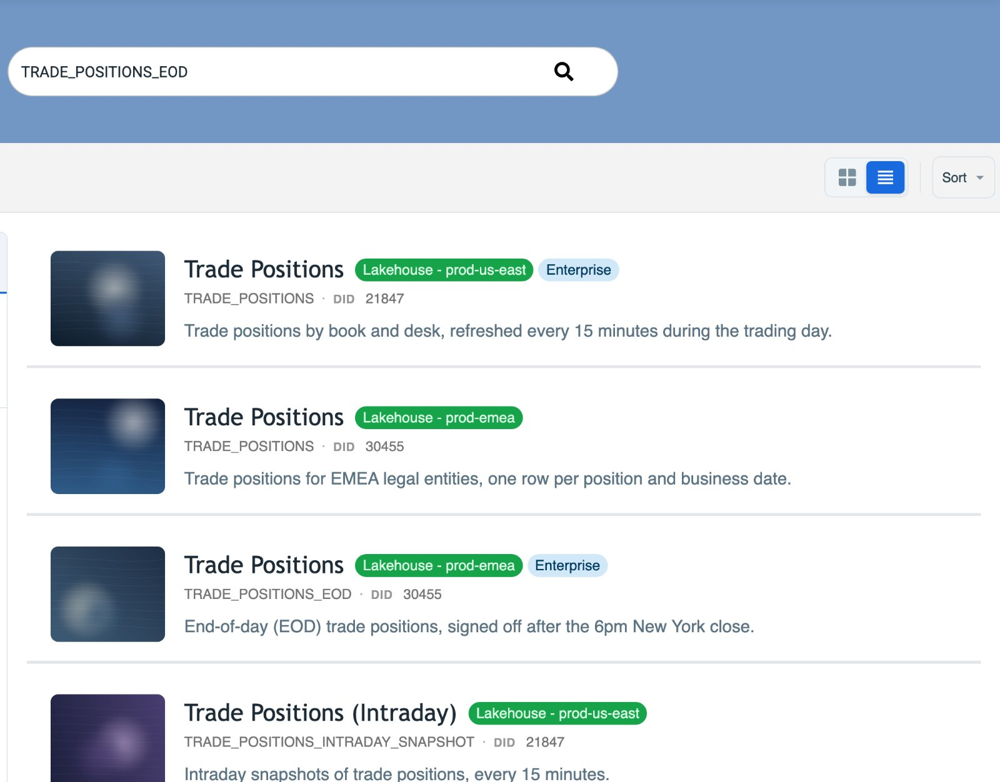 |

| Click to copy                                                                          | DataSpaces: the element path                                                               |
| -------------------------------------------------------------------------------------- | ------------------------------------------------------------------------------------------ |
| 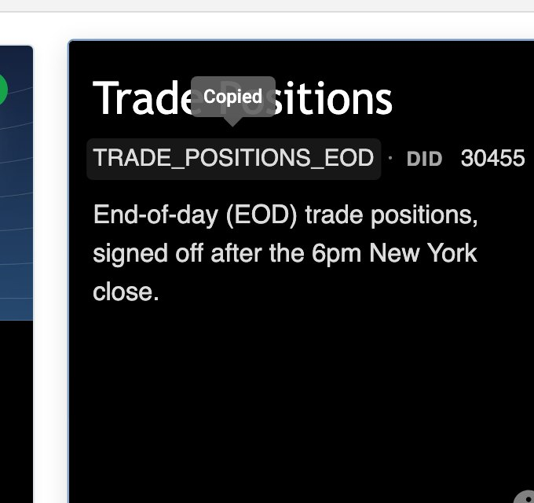 | 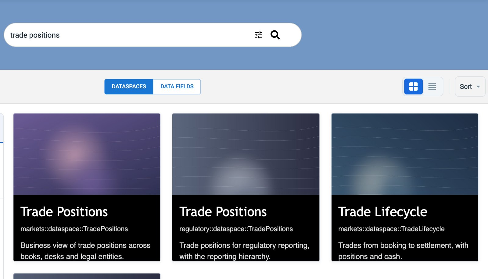 |

**Pros**

- The smallest change: one line in the card and in the list row.
- No new state.

**Cons**

- It doesn't say which result matched. With look-alike titles, you still read each line.

**What it takes**

- An ID line in `LakehouseProductCard` and `LakehouseProductListItem`.
- A shared copyable-ID component (see "Shared pieces").

### Option B · Labelled ID chips, the exact match marked

_Borrowed from:_ issue trackers (Jira, Linear), which show a copyable key on every card; search pages that mark why a result matched.

- **Two labelled chips under the title:** `ID TRADE_POSITIONS_EOD` and `DID 30455`, each with a copy icon.
- **The exact match is marked.** When the query equals a result's data product ID or DID (ignoring case), that chip turns yellow, and the card gets an outline and an **Exact ID match** or **Exact DID match** badge.
- **Searching a DID marks every product of that deployment.**
- **The ranking stays the search service's.** The match is marked where it is, not moved (see "Exact matches first").
- **List view:** the same chips and badge.

| Searching an ID                                                         | Searching a DID                                                                     |
| ----------------------------------------------------------------------- | ----------------------------------------------------------------------------------- |
| 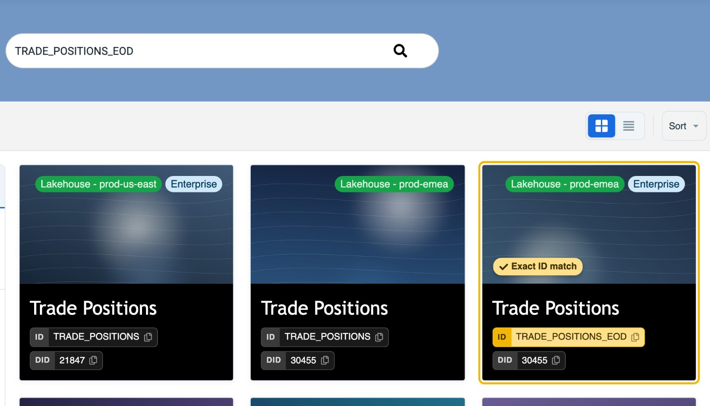 | 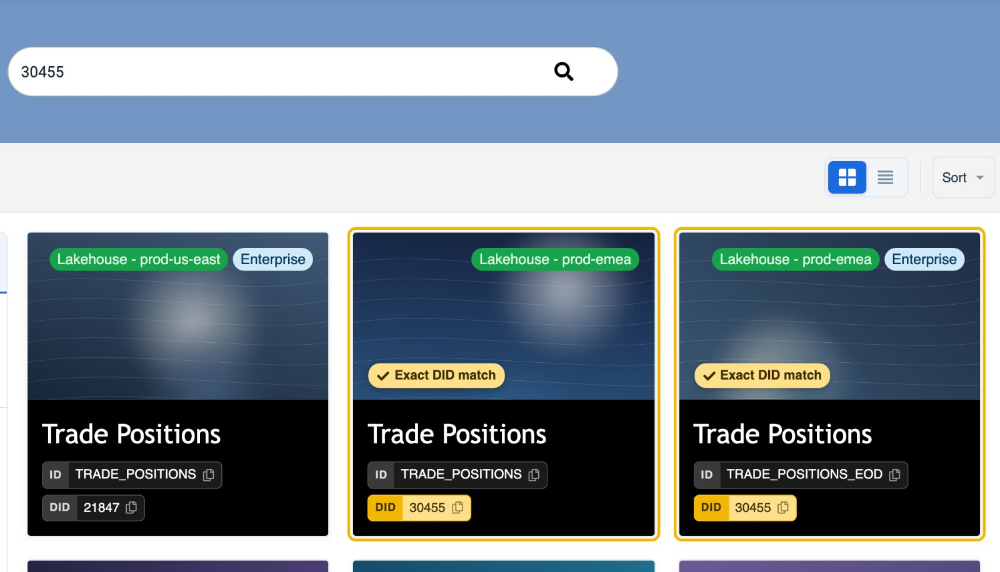 |

| List                                                                      | Click to copy                                                        |
| ------------------------------------------------------------------------- | -------------------------------------------------------------------- |
| 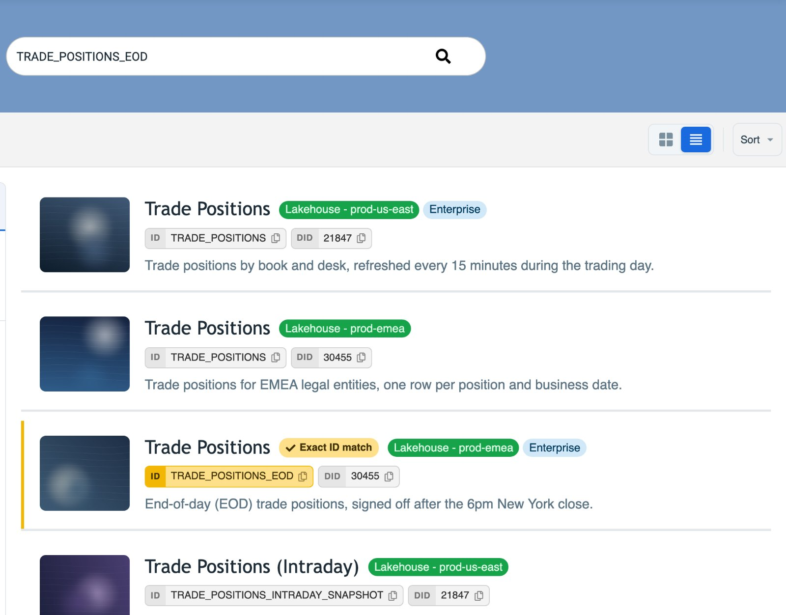 | 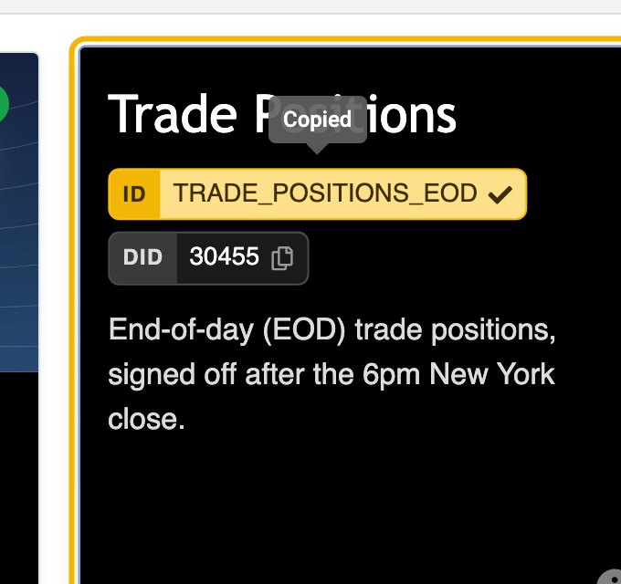 |

**Pros**

- It answers "which one is it?" at a glance.
- Copy is obvious.

**Cons**

- On tiles the chips take two lines, so the description moves to the hover panel.
- Matching runs in the browser: exact equality only, and only on the current page.
- More colour on the page.

**What it takes**

- A's pieces, plus chip styles.
- The search query passed to `SearchResultsCardGrid`, and from there to each card.
- A helper that compares the query with the card's IDs.

### Option C · A Table view

_Borrowed from:_ data catalogs and cloud consoles, which list resources as a table with name and ID columns.

- **A third view next to Tile and List**, with columns Name, Data product ID, DID, Environment and License.
- **Each ID cell copies on click.** A copy icon shows on hover.
- **The exact match row is highlighted**, as in B.
- **Untitled products show "Untitled"** in Name, since the ID has its own column.
- **The view mode is remembered**, like Tile and List today.

| Table                                                        | Click to copy                                                                              |
| ------------------------------------------------------------ | ------------------------------------------------------------------------------------------ |
| 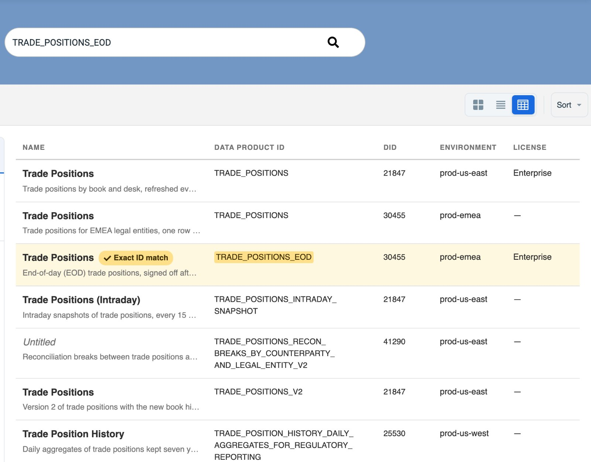 | 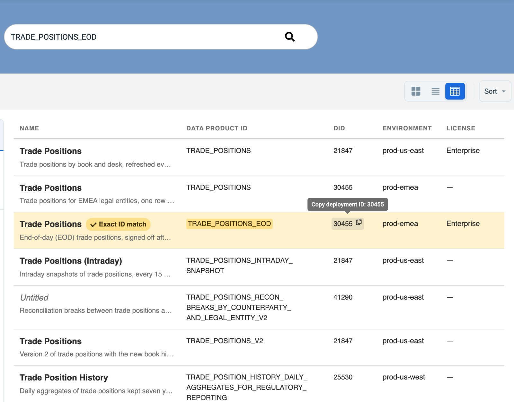 |

**Pros**

- The densest view: a page of results with their IDs at a glance.
- Easy to compare products that share a title.

**Cons**

- A third view to build and keep up.
- Less visual.
- Narrow screens need column hiding.
- Sorting by a column sorts only the current page (sorting is already page-only today).

**What it takes**

- A `TABLE` view mode, a third toggle button, and a table component.
- Telemetry for the new view.

### Exact matches first (search service)

Ranking and paging happen on the server, so the browser can only mark an exact match on the page it has. If `TRADE_POSITIONS_EOD` is ranked 13th, page 1 shows no match at all. Two asks for the search service:

- Rank an exact data product ID or DID match first.
- Return the matched fields with each result (say `matched_fields: ["dataProductId"]`), so a card can say why it matched without guessing.

### Side by side

|                      | A · ID line     | B · ID chips + exact match            | C · Table view         |
| -------------------- | --------------- | ------------------------------------- | ---------------------- |
| ID and DID visible   | yes, quiet      | yes, labelled                         | yes, as columns        |
| Copy                 | click the value | copy icon on each chip                | click the cell         |
| Which result matched | no              | yellow chip, outline, badge           | highlighted row, badge |
| Tiles                | +1 line         | +2 lines (description moves to hover) | own view               |
| List rows            | +1 line         | +1 line                               | own view               |
| Results per screen   | same            | same                                  | most                   |
| New state            | none            | the query passed to the cards         | a view mode            |
| Size                 | small           | small to medium                       | medium                 |

### Recommendation for search results

1. **A's ID line, with B's exact-match marking.** Every card shows its IDs quietly, and the one you searched for gets its value highlighted, an outline and a badge. It keeps A's single line, so the description stays visible.
2. **Ask the search service** to rank exact ID and DID matches first and to return the matched fields. Until then, the marking covers the current page only.
3. **Add the Table view (C) later**, if people ask to compare many products at once.

| Recommended: searching an ID                                                                         | Recommended: searching a DID                                                               |
| ---------------------------------------------------------------------------------------------------- | ------------------------------------------------------------------------------------------ |
| 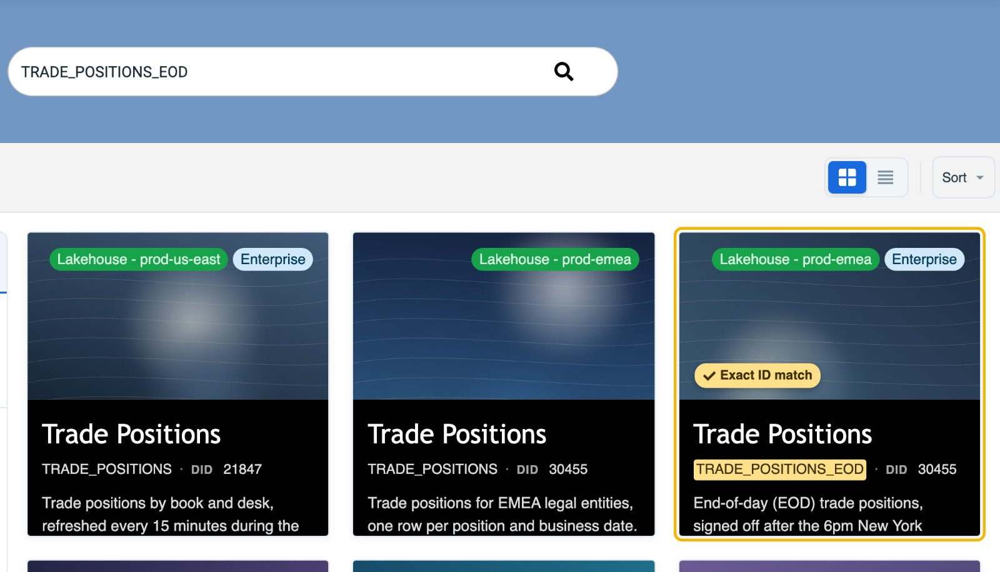 | 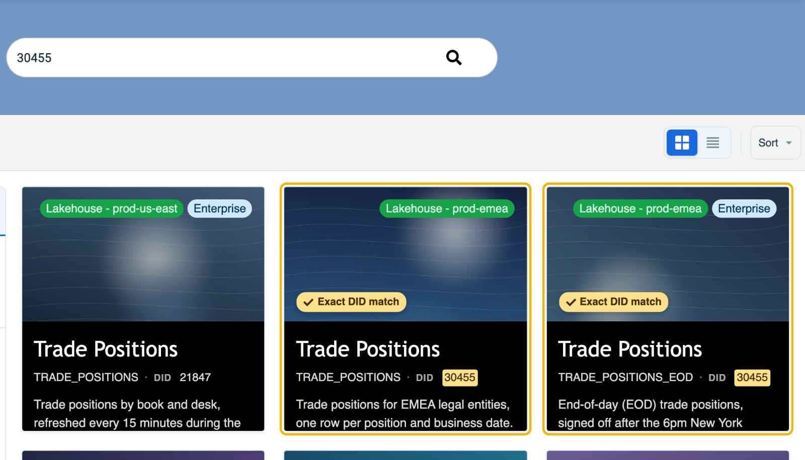 |

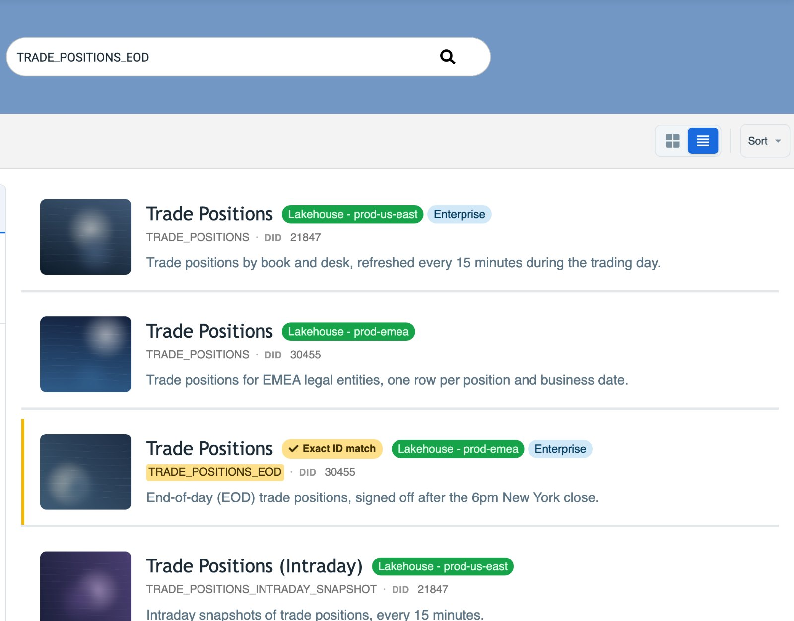

### Also noticed

- With two cards per row, a tile's chip row clips its last chip: "Enterprise" shows as "Enterp". The chips should wrap or shrink.

## 2. The data product viewer

The viewer shows the title of the data product, of each access point group, and of each access point. Their IDs are what people copy into queries, SQL and support threads, but they show only when there is no title.

**Goals:** the title stays the primary text; the IDs are readable and one click copies them; nothing repeats when there is no title.

### Option 1 · A quiet ID next to each title

- **Header:** under the title, `TRADE_POSITIONS_EOD` and `DID 30455`.
- **Access point group:** its ID after the title, before the **LAKEHOUSE** badge.
- **Access point:** its ID after the title, before the platform chip.
- **Muted monospace, click to copy,** with the same tooltip as on the cards. The click doesn't expand or collapse the section.
- **No title?** The title already shows the ID, so there is no extra ID.

| Today                                                                     | Option 1                                                                                   |
| ------------------------------------------------------------------------- | ------------------------------------------------------------------------------------------ |
| 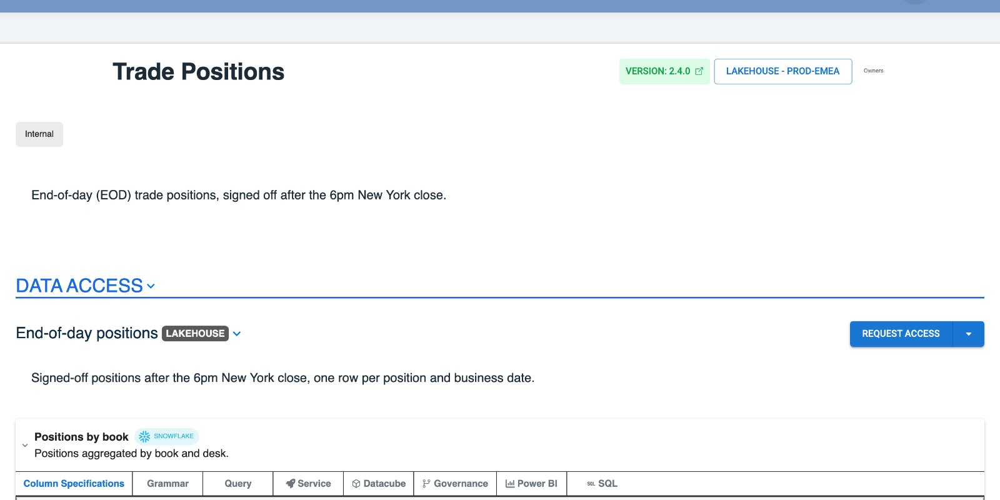 | 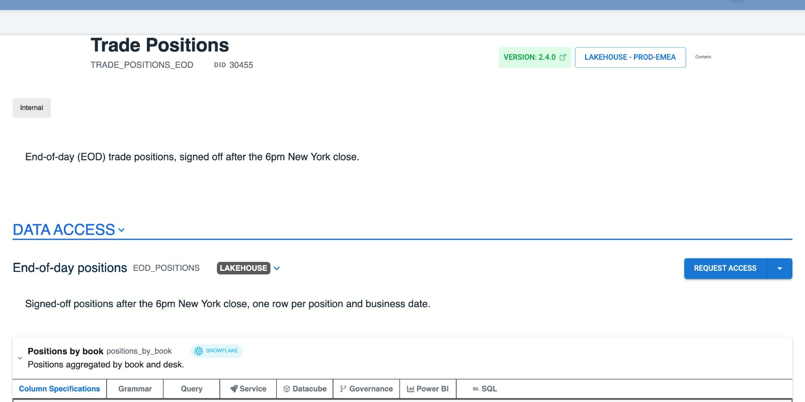 |

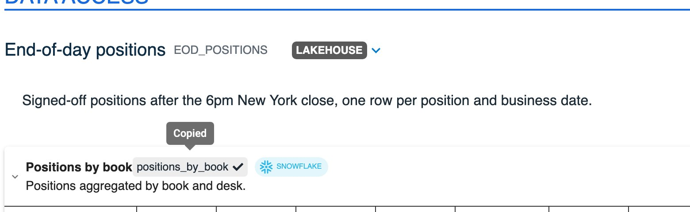

### Option 2 · The same IDs, shown on hover

- The same places as option 1, but each ID appears only while you hover or focus its header row.
- Keyboard focus shows it too.

| At rest                                                                          | Hovering the access point group                                                          |
| -------------------------------------------------------------------------------- | ---------------------------------------------------------------------------------------- |
| 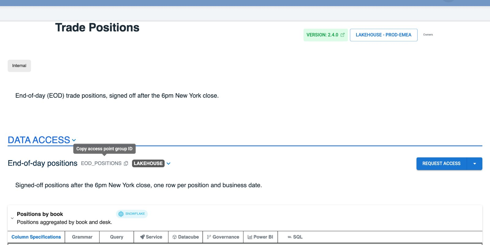 | 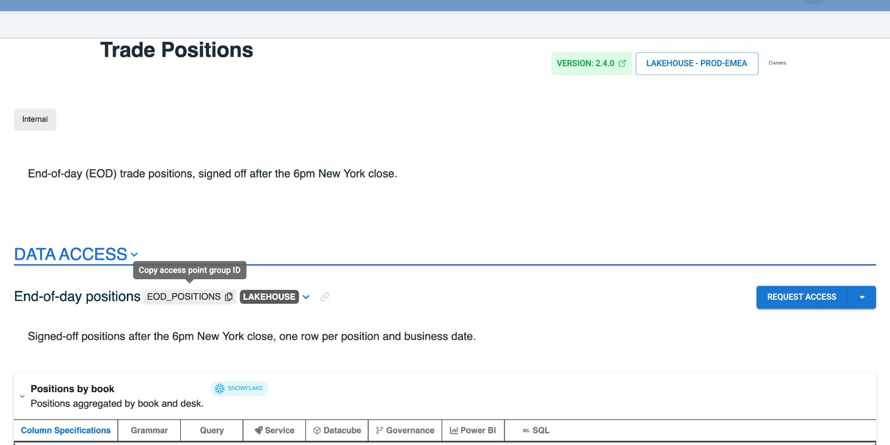 |

### Option 3 · One "IDs" button

- **An IDs button in the header** opens a list of every ID: the data product, the DID, each access point group and its access points, each next to its title.
- **Each ID copies on click.**
- **Copy all** copies the whole list as text, for a support thread.

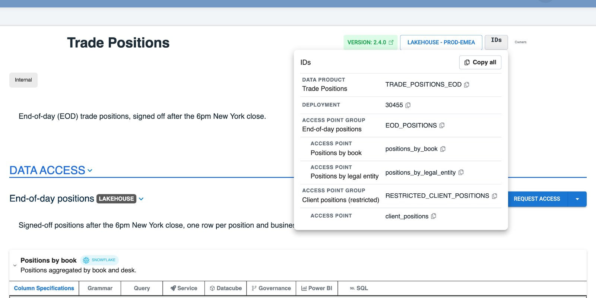

|                 | 1 · Next to the title | 2 · On hover         | 3 · IDs button  |
| --------------- | --------------------- | -------------------- | --------------- |
| IDs visible     | always, quiet         | on hover or focus    | in a popover    |
| Where the ID is | next to its title     | next to its title    | all together    |
| Touch screens   | yes                   | no hover: IDs hidden | yes             |
| Copy everything | no                    | no                   | Copy all        |
| Size            | small                 | small                | small to medium |

### Recommendation for the viewer

1. **Option 1.** The IDs stay quiet but are always there, so people find them without knowing a trick.
2. **Option 3's Copy all later**, if support asks for it.

**What it takes (option 1)**

- The header in `ProductViewer`, plus `DataProductAccessPointGroupViewer` and `DataProductAccessPointViewer`, in `legend-extension-dsl-data-product`.
- The header shows the deployed data product ID, the one on the search cards (`entitlementsDataProductDetails.id`). It doesn't show the element name, which can differ from it in case.
- The same viewer runs in Studio's data product editor preview and on Marketplace's SDLC data product page. Neither has a deployment, so the header shows no ID line there. The group and access point IDs show as everywhere else.

## Shared pieces

- **A copyable-ID component in `legend-art`,** used by the cards, the list rows, the table and the viewer. It shows the value and a tooltip, copies on click or Enter, says "Copied", and stops the click from reaching the card, the row or the accordion. Nothing like it exists today; each page copies to the clipboard its own way.
- **Long IDs:** ellipsis with the full value in the tooltip; wrap after underscores when the ID is the title.
- **Tests:** the ID line, the no-title case, the exact match, and copy (with the clipboard mocked).
- **Telemetry:** which ID was copied, and from where.

## Alternatives considered

- **The ID in the title,** like "Trade Positions (TRADE_POSITIONS_EOD)": the title stops being the primary text, and long IDs break the layout.
- **Keep the IDs in the (i) popover, with a clearer icon:** still two steps per card, and you can't scan a page of results.
- **Open the product directly when the query is an exact ID or DID:** fast for one exact match, but surprising, and one DID can have several products.

## Questions for the team

1. DataSpaces tab: show the element path under the title (as in A), or leave DataSpace cards as they are?
2. Does the Lakehouse Access search index data product IDs and DIDs? If not, should a numeric query also apply the Deployment ID filter?
3. Can the search service rank exact matches first and return the matched fields?
4. Viewer: IDs always visible (option 1), or on hover (option 2)?
5. Copy feedback: the "Copied" tooltip only, or a toast too?
