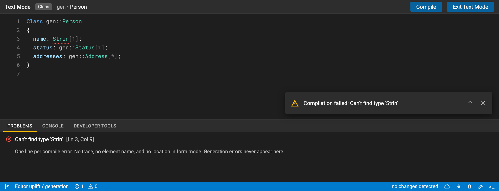
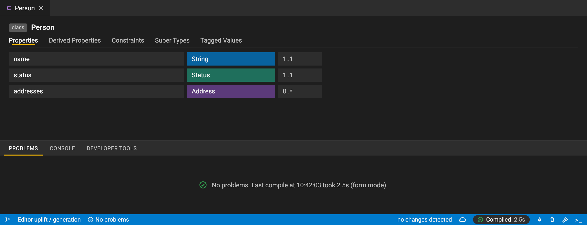
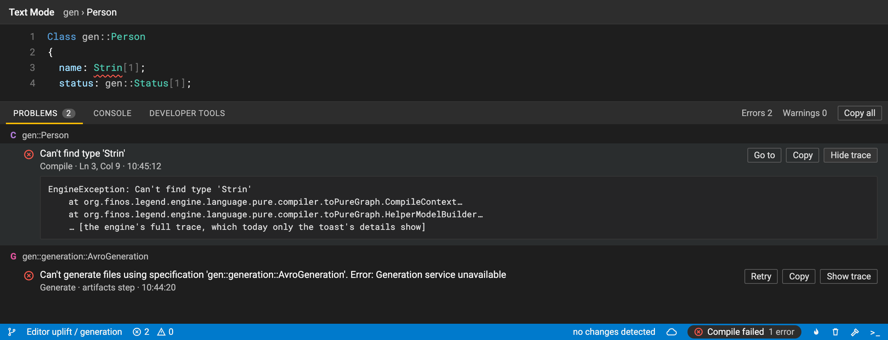
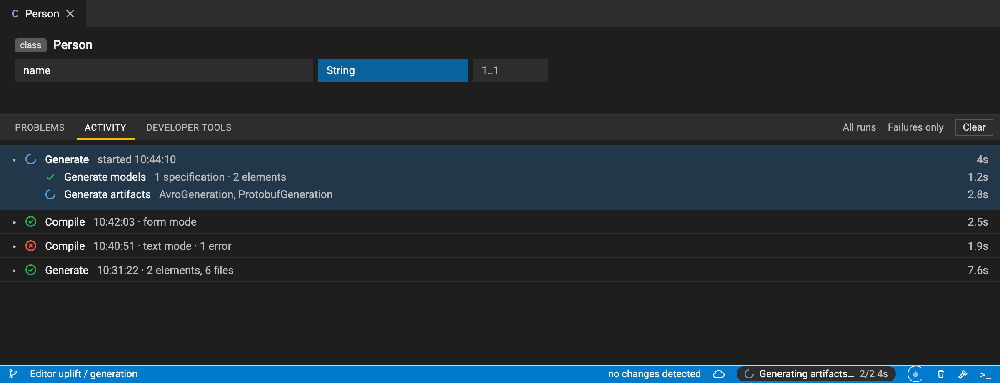
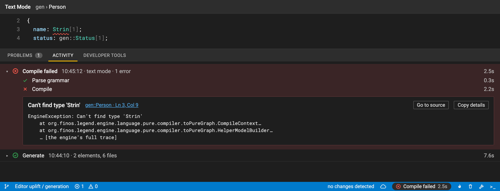
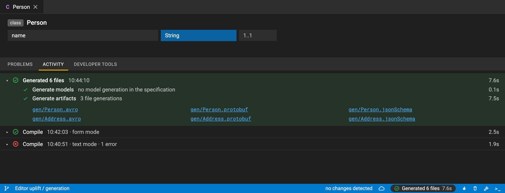
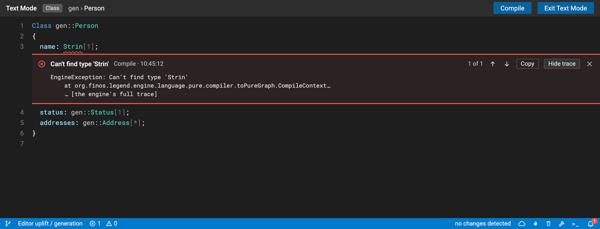
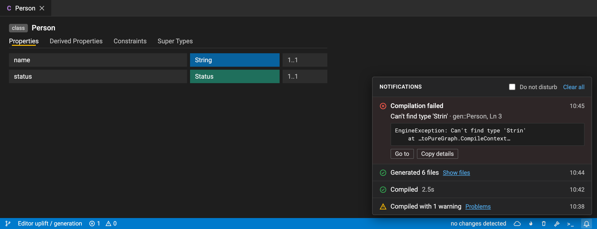

# Compile and generate status without toasts

> **Status:** proposal, for discussion. Nothing here is built yet.
>
> **Follows:** [#5823](https://github.com/finos/legend-studio/pull/5823), which shows a running compile (F9) or generate (F10) in the status bar and adds a success toast for generation. Every option below keeps that running state. They differ in where a result, and above all a **full error**, goes once toasts are gone.

The mockups use Studio's dark theme against a small example model. Engine traces in them are illustrative.

## Where feedback lives today

Today, the full message and trace of a failure live only in the toast:

| What                                               | Where it shows today                                                                                          |
| -------------------------------------------------- | ------------------------------------------------------------------------------------------------------------- |
| Compile or generate running                        | the status bar chip (after #5823)                                                                             |
| Compile succeeded                                  | toast: "Compiled successfully"                                                                                |
| Generate succeeded                                 | toast (after #5823); nothing before                                                                           |
| Compile error: message                             | toast; Problems shows one line per error                                                                      |
| Compile error: location                            | text mode: squiggle, and `[Ln, Col]` in Problems; form mode: only on fields that can show it                  |
| Engine trace                                       | only in the toast's expandable details                                                                        |
| Generation errors                                  | only in the toast; model generation failures also on the generation specification's cards                     |
| Engine or network errors (e.g. engine unreachable) | only in the toast                                                                                             |
| History of earlier runs                            | none                                                                                                          |
| The **CONSOLE** tab                                | empty: a placeholder, with an open TODO pointing at [#273](https://github.com/finos/legend-studio/issues/273) |

A toast covers the editor, disappears on its own, and only one shows at a time. A newer one replaces an error before the user has read it. So removing toasts first needs a permanent home for the full error.

## Goals

- Nothing pops over the editor.
- Every failure has a permanent home with the full message, where it happened (element, line), its trace, and a way to copy it all for a bug report or a support thread.
- Success is visible but quiet.
- The status is announced to screen readers, and animations respect `prefers-reduced-motion` (as in #5823).

## Option A · Problems first

_Borrowed from:_ VS Code's status bar and Problems panel; IntelliJ's Problems tool window.

- **Every failure becomes a Problems row.** That includes generation errors and engine or network errors, not just compile errors.
- **Each row is complete:**
  - the full, wrapped message, grouped under the element it belongs to (or the generation specification)
  - the step and location (`Compile · Ln 3, Col 9`), shown in form mode too
  - actions: **Go to**, **Copy**, **Show trace**, and **Retry** for generation
- **Copy all** copies every problem, with traces, for a bug report.
- **The status bar keeps the last result:** `✓ Compiled 2.5s` fades after a few seconds, while `✕ Compile failed · 1 error` stays until the next run. Clicking it opens Problems.
- **A failure opens Problems.** This could be a setting.
- **Success:** the status bar result, and an empty state in Problems that says when the last compile ran and how long it took.

| Compile succeeded                                                         | Compile and generate failed                                                                                                   |
| ------------------------------------------------------------------------- | ----------------------------------------------------------------------------------------------------------------------------- |
|  |  |

**Pros**

- The smallest change: it builds on the existing Problems panel and problem counts.
- Every error has a place, so toasts can go.

**Cons**

- A success is easy to miss.
- There is no history: each compile replaces the last one's problems.

**What it takes**

- A problem type for generation and engine errors, keeping the step, time and trace.
- Richer Problems rows.
- A last-result item in the status bar.

## Option B · Activity log

_Borrowed from:_ IntelliJ's Build tool window, Xcode's report navigator, GitHub Actions run logs.

- **The empty CONSOLE tab becomes ACTIVITY.** It holds one entry per compile or generate, newest first.
- **Each entry shows the run's steps and timings:** parse and compile; or models, then artifacts.
- **A failed run opens at its error,** with the full message, a link to the source, the trace, and **Copy details**.
- **A generate run lists what it produced:** elements and files, each opening its viewer.
- **The status bar's result opens that run.** A failure reveals the panel at the run.
- **Filters:** all runs or failures only, plus Clear.

| Generate running                                                                   | Compile failed                                                                                             | Generate succeeded                                                                                     |
| ---------------------------------------------------------------------------------- | ---------------------------------------------------------------------------------------------------------- | ------------------------------------------------------------------------------------------------------ |
|  |  |  |

**Pros**

- The most information: full errors, history and timings.
- "Copy details" gives support one paste with everything.
- It fills the empty Console tab, an open TODO.

**Cons**

- The biggest build: a run log in the store (in memory and bounded, say the last 50 runs), and a new panel.

**What it takes**

- A run record (kind, steps, timings, outcome, error, outputs) written by `globalCompile` and `globalGenerate`.
- The Activity panel.
- Linking from the status bar.

## Option C · Inline + notification center

_Borrowed from:_ Xcode's inline issues; VS Code's peek view and notification center; JetBrains' Notifications.

- **Errors open where they happened.**
  - In text mode: a peek under the failing line with the full message, **Copy**, **Show trace**, and the previous or next problem.
  - In form mode: under the field. The lambda editors already do this for some errors.
- **Results collect behind a bell** in the status bar instead of popping over the editor. Each entry has its time, details and actions; a badge counts unread failures.
- **Do not disturb** silences the badge.

| Compile failed, shown inline                                                                                       | Notification center                                                                                      |
| ------------------------------------------------------------------------------------------------------------------ | -------------------------------------------------------------------------------------------------------- |
|  |  |

**Pros**

- The error is where the user is working.
- It is quiet.

**Cons**

- Each form editor needs its own inline support, so coverage stays uneven.
- A bell is easy to ignore.
- Errors without a location (engine down) only reach the bell.

**What it takes**

- A Monaco peek widget for text mode.
- An inline error slot in more form editors.
- A notification history in `NotificationService`, which today keeps one notification.

## Side by side

|                              | A · Problems first         | B · Activity log              | C · Inline + bell              |
| ---------------------------- | -------------------------- | ----------------------------- | ------------------------------ |
| Success                      | status bar result          | status bar result + run entry | bell entry                     |
| Full error message           | Problems row               | run entry                     | peek / field, bell entry       |
| Trace                        | expandable in the row      | in the run entry              | in the peek and the bell entry |
| Generation and engine errors | Problems rows              | run entries                   | bell entries                   |
| History                      | no                         | yes                           | the bell's list                |
| Copy for a bug report        | Copy, Copy all             | Copy details                  | Copy                           |
| New state                    | problem kinds, last result | run log                       | notification history           |
| Size                         | small                      | large                         | medium                         |

## Recommendation

1. **Option A first.** It gives every error a permanent home with the full message, trace and Copy, so toasts can go without losing anything. It's a small change to an existing panel.
2. **Option B next.** It turns the empty Console tab into the run log, which adds history, timings and "Copy details" for support.
3. **From C, perhaps the text-mode peek later,** as an extra. Skip the bell, which repeats what A and B already show.
4. **Remove the compile and generate toasts once A lands.** Until then, keep them.

## Questions for the team

1. Should a failure open the Problems (or Activity) panel by itself, or only update the status bar? Should that be a setting?
2. Keep a success toast as an opt-in setting for people who want it?
3. For B: rename the CONSOLE tab to ACTIVITY, or keep the name? Keep runs across a reload, or only in memory?
4. Generation errors: attach them to the generation specification, or to the file generation element that failed?
5. Should other long-running actions (push, workflow, service registration) report the same way later?
