# Studio's ingest definition editor: materialized views, flow first

**Decision: design 1b, a list of the views down the left, with the data sets group.** When an ingest definition has
materialized views, its Definition tab opens on what they do: a Flow | Pure switch, the list of the views, then of the
definition's other data sets, and the picked one on the right: a view drawn read-only by Legend Cube, or a data set's
columns. The pull request that adds this page builds design 1b with the data sets group. A view's own columns are
[future work](#future-work).

This page keeps the designs we considered, and why we chose this one.

> **Every screenshot below is on made-up data, and all but the first are design mocks.** The data is an ingest
> definition, `markets::ingest::TradePositionsIngest`, with three views, and a version of it with ten views and
> twenty-three plain data sets. The first screenshot is today's editor. The mocks ran in Studio with Cube's real canvas,
> but their details, such as the captions under the flows, differ from what was built. Screenshots of the
> implementation are in the pull request.

- [Today](#today)
- [What stays as it is](#what-stays-as-it-is)
- [The designs](#the-designs): [1](#design-1-flow--pure-one-view-at-a-time-chosen),
  [2](#design-2-a-card-per-view-over-the-data-sets), [3](#design-3-a-map-of-the-ingest-then-a-views-flow)
- [Why design 1b](#why-design-1b)
- [The data sets that aren't views](#the-data-sets-that-arent-views)
- [How a view is drawn](#how-a-view-is-drawn)
- [Future work](#future-work)

## Today

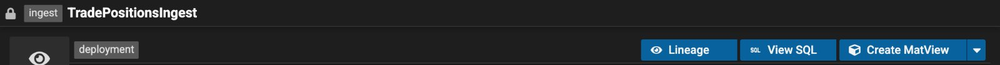

_Today's Definition tab on the made-up ingest: its header. Below it, the panel is the whole definition as Pure._

- The materialized views are only visible as Pure, inside the whole definition.
- Lineage always opens on the first view; its dialog then needs its own picker.
- Edit MatView for a given view hides in the dropdown beside Create MatView.

## What stays as it is

Studio doesn't build a model of an ingest definition: it keeps the definition's raw JSON and parses only the parts it
edits. Every design keeps it that way.

- **No model of the definition.** The views' flows need what Studio already reads: each view's name, function,
  primary key and classification. The data sets' designs also read, for display only, each data set's name, columns,
  key and write mode.
- **Editing doesn't move.** Views are still created and edited in Cube, through Studio's existing add and update
  helpers. Everything else is edited in text mode: no form fields for data sets, write modes or owners.
- **The drawings are read-only.** Clicking a step opens nothing. The flow is a view of the function, never an editor.
- **Nothing blocks.** If Cube can't draw a view, its panel says why and shows the view's own Pure. The whole
  definition's Pure and Edit in Cube stay one click away.

## The designs

### Design 1: Flow | Pure, one view at a time (chosen)

The tab opens on Flow: one view's flow, with the view's key, classification, Edit in Cube and Lineage above it. Pure,
beside Flow, is today's whole-definition Pure.

- **For:** the smallest change, as today's panel gains a Flow side; the flow gets most of the panel, so big views stay
  readable.
- **Against:** one view at a time, so views can't be compared side by side.

#### Three ways to pick the view

The same design on the ten-view ingest, with POSITIONS_BY_COUNTRY picked in each. Only the picker changes. Each view
also says which data sets it reads.

**1a. Names above the flow.** Every name in sight, as chips; at ten views they take two rows.

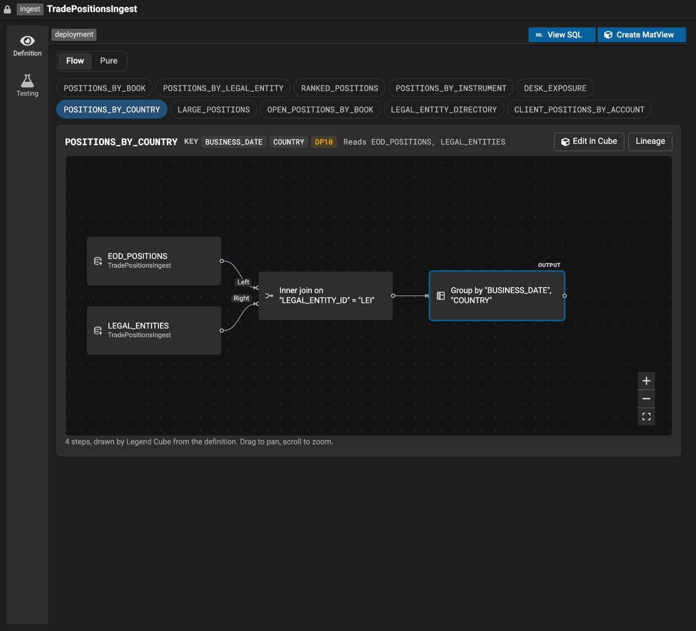

_Design mock, made-up data: design 1a on the ten-view ingest._

- **For:** one click to any view; the flow keeps the full width.
- **Against:** busy past six or so views, and the rows push the flow down.

**1b. A list down the left (chosen).** Every view in a list with its number of steps; the picked one's flow beside it.

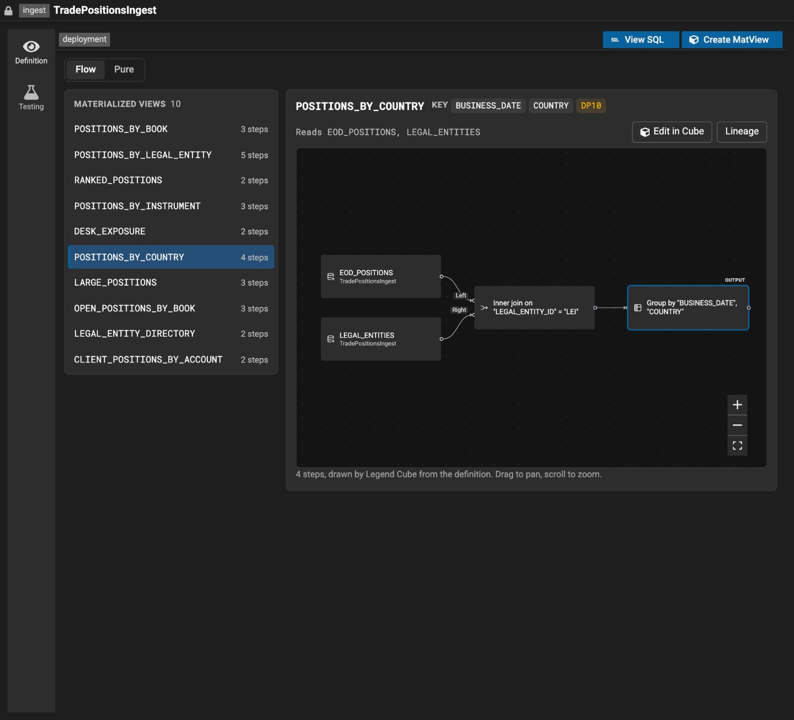

_Design mock, made-up data: design 1b on the ten-view ingest._

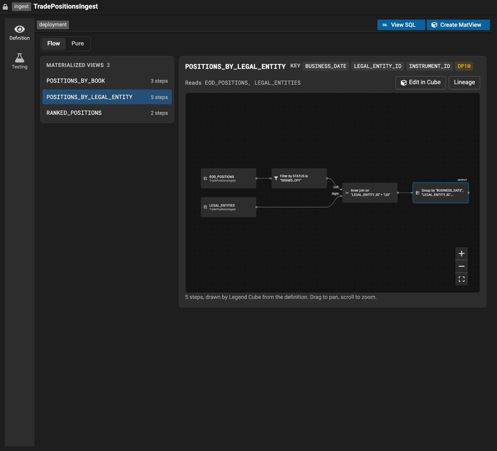

_Design mock, made-up data: design 1b on the three-view ingest._

- **For:** calm at any count, as the list scrolls; an overview of every view and its size, without opening any.
- **Against:** the flow loses the list's width.

**1c. A dropdown.** One dropdown, with where you are: 6 of 10.

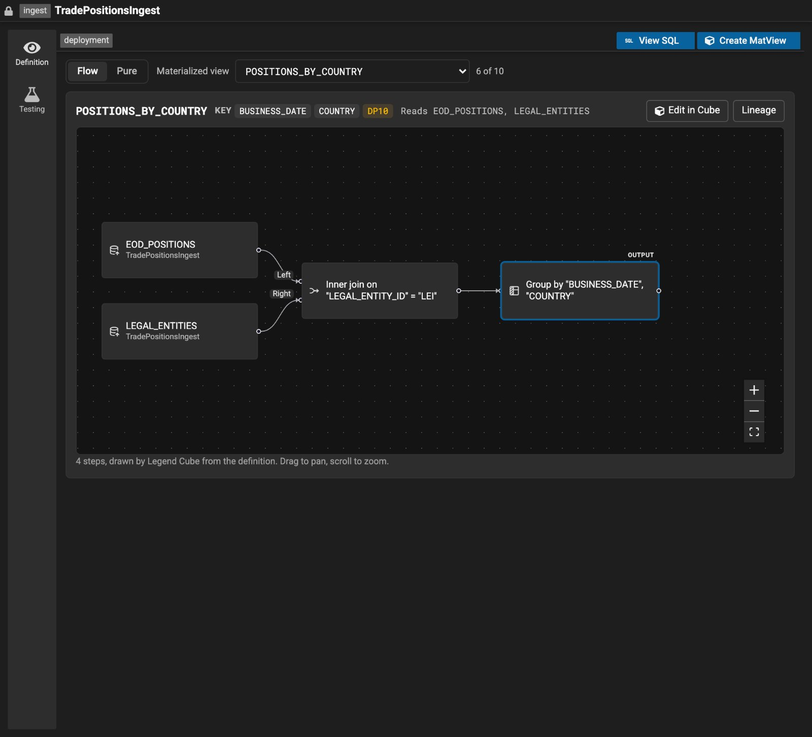

_Design mock, made-up data: design 1c on the ten-view ingest._

- **For:** the least on screen; the flow gets everything.
- **Against:** the other views are hidden until it opens.

### Design 2: a card per view, over the data sets

Every view as a card with its flow, under Create MatView. Below the cards, the plain data sets, read-only, with the
views that read each. A card's Pure is that view's own function, not the whole definition.

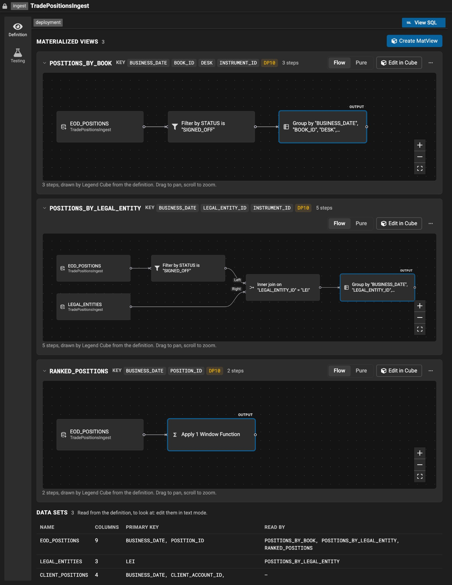

_Design mock, made-up data: design 2 on the three-view ingest. The third view uses a window function, which Cube draws
too._

At ten views and twenty-three data sets, it doesn't switch layouts; only how much is open by default changes. Past four
views, the first three cards open and the rest show as one line each; a row of the views' names opens a card and
scrolls to it; past twelve data sets, the table gets a filter.

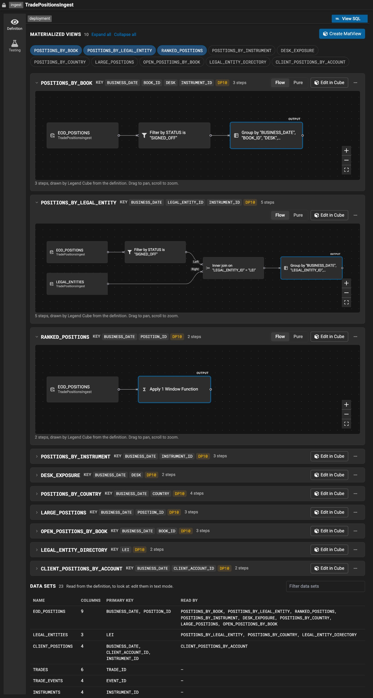

_Design mock, made-up data: design 2 on the ten-view ingest, as it opens._

- **For:** every view visible up front; it shows which data sets each view reads, and which ones no view reads; each
  view carries its own actions.
- **Against:** long with many views; a canvas per view costs more to draw than one.

### Design 3: a map of the ingest, then a view's flow

Drawn, not built. The whole ingest in one picture: data sets on the left, views on the right, a line wherever a view
reads a data set. Picking a view opens its flow below the map, as in design 1.

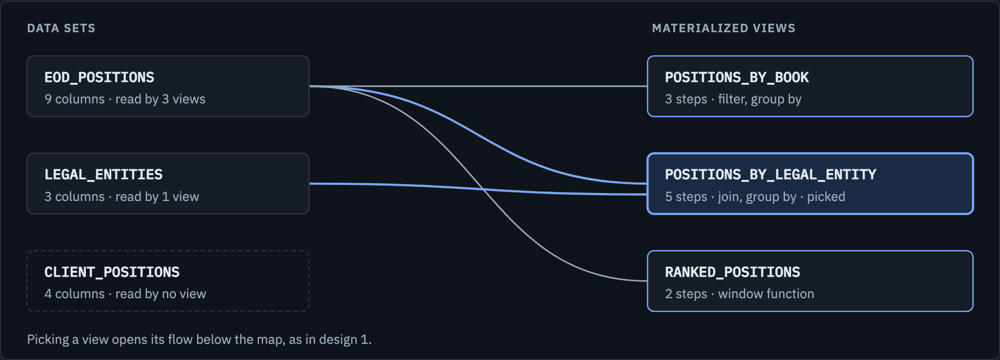

_Design mock, made-up data: design 3's map of the three-view ingest, drawn by hand._

Cube's own canvas can't draw this map. In Cube, a step feeds only one next step, so a data set read by three views
would appear three times. The map would need its own drawing, each view collapsed to one box.

- **For:** the best overview once there are many views; shared and unused data sets stand out.
- **Against:** a new drawing to build and maintain beside Cube's canvas; two levels to move between, the map and then a
  view.

## Why design 1b

- Design 2 shows everything, but at ten views it is a lot to take in. Design 1 keeps one flow in focus.
- Of design 1's pickers, the list keeps every view in sight with its number of steps, stays calm at ten views or thirty,
  and leaves the flow most of the width.
- Design 3's overview needs a drawing of its own, beside Cube's.

## The data sets that aren't views

Two ways to show the plain data sets were mocked with design 1. The first is built.

**In design 1b's list (built).** The list gets a second group, Data sets, under the views. Picking one shows its
columns where a view's flow would be: name, type, how many values it holds and whether it is in the key, read-only. A
view says which data sets it reads, and a data set which views read it, each name a link to the other.

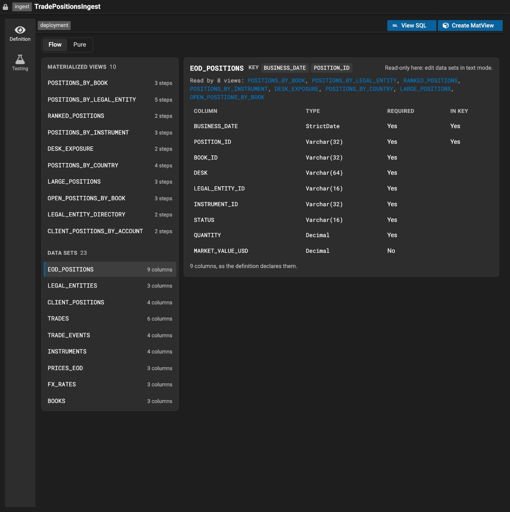

_Design mock, made-up data: EOD_POSITIONS picked in the list's Data sets group._

**With design 1a's chips (not built).** The data sets can't be chips too: twenty-three more would add four or five rows above the
flow. So the chips stay the views, and the data sets sit behind one menu at the top right, which filters as you type
and carries the icon Cube's flow draws on a data set's step.

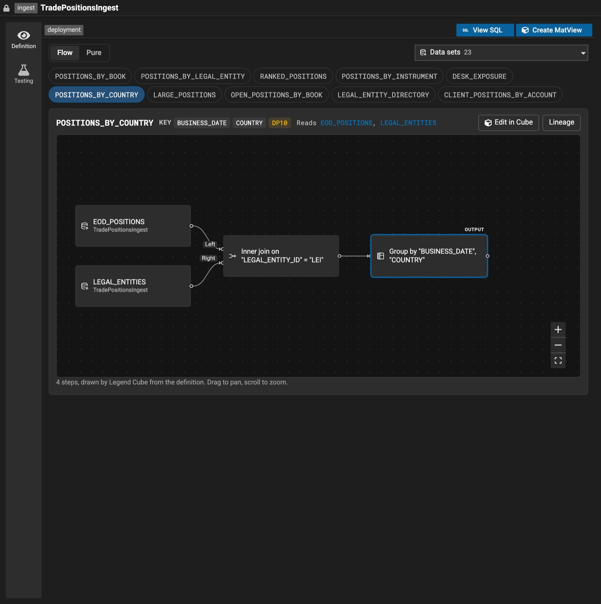

_Design mock, made-up data: the views as chips, the twenty-three data sets behind one menu._

How they are built:

- A small reader of the data sets' JSON, beside the one Studio has for the views: it reads each data set's name, key,
  write mode and columns, and nothing else of the definition. It needs no Cube and no engine.
- Studio's own reader, not Cube's. Cube's would bring Cube into Studio's main bundle, it fails on a write mode it
  doesn't know, and one column it can't read hides a data set's whole table.
- The table has View SQL's headers (Column Name, Column Type, Multiplicity) and Key, so a data set's columns and a
  view's schema look alike in one editor. Each type shows its full path in a tooltip.
- The columns a write mode adds are listed greyed out after the declared ones, in the engine's order: batch
  milestoning adds LAKE_DIGEST, LAKE_IN_ID and LAKE_OUT_ID; business temporal also adds LAKE_FROM and LAKE_THRU. A
  write mode Studio doesn't know adds none, and the data set says so. One that declares no columns says so.
- What a view reads, and which views read a data set, come from the views' functions as the definition holds them,
  so a view Cube can't draw is listed too.

## How a view is drawn

- Each flow is drawn from the view's function, its data sets' columns typed from the JSON of the ingest definitions in
  Studio's graph. Drawing calls no engine and runs nothing. It is Legend Cube's read-only definition flow
  (`@finos/legend-cube-builder/definition-flow`), which the data product viewer draws access points with; Studio loads
  it the first time a flow shows.
- Edit in Cube reads a view another way, on Studio's Cube host, which binds the view's sources to run them. That needs
  a lakehouse environment, from the viewer's entitlements or a lakehouse runtime in the project. Tying the flow to it
  would make the flow vanish exactly where Cube can't run, so the flow doesn't use it.
- A view Cube can't draw shows why, and its own Pure, in place of the flow.
- A data set whose columns Cube doesn't know, e.g. one of an ingest definition the graph doesn't have, is drawn by its
  name, and a line above the flow says the steps after it aren't checked.
- Cube's flow doesn't draw a view that reads a data product yet: drawing one needs a binder for data product sources,
  the same work access points need for theirs. Such a view shows why, and its Pure.

## Future work

**A view's columns, from the artifact generation.** Not built. A view's panel could list the columns the view returns,
with their types, in the same table a data set uses.

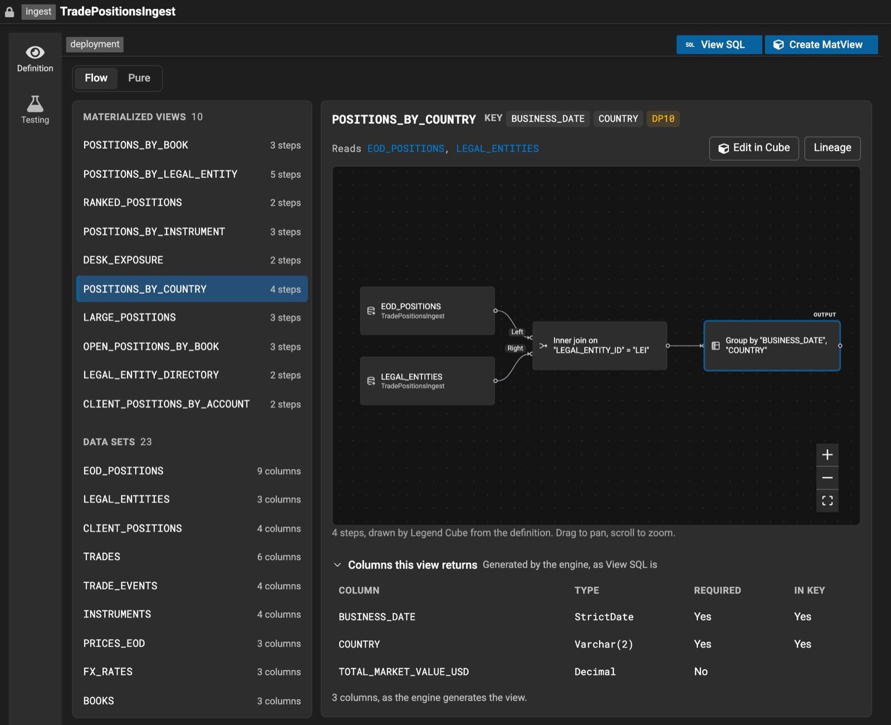

_Design mock, made-up data: under the flow, "Columns this view returns" asks the engine when it is opened, and lists
the view's columns with its key. The engine's answer in it is made up._

- **Where the columns come from:** Studio already runs this generation for View SQL.
  `IngestDefinitionEditorState.generateArtifact()` calls `graphManager.generateArtifacts`, and caches the result by the
  definition's hash code.
- **What it returns:** an `IngestionDefinitionArtifact` (legend-graph,
  `graph-manager/action/generation/IngestionDefinitionArtifact.ts`). For each view, its
  `IngestionArtifactMatViewImplementation` carries its `schema` (a `RelationType` with the columns' names, types with
  their parameters, and multiplicities), its `primaryKey`, and its `dependentDatasets` and `dependentAccessPoints`.
- **The cost:** it needs the engine and a definition that compiles, so the columns would load only when asked for, and
  reuse View SQL's cache.
